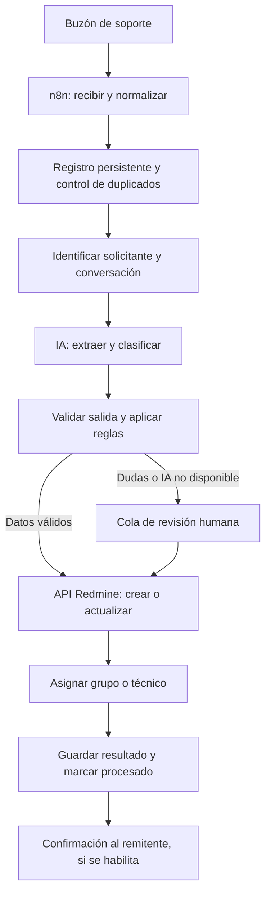

# Automatización de correos de soporte con n8n, IA y Redmine

Estado: diseño completo del proceso y primera demo creada en n8n, pendiente de credenciales y prueba integral.

Actualización: el [flujo de demostración](workflows/README.md) implementa lectura
IMAP, análisis con Gemini, descarga y carga de adjuntos, y alta en Redmine.
Está inactivo y no implementa aún deduplicación persistente, asignación ni
seguimiento de conversaciones. Los PDF e imágenes compatibles se analizan con IA;
el resto se adjunta directamente. Ante fallo de IA, crea un ticket para revisión.
Las tablas y etapas siguientes describen el plan completo original.
Fecha: 23 de septiembre de 2026.

## 1. Objetivo y alcance

Convertir solicitudes recibidas por correo en tickets de Redmine con información
estructurada y asignación al equipo adecuado. n8n coordina la lectura, el análisis
con IA, las validaciones y las llamadas a la API de Redmine.

Las imágenes aportadas son la referencia funcional. «Sistema X» se reemplaza por
Redmine. Los nombres, empresas y agentes de las imágenes son ejemplos; no son
usuarios, proyectos ni reglas configurados en esta instalación.

El primer alcance será: recibir correo, extraer texto, identificar al solicitante,
clasificar, crear un ticket y asignarlo a un grupo. Luego incorporaremos respuestas
al hilo, confirmaciones al remitente y distribución entre técnicos.

## 2. Qué tenemos y qué falta

| Componente | Estado actual | Trabajo pendiente |
|---|---|---|
| Docker Compose y Dockerfiles | Archivos preparados localmente | Construir e iniciar en el servidor |
| Red y persistencia | Definidas en Compose | Verificar comunicación y reinicios |
| n8n y Redmine | Configurados para primer arranque | Verificar salud, login y versiones en el servidor |
| Administrador y API de Redmine | Bootstrap preparado | Confirmar ejecución correcta |
| Buzón de soporte | Sin configurar | Proveedor, dirección, autenticación y carpeta |
| IA | Sin configurar | Proveedor, modelo, credencial y límites de uso |
| Proyecto de soporte | Sin crear | Proyecto, tipos de ticket, categorías y prioridades |
| Equipos y técnicos | Sin crear | Usuarios, grupos, roles y pertenencia al proyecto |
| Usuario de integración | Sin crear | Cuenta dedicada y clave API con permisos acotados |
| Directorio de solicitantes | Sin definir | Fuente que relacione email, persona y empresa |
| Reglas de asignación | Sin definir | Categoría → grupo y grupo de respaldo |
| Registro de procesamiento | Sin implementar | Persistencia, duplicados, estados y reintentos |
| Workflow n8n | Sin implementar | Construir, probar y activar |
| Confirmaciones de correo | Sin configurar | SMTP o API del proveedor y plantilla |
| Operación | Pendiente | Backups, restauración, alertas y HTTPS si aplica |

## 3. Arquitectura propuesta



Los servicios actuales comparten `correo-tickets_automatizacion`.
Son tres contenedores: n8n, Redmine y PostgreSQL. El único PostgreSQL aloja las
bases `n8n` y `redmine`, con usuarios separados y datos en `postgres_data`.
n8n usa `http://redmine:3000` para conectarse a Redmine.
Los enlaces que se envíen a personas deben usar la URL pública o de la red de la
empresa, nunca el nombre interno `redmine`.

No hace falta agregar otro contenedor para llamar a un proveedor externo de IA.
Un modelo local requerirá un servicio adicional y dimensionamiento de CPU/RAM/GPU.
Redis y workers se evaluarán si el volumen requiere ejecución en cola; no son
un requisito del piloto. El registro de procesamiento puede usar una base y un
usuario dedicados en PostgreSQL, a provisionar, sin modificar tablas internas
de n8n ni de Redmine.

## 4. Decisiones necesarias antes de implementar

| Dato | Propuesta inicial | Confirmación pendiente |
|---|---|---|
| Proveedor del buzón | IMAP o API de Microsoft 365/Gmail según proveedor | Proveedor y permisos disponibles |
| Dirección de soporte | Buzón dedicado | Dirección real y carpeta a monitorear |
| Correos históricos | Procesar desde una fecha de puesta en marcha | Fecha y política de importación |
| Motor de IA | API externa o modelo local | Proveedor, modelo y tratamiento de datos |
| Proyecto Redmine | Proyecto «Soporte» | Nombre e identificador |
| Clasificación | Aplicaciones, infraestructura, accesos y otros | Catálogo real y subcategorías |
| Solicitantes desconocidos | Revisión por mesa de ayuda | Política de registro y atención |
| Asignación inicial | Grupo según categoría | Grupos, responsables y respaldo |
| Confirmación de recepción | Enviar luego de persistir el ticket | Remitente y texto de respuesta |
| Capacidad | Medir correos/día y tamaño de adjuntos | Volumen estimado y recursos del servidor |
| Atención y SLA | Definir por prioridad | Horarios, vencimientos y escalamiento |

Las credenciales se cargarán en el almacén de credenciales de n8n. No incluir
claves API ni contraseñas en los documentos o en exportaciones del workflow.

## 5. Proceso detallado

### Paso 1: ingesta del correo

- Detectar mensajes nuevos del buzón acordado mediante un disparador compatible.
- Capturar ID del proveedor, `Message-ID`, `In-Reply-To`, `References`, remitente,
  destinatarios, asunto, fecha, texto y metadatos de adjuntos.
- Preferir texto plano; limpiar HTML y separar firma e historial citado sin
  perder el contenido original necesario para auditoría.
- Filtrar notificaciones automáticas, rebotes y mensajes generados por la propia
  integración para evitar bucles. Las excepciones van a revisión, no se borran.
- No considerar «leído» equivalente a «ticket creado». Registrar el éxito en
  forma persistente y marcar o mover el correo después de completar el proceso.
  La operación de mover o etiquetar dependerá del conector elegido.

### Paso 2: control de duplicados y conversación

- Reservar una clave única por buzón + ID estable del mensaje. Para IMAP, conservar
  UID y UIDVALIDITY cuando estén disponibles; usar `Message-ID` como correlación.
- Si no hay ID fiable, construir una huella documentada de los datos del mensaje.
- Crear una restricción única en el registro de procesamiento para impedir que
  dos ejecuciones concurrentes creen el mismo ticket.
- Si el correo ya terminó de procesarse, no repetir la creación.
- Una respuesta debe localizar el ticket por referencias del hilo y una relación
  persistida. Verificar que el remitente pueda intervenir antes de agregar notas.
  Un número de ticket escrito en el asunto no basta como autorización.

### Paso 3: identificación del usuario

Buscar el email en el directorio autorizado para obtener nombre, empresa,
departamento y, si existe, ID del usuario de Redmine. La IA no debe inventar
identidades ni decidir que alguien tiene acceso a un proyecto.

En la primera versión, el autor del ticket será el usuario de integración.
Guardar al solicitante real en campos personalizados y en la descripción.
La creación en nombre de otra persona requeriría un diseño de permisos separado.
Un remitente desconocido queda identificado como no verificado y se deriva a
mesa de ayuda; no se crean cuentas automáticamente en el piloto.

### Paso 4: comprensión y clasificación con IA

Enviar el texto necesario y un catálogo cerrado de categorías al modelo.
Solicitar una salida JSON validable, por ejemplo:

```json
{
  "resumen": "No puede acceder a JDE",
  "descripcion": "El remitente informa que no puede ingresar desde esta mañana.",
  "categoria": "aplicaciones",
  "subcategoria": "JDE",
  "impacto": "individual",
  "urgencia": "sin_determinar",
  "prioridad_sugerida": "normal",
  "datos_faltantes": ["mensaje de error", "cantidad de usuarios afectados"],
  "requiere_revision": true
}
```

El ejemplo de JDE no implica prioridad alta automáticamente: el impacto y la
urgencia deben sostenerse en información del correo y reglas acordadas.
La IA propone etiquetas; n8n valida tipos, valores permitidos, longitud y campos
requeridos. Los IDs de Redmine se resuelven desde una configuración controlada.

El contenido del correo y sus adjuntos se trata como información de entrada:
instrucciones incrustadas como «ignorar reglas» no pueden cambiar el proceso,
los permisos, el proyecto destino ni las herramientas disponibles. El modelo
no necesita acceso directo para ejecutar acciones en Redmine.

Si la salida es inválida o el modelo falla, conservar la solicitud y enviarla a
revisión con el texto original. Un indicador de confianza del modelo no reemplaza
las validaciones ni debe interpretarse como probabilidad calibrada.

### Paso 5: validación y mapeo a Redmine

| Dato del proceso | Destino propuesto |
|---|---|
| Resumen | Asunto (`subject`) |
| Descripción y contexto del correo | Descripción (`description`) |
| Proyecto acordado | `project_id` |
| Tipo: incidente o solicitud | `tracker_id` |
| Categoría admitida en el proyecto | `category_id` |
| Prioridad validada por reglas | `priority_id` |
| Grupo o técnico elegido | `assigned_to_id` |
| Email, empresa, departamento, subcategoría e ID de origen | Campos personalizados a crear |
| Archivos aceptados | Adjuntos mediante carga previa |

Empresa, departamento, impacto, urgencia y subcategoría no se presuponen campos
nativos de Redmine. Crear los campos necesarios y mapear sus IDs reales.
Comprobar también que el grupo o técnico pueda recibir tickets del proyecto.

### Paso 6: creación del ticket y adjuntos

Usar la credencial de integración para llamar a `POST /issues.json` en Redmine.
Para adjuntos, cargar cada archivo en `POST /uploads.json` y asociar los tokens
devueltos a la petición de creación. Para añadir una respuesta a un ticket
existente, usar `PUT /issues/{id}.json` con notas y los campos autorizados.

Guardar el ID de ticket que devuelve Redmine, el identificador de origen y el
resultado antes de confirmar el procesamiento. El esquema de endpoints y cargas
está documentado en la [API oficial de Redmine](https://www.redmine.org/projects/redmine/wiki/rest_api)
y en [operaciones sobre tickets](https://www.redmine.org/projects/redmine/wiki/rest_issues).

Definir límites de tamaño, extensiones admitidas y revisión de archivos.
En el piloto, adjuntar archivos sin analizarlos con IA. OCR o lectura de documentos
es una ampliación posterior. Conservar el correo original como `.eml` solo si el
conector permite obtener el mensaje completo; guardar texto y cabeceras no es
equivalente a conservar el original.

### Paso 7: asignación

Propuesta de reglas para validar con el equipo:

| Categoría | Destino propuesto | Respaldo |
|---|---|---|
| Aplicaciones / JDE | Soporte Aplicaciones | Mesa de ayuda |
| Redes o conectividad | Infraestructura | Mesa de ayuda |
| Accesos | Equipo de accesos | Mesa de ayuda |
| Otros, ambiguos o sin datos | Mesa de ayuda | Responsable de guardia |

Estos grupos son ejemplos y deben crearse/configurarse. La asignación a grupos
requiere habilitar esa opción en Redmine y comprobar la pertenencia al proyecto.
El campo de asignación permite un destinatario; para conservar grupo y técnico
a la vez, definir cómo registrar el grupo cuando se asigne una persona.

La primera versión asignará a un grupo. La distribución por carga, turnos,
especialidad o rotación requiere datos y reglas adicionales que implementaremos
en una segunda etapa. Los compromisos de SLA y sus alertas también requieren
configuración o automatización específica.

### Paso 8: confirmación y seguimiento

Si se habilita, enviar una confirmación con el número de ticket y un enlace
accesible al remitente, sin incluir información de otros usuarios. Elegir si la
confirmación la envía n8n o Redmine para evitar duplicarla.
Si falla el envío, reintentar solo la notificación: el ticket ya creado sigue siendo
válido. Mantener la relación entre correo original, respuestas y ticket.

## 6. Errores, reintentos y trazabilidad

Registro mínimo propuesto: clave de mensaje, buzón, fecha de recepción, estado,
ID de ejecución n8n, ID de ticket, intentos, último error y fechas de actualización.
Separar estados como `recibido`, `procesando`, `requiere_revision`, `ticket_creado`,
`notificacion_pendiente`, `completado` y `error`. Implementar recuperación de
registros que queden en `procesando` después de una caída.

- Reintentar fallos transitorios con espera creciente y un máximo de intentos.
- Detener y alertar ante credenciales inválidas, permisos insuficientes o mapeos
  inexistentes; repetir la misma solicitud no corrige esos errores.
- Si Redmine recibe un alta pero la respuesta se pierde, el resultado es incierto:
  buscar y conciliar por el identificador de origen antes de repetir el alta.
  Si no se puede determinar el resultado, enviar a revisión. Un registro local
  único por sí solo no garantiza exactamente una creación en la API remota.
- No guardar credenciales en logs. Definir retención de correos, adjuntos y
  ejecuciones de n8n para controlar exposición de datos y crecimiento del disco.
- Alertar por fallos consecutivos, mensajes pendientes y desconexión del buzón.

## 7. Plan de implementación

1. **Validar infraestructura:** desplegar en el servidor siguiendo `README.md`,
   comprobar salud, acceso, persistencia y comunicación interna.
2. **Preparar Redmine:** crear proyecto, grupos, roles, campos personalizados,
   categorías y usuario de integración. Registrar los IDs reales.
3. **Conectar el buzón:** probar lectura de un correo controlado y recuperar
   mensajes pendientes sin procesar correos históricos por accidente.
4. **Construir el flujo básico:** correo → validación → ticket con asignación fija,
   incluyendo registro persistente, duplicados y recuperación de errores.
5. **Agregar IA:** extracción estructurada, clasificación, validación y revisión
   humana. Evaluar ejemplos representativos con resultados esperados.
6. **Agregar asignación por reglas y adjuntos:** validar destinatarios, formatos
   y límites. Registrar la regla que produjo cada asignación.
7. **Agregar seguimiento:** correlacionar respuestas y habilitar confirmaciones
   después de probar que no generan bucles ni notificaciones duplicadas.
8. **Piloto y operación:** supervisar un conjunto acotado de correos, ajustar
   reglas, probar restauración y luego activar el buzón completo.

## 8. Pruebas de aceptación

| Caso | Resultado esperado |
|---|---|
| Solicitud nueva completa | Un ticket con solicitante, contenido y destino correctos |
| Mismo mensaje recibido dos veces o en paralelo | Un solo ticket |
| Respuesta de participante autorizado | Nota en el ticket correspondiente |
| Asunto con ID ajeno o remitente sin relación | Revisión, sin modificar el ticket ajeno |
| Correo vacío o ambiguo | Revisión humana, sin inventar datos |
| Solicitante desconocido | Identificado como no verificado y derivado |
| JSON inválido o IA no disponible | Solicitud conservada y ruta de respaldo |
| Redmine no disponible | Reintento limitado y alerta; correo sin perder |
| Timeout luego de crear ticket | Conciliación antes de cualquier nueva alta |
| Adjunto admitido | Archivo asociado al ticket correcto |
| Archivo rechazado | Incidencia registrada, sin perder la solicitud |
| Respuesta automática o rebote | Sin bucle de tickets/correos |
| Instrucciones maliciosas en el correo | Sin cambios de reglas ni acciones no previstas |
| Reinicio de contenedores | Datos conservados y pendientes recuperables |
| Fallo al confirmar por email | Se reintenta el aviso, sin crear otro ticket |
| Restauración de respaldo | Tickets, adjuntos y credenciales recuperables |

El piloto se considera listo cuando los casos acordados pasan, existe una persona
responsable de la revisión y las alertas llegan al canal definido.

## 9. Entregables siguientes

- Workflow exportado de n8n sin secretos y con instrucciones de importación.
- Catálogo de clasificación y tabla de IDs/reglas de Redmine.
- Esquema del registro persistente y procedimiento de recuperación.
- Plantillas de ticket, revisión y confirmación.
- Casos de prueba con correos ficticios y resultados esperados.
- Procedimiento de respaldo, restauración y atención de alertas.

Este documento describe el proceso propuesto. No configura un buzón, no activa
workflows ni envía correos. El despliegue real se ejecutará en el servidor.
