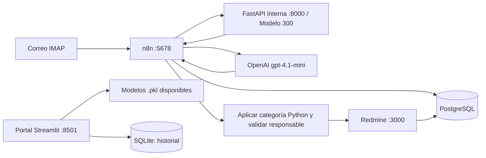
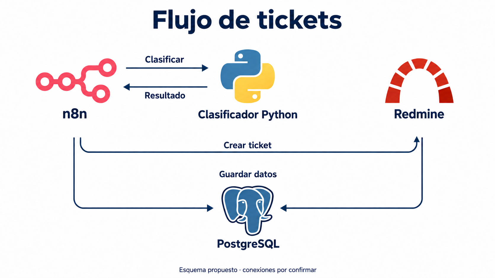
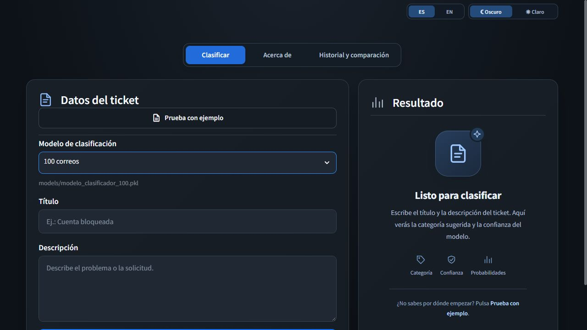
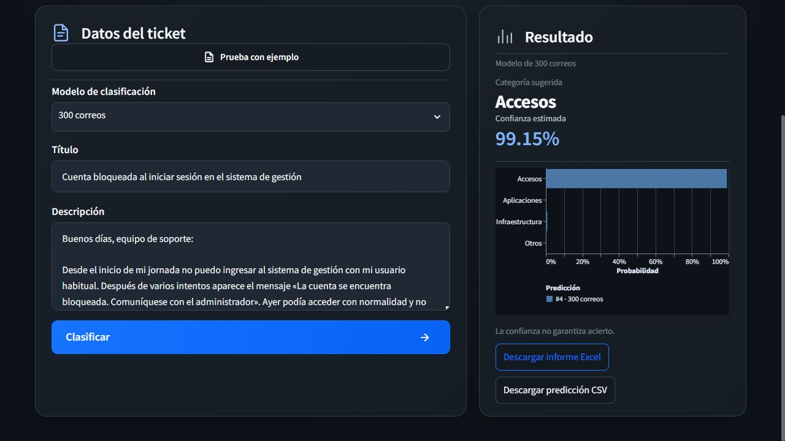

# Mquito Ticket

## 1. Encabezado y badges

<p>
   &nbsp;
   &nbsp;
   &nbsp;
  
</p>


[](python/LICENSE)

[](http://185.208.207.203:8501)

Clasifica correos de soporte TI con Python y automatiza su registro en Redmine mediante n8n. Incluye una interfaz Streamlit para probar modelos, visualizar predicciones y consultar el historial.

## 2. Tabla de contenidos

1. [Encabezado y badges](#1-encabezado-y-badges)
2. [Tabla de contenidos](#2-tabla-de-contenidos)
3. [Descripción del problema](#3-descripción-del-problema)
4. [Dataset](#4-dataset)
5. [Metodología](#5-metodología)
6. [Resultados](#6-resultados)
7. [Instalación y uso](#7-instalación-y-uso)
8. [Interfaz de usuario](#8-interfaz-de-usuario)
9. [Estructura del proyecto](#9-estructura-del-proyecto)
10. [Consideraciones éticas](#10-consideraciones-éticas)
11. [Autores y contribuciones](#11-autores-y-contribuciones)
12. [Licencia](#12-licencia)
13. [Agradecimientos y referencias](#13-agradecimientos-y-referencias)
14. [Videos](#14-videos)

## 3. Descripción del problema

- **¿Qué problema resuelve?** La lectura y clasificación manual de correos de soporte y su derivación a responsables, tareas repetitivas que pueden generar asignaciones inconsistentes.
- **¿Por qué es importante?** Ayuda a organizar las solicitudes y mantener trazabilidad de su categoría y asignación. La reducción de tiempos es un objetivo; todavía no se ha medido.
- **¿Quiénes lo utilizan?** Operadores de mesa de ayuda, personal de soporte TI y responsables que supervisan los tickets; también estudiantes y evaluadores del proyecto.

## 4. Dataset

### Descripción, tamaño y variables

Se utilizan **300 correos simulados en español**: 70 de accesos, 90 de aplicaciones, 70 de infraestructura y 70 de otros.

| Variable | Contenido | Uso |
|---|---|---|
| `titulo` | Asunto del correo | Entrada del modelo |
| `cuerpo` | Texto de la solicitud | Entrada del modelo |
| `clasificacion` | Una de las cuatro categorías | Etiqueta para entrenar y evaluar |

Hay muestras anidadas de **10, 100, 200 y 300 correos**, cada una con su modelo. Los **25 correos de prueba** solo contienen título y cuerpo: permiten obtener predicciones, pero no calcular accuracy o F1 porque no tienen etiquetas esperadas.

### Fuente, licencia y acceso

- **Fuente:** 100 ejemplos iniciales aportados al proyecto y 200 ejemplos ficticios añadidos para ampliar el corpus; no se presentan como correos reales de producción.
- **Licencia de los datos:** no se ha declarado una licencia específica. La licencia MIT del código no concede automáticamente derechos sobre el dataset.
- **Enlaces:** [corpus de 300 correos](python/data/raw/correos.json), [muestras de entrenamiento](python/data/train/) y [25 correos de prueba](python/data/test/correos_test_25.json). Están incluidos en este repositorio y su acceso depende de los permisos del mismo.

Más detalle en el [análisis de datos](python/docs/analisis_datos.md).

## 5. Metodología

| Aspecto | Implementación y justificación |
|---|---|
| **Modelo** | Clasificación supervisada multiclase con TF-IDF y SVM lineal calibrada. Se eligió por su F1 macro en la comparación con regresión logística y por ofrecer probabilidades estimadas. |
| **Preprocesamiento** | Validación de campos y etiquetas; limpieza de HTML, normalización Unicode y minúsculas; sustitución de enlaces, correos, IP y números largos; combinación de título y cuerpo y control de duplicados. |
| **Representación** | TF-IDF de palabras y pares de palabras, con frecuencia sublineal y normalización de acentos. Se ajusta dentro de cada partición de validación. |
| **Optimización** | `GridSearchCV` con cuatro particiones estratificadas y semilla 42 sobre `C`, `class_weight` y `min_df`; calibración sigmoide interna de dos particiones. Los comandos por tamaño entrenan desde cero con los parámetros guardados en YAML, sin repetir la búsqueda. |
| **Métricas** | F1 macro como principal, porque pondera por igual las categorías; accuracy, precisión, recall, F1 por clase y matriz de confusión. También se registran log loss y Brier multiclase para las probabilidades. |

En n8n, **Python determina la categoría final**. El agente prepara el resumen y propone prioridad, tipo y proyecto; el código consulta el responsable configurado de la categoría y valida membresía y rol. Si Python no devuelve una categoría válida, no se crea el ticket y el caso deriva a revisión.

### Arquitectura desplegada

El servidor ejecuta los servicios con Docker Compose. n8n recibe el correo por IMAP, consulta la API FastAPI de 300 correos y envía al agente OpenAI el texto, los adjuntos seleccionados y la categoría Python. El código fija esa categoría, resuelve el responsable por el catálogo de Redmine y valida los datos antes de crear el ticket. PostgreSQL guarda los datos de n8n y Redmine; Streamlit funciona como portal independiente, carga sus modelos desde `models/` y guarda el historial en SQLite.



**Imagen de arquitectura general disponible en la documentación:**



La imagen corresponde al esquema inicial de componentes; el diagrama anterior describe el despliegue actual e incluye OpenAI, Streamlit y la categoría final de Python.

Ver [arquitectura](python/docs/arquitectura.md), [optimización](python/docs/optimizacion.md) y [flujo n8n](workflows/README.md).

## 6. Resultados

### Métricas registradas y comparación con baseline

Evaluación registrada del pipeline mediante **validación cruzada exploratoria de cuatro particiones**. El baseline predice siempre la categoría mayoritaria.

| Correos de entrenamiento | Accuracy CV | F1 macro CV | F1 macro baseline CV |
|---:|---:|---:|---:|
| 10 | No viable | No viable | No viable |
| 100 | 0.9200 | 0.9201 | 0.0968 |
| 200 | 0.9450 | 0.9442 | 0.0968 |
| **300 — modelo final** | 0.9533 | 0.9543 | 0.1154 |

El pipeline de 300 obtiene **accuracy CV de 95,33 % y F1 macro CV de 0,9543**, frente a **0,1154 de F1 macro del baseline**. En 10 correos la calibración no es viable en todos los folds, por lo que no se publica una cifra de CV.

Estas cifras pertenecen a los artefactos identificados por sus hashes en [version_evaluation.json](python/results/metrics/version_evaluation.json); no se recalculan automáticamente al reentrenar. Los ajustes se seleccionaron sobre datos relacionados y las muestras son anidadas: los resultados no equivalen a una prueba externa independiente. Los 25 correos sin etiquetas tampoco proporcionan accuracy o F1.

El diagnóstico histórico del modelo entrenado con 280 correos sobre 20 reservados obtuvo accuracy 0,9500 y F1 macro 0,9511; corresponde a otra etapa, no al modelo final ajustado con 300. Ver [evaluación y pruebas](python/docs/evaluacion_pruebas.md).

## 7. Instalación y uso

### Requisitos del sistema

- Git y Python **3.10**, la versión utilizada por las imágenes Docker; entorno virtual y dependencias de `requirements.txt`.
- CPU; **no requiere GPU**. No se han establecido mínimos medidos de RAM y disco.
- Docker con Compose para ejecutar los contenedores. Para el flujo completo se necesitan además Redmine, n8n y credenciales IMAP, SMTP y OpenAI.

### Versiones utilizadas en producción

Versiones verificadas en los contenedores y en el servidor:

| Componente | Versión |
|---|---|
| Python — portal y API | 3.10.22 |
| Streamlit | 1.41.1 |
| scikit-learn | 1.5.2 |
| pandas / NumPy | 2.2.3 / 1.26.4 |
| Altair | 5.5.0 |
| FastAPI / Uvicorn | 0.115.6 / 0.34.0 |
| n8n | 2.40.5 |
| Redmine | 6.1.4 |
| PostgreSQL | 16.15 |
| Docker Engine / Compose | 29.8.1 / 5.5.1 |
| Portainer CE | 2.45.1 |

El agente usa el identificador de modelo **`gpt-4.1-mini`** de OpenAI. Es una configuración del proveedor externo, no una dependencia Python instalada. Los paquetes del clasificador se fijan en `requirements.txt` y en los archivos de dependencias de `deploy/`.

### Instalación paso a paso en Linux

```bash
git clone https://github.com/n8nmquito/ProyectoIA.git
cd ProyectoIA/python
python3 -m venv .venv
source .venv/bin/activate
python -m pip install -r requirements.txt

# Crear los cuatro modelos desde cero; los .pkl no se incluyen en Git
python -m src.train_versions

# Iniciar la interfaz
python -m streamlit run app/app.py
```

Abrir [la interfaz local](http://localhost:8501). Las instrucciones de Windows y la solución de problemas están en el [manual](python/docs/manual_usuario.md).

### Comandos y ejemplos de uso

Desde la carpeta `python`, con el entorno virtual activado, entrenar únicamente el tamaño elegido:

```bash
python -m src.train_versions --size 10
python -m src.train_versions --size 100
python -m src.train_versions --size 200
python -m src.train_versions --size 300
```

Cada comando reemplaza solo el modelo y el dataset de ese tamaño; no necesita un modelo previo. La fuente y los parámetros se definen en [config.yaml](python/config.yaml).

Probar un modelo con los 25 correos incluidos y actualizar la comparación por tamaños:

```bash
python evaluar_nuevos.py --model 300
python -m src.evaluate_versions
```

El primer comando muestra título, categoría, confianza y revisión; guarda el CSV y el resumen en `results/new_test_25/modelo_clasificador_300/`. Cambiar `300` por `10`, `100` o `200` para probar otra versión.

### Ejecutar con Docker

Después de generar los modelos, desde la carpeta `python`:

```bash
docker compose up -d --build --wait
```

El portal queda en el puerto 8501 y conserva el historial en un volumen SQLite. Para desplegar la automatización completa, seguir la [guía de integración](workflows/GUIA_CONFIGURACION.md) y el [despliegue de la API](python/deploy/README.md); configurar las credenciales antes de activar el flujo, que puede crear tickets y enviar avisos.

## 8. Interfaz de usuario

### URL de los servicios desplegados

Servidor de producción: **185.208.207.203**.

| Servicio | URL | Uso |
|---|---|---|
| Portal de clasificación | [http://185.208.207.203:8501](http://185.208.207.203:8501) | Probar modelos, consultar resultados e historial |
| n8n | [http://185.208.207.203:5678](http://185.208.207.203:5678) | Administrar los flujos y consultar ejecuciones |
| Redmine | [http://185.208.207.203:3000](http://185.208.207.203:3000) | Consultar y gestionar tickets |
| Portainer | [https://185.208.207.203:9443](https://185.208.207.203:9443) | Administración de contenedores con cuenta autorizada |

[Flujo principal de correo en n8n](http://185.208.207.203:5678/workflow/opxBwpGpRDrbQeHn). n8n, Redmine y Portainer requieren sus respectivas cuentas; no se incluyen contraseñas en el repositorio.

**Servicios entre contenedores:** FastAPI recibe `POST http://clasificador-python:8000/predict` y expone `GET /health`, sin publicar el puerto 8000 del host. PostgreSQL se utiliza mediante `postgres:5432` y no tiene interfaz web propia.

### Descripción y acceso

[**Aplicación desplegada**](http://185.208.207.203:8501) con tres vistas: **Clasificar**, **Acerca de** e **Historial y comparación**. Ofrece validación de entradas, indicador de procesamiento, mensajes de error, categoría, confianza, gráfico interactivo, ejemplos precargados, idioma español/inglés, tema claro/oscuro y descarga CSV/Excel. El selector lee los modelos existentes en `models/` y muestra su archivo.

### Cómo usarla

1. Seleccionar uno de los modelos disponibles.
2. Escribir título y descripción, o pulsar **Prueba con ejemplo**. Ejemplo: «Cuenta bloqueada» / «No puedo iniciar sesión; solicito revisar el bloqueo de mi usuario».
3. Pulsar **Clasificar** y revisar categoría, confianza y probabilidades.
4. Descargar el resultado o comparar predicciones en **Historial y comparación**; consultar métricas y limitaciones en **Acerca de**.
5. Recargar la página después de añadir o quitar modelos. El formulario prueba el clasificador; la creación de tickets pertenece al flujo de correo n8n.

### Capturas de pantalla

**Formulario y selección del modelo:**



**Predicción, probabilidades y exportación:**



## 9. Estructura del proyecto

| Carpeta | Contenido principal |
|---|---|
| `python/src/` | Procesamiento, modelos, entrenamiento, evaluación y API |
| `python/app/` | Interfaz Streamlit, estilos, exportación e historial |
| `python/data/` | Corpus, muestras de entrenamiento y correos de prueba |
| `python/models/` | Modelos `.pkl` generados, excluidos de Git |
| `python/results/` | Métricas, predicciones e informes |
| `python/tests/` | Pruebas automatizadas |
| `python/notebooks/` | Análisis y experimentos reproducibles |
| `python/docs/` | Planificación, datos, arquitectura, optimización, ética y manual |
| `python/deploy/` | Dockerfiles, dependencias y operación del despliegue |
| `python/documentacion/imagenes/` | Gráficos y capturas |
| `python/workshop/` | Material de referencia del taller |
| `workflows/` | Flujos n8n, validaciones JavaScript y pruebas |
| `n8n/`, `redmine/`, `postgres/` | Configuración de n8n, Redmine e inicialización de bases, respectivamente |
| `classifier/` | Experimento anterior con PostgreSQL; no es el clasificador Python actual |
| `Documentacion/` | Diagramas y documentos complementarios |

## 10. Consideraciones éticas

- **Privacidad:** usar datos ficticios o autorizados; no introducir contraseñas ni información personal innecesaria. La limpieza del texto no garantiza anonimización.
- **Servicios externos:** OpenAI puede recibir texto, adjuntos seleccionados y datos consultados en Redmine. Su envío requiere permisos y una política de tratamiento de datos.
- **Limitaciones y sesgos:** corpus pequeño, simulado, en español y de un dominio limitado; no se ha demostrado generalización a correo real ni equidad demográfica. Una confianza alta no garantiza un acierto.
- **Supervisión:** baja confianza o desacuerdo marcan revisión. La creación automática de tickets no incluye aprobación humana obligatoria; el equipo debe revisar y corregir errores.
- **Uso inadecuado:** no usar el resultado para conceder accesos, sancionar personas o resolver incidentes críticos automáticamente. El portal desplegado usa HTTP y no tiene autenticación: utilizar ejemplos sin datos sensibles.

Ver las [consideraciones éticas completas](python/docs/consideraciones_eticas.md).

## 11. Autores y contribuciones

| Integrante | Rol | Contribución |
|---|---|---|
| **María Quito Castillo** | Líder del Proyecto y Desarrollador TI (desarrolladora full stack) | Liderazgo del proyecto y desarrollo full stack |
| &nbsp; | Data Scientist | &nbsp; |
| &nbsp; | Experto Soporte TI | &nbsp; |
| &nbsp; | Equipo IA | &nbsp; |
| &nbsp; | Soporte TI | &nbsp; |
| &nbsp; | TI | &nbsp; |
| &nbsp; | Mesa de Ayuda | &nbsp; |

<br>

## 12. Licencia

<br><br>

## 13. Agradecimientos y referencias

<br><br>

## 14. Videos

### Video pitch de 5 minutos

Enlace:

<br><br>

### Video de respuestas a las preguntas

Enlace:

<br><br>
