# Mquito Ticket

## 1. Encabezado y badges

<p>
   &nbsp;
   &nbsp;
   &nbsp;
   &nbsp;
   &nbsp;
   &nbsp;
  
</p>

<p>
   &nbsp;
   &nbsp;
   &nbsp;
   &nbsp;
   &nbsp;
  
</p>


[](python/LICENSE)

[](http://185.208.207.203:8501)

Automatiza la gestión de correos de soporte TI con n8n: un clasificador Python determina la categoría y un agente de OpenAI analiza la solicitud, genera el resumen y propone prioridad, tipo y proyecto del ticket en Redmine. Antes del análisis, un nodo de código de n8n filtra firmas y datos sensibles del texto; el flujo valida la categoría y el responsable antes de registrar el ticket. Incluye un portal Streamlit para probar modelos, comparar predicciones, consultar el historial y exportar resultados, con despliegue en contenedores Docker.

## 2. Tabla de contenidos

1. [Encabezado y badges](#1-encabezado-y-badges)
2. [Tabla de contenidos](#2-tabla-de-contenidos)
3. [Descripción del problema](#3-descripción-del-problema)
4. [Dataset](#4-dataset)
5. [Metodología](#5-metodología)
   - [Flujo de automatización](#flujo-de-automatización)
6. [Resultados](#6-resultados)
7. [Instalación y uso](#7-instalación-y-uso)
8. [Interfaz de usuario](#8-interfaz-de-usuario)
9. [Estructura del proyecto](#9-estructura-del-proyecto)
10. [Consideraciones éticas](#10-consideraciones-éticas)
11. [Autores y contribuciones](#11-autores-y-contribuciones)
12. [Licencia](#12-licencia)
13. [Agradecimientos y referencias](#13-agradecimientos-y-referencias)
14. [Videos](#14-videos)

## 3. Descripción del problema

- **¿Qué problema resuelve?** Centraliza la atención de solicitudes de soporte TI recibidas por correo. Automatiza su clasificación, la preparación del ticket y su asignación en Redmine para reducir tareas repetitivas y evitar derivaciones inconsistentes.
- **¿Por qué es importante?** Una solicitud mal clasificada o derivada puede retrasar su atención. El proyecto aplica criterios uniformes de categorización y asignación, conserva la trazabilidad en Redmine y facilita la supervisión del equipo; busca reducir el tiempo de gestión, aunque ese ahorro todavía no se ha medido.
- **¿Quiénes son los usuarios objetivo?** Operadores de mesa de ayuda que registran y derivan solicitudes, técnicos de soporte TI que atienden los tickets y responsables que supervisan su asignación y seguimiento. El portal Streamlit permite probar los modelos y revisar sus predicciones antes de valorar su uso operativo.

## 4. Dataset

### Descripción de los datos utilizados

Correos simulados en español que representan solicitudes de soporte TI de cuatro categorías: **accesos, aplicaciones, infraestructura y otros**. Se usan para entrenar los modelos y probar la clasificación de nuevas solicitudes.

### Fuente y licencia de los datos

- **Fuente:** conjuntos de **10, 100, 200 y 300 correos simulados**, creados para el proyecto. No proceden de correos reales de producción.
- **Licencia de los datos:** no se ha declarado una licencia específica. La licencia MIT del código no concede automáticamente derechos sobre el dataset.

### Características principales (tamaño y variables)

Hay cuatro muestras anidadas de **10, 100, 200 y 300 correos**, cada una con su modelo. El conjunto de 300 contiene **70 de accesos, 90 de aplicaciones, 70 de infraestructura y 70 de otros**.

| Variable | Contenido | Uso |
|---|---|---|
| `titulo` | Asunto del correo | Entrada del modelo |
| `cuerpo` | Texto de la solicitud | Entrada del modelo |
| `clasificacion` | Una de las cuatro categorías | Etiqueta para entrenar y evaluar |

Los **25 correos de prueba** contienen título y cuerpo y se utilizan para comprobar el funcionamiento del clasificador y revisar manualmente sus predicciones. Su contenido permite reconocer el tipo de solicitud; no necesitan etiquetas para ejecutar estas pruebas funcionales. Para calcular accuracy o F1 sí sería necesario registrar y validar una categoría esperada para cada correo.

### Link a los datos si son públicos

- [Corpus de 300 correos](python/data/raw/correos.json).
- [Muestras de entrenamiento de 10, 100, 200 y 300 correos](python/data/train/).
- [25 correos de prueba](python/data/test/correos_test_25.json).

Más detalle en el [análisis de datos](python/docs/analisis_datos.md).

## 5. Metodología

### Tipo de modelo utilizado y justificación

Clasificador supervisado multiclase con **TF-IDF y SVM lineal calibrada**. Se eligió por su F1 macro frente a regresión logística y porque permite obtener probabilidades estimadas para las cuatro categorías.

### Preprocesamiento aplicado

Validación de campos y etiquetas, limpieza de HTML, normalización Unicode y minúsculas, sustitución de enlaces, correos, IP y números largos, unión de título y cuerpo y control de duplicados. TF-IDF utiliza palabras y pares de palabras (`ngram_range: [1, 2]`), frecuencia sublineal, normalización de acentos, `min_df: 1` y `max_df: 1.0`, según [config.yaml](python/config.yaml).

### Técnicas de optimización empleadas

Búsqueda con `GridSearchCV` de `C: [0.1, 1.0, 10.0]`, `class_weight: [null, balanced]` y `min_df: [1, 2]`, usando F1 macro, **4 particiones estratificadas** y **semilla 42**. La configuración de entrenamiento en [config.yaml](python/config.yaml) utiliza **C = 10.0**, sin ponderación de clases y calibración sigmoide con **2 particiones**. El entrenamiento por tamaño aplica estos parámetros sin repetir la búsqueda.

### Métricas de evaluación seleccionadas

**F1 macro** como métrica principal para dar el mismo peso a cada categoría; **accuracy, precisión, recall y F1 por clase**, junto con la **matriz de confusión**, para analizar aciertos y errores. Se registran **log loss y Brier multiclase** para evaluar las probabilidades.

### Flujo de automatización

#### Workflows de n8n

La instalación tiene dos flujos que cubren momentos distintos de la atención:

| Workflow | Cómo se inicia | Qué hace | Resultado |
|---|---|---|---|
| **Mquito \| Correo → IA → Ticket Redmine** | Al recibir un correo en el buzón IMAP | Normaliza y limpia el texto, consulta el clasificador Python, analiza la solicitud con OpenAI, valida los datos y el responsable, sube los adjuntos y crea el ticket si corresponde | Ticket en Redmine y confirmación por correo cuando los filtros lo permiten; los correos ajenos a soporte se omiten y los fallos se derivan a revisión |
| **Mquito \| Avisos de cambios de estado Redmine** | Cada minuto | Consulta los tickets del proyecto configurado, compara su estado con el guardado en PostgreSQL y prepara avisos cuando detecta un cambio | Correo al solicitante con el estado anterior, el nuevo estado y el enlace del ticket; guarda el resultado del envío |

El primer flujo registra la solicitud; el segundo mantiene informado al solicitante durante su atención. Se ejecutan de forma independiente y se relacionan mediante los tickets de Redmine. El seguimiento usa el campo **Correo del solicitante**, guarda la primera observación sin enviar aviso y notifica los cambios de estado observados en consultas posteriores. No ejecuta el clasificador ni el agente de IA, y no cambia el estado del ticket.

Por ejemplo, el primer flujo puede registrar un correo sobre un problema de acceso y confirmar el número del ticket. Si después un técnico cambia su estado en Redmine, el segundo detecta ese cambio y avisa al solicitante, siempre que tenga una dirección válida y el ticket ya cuente con una observación anterior.

La captura muestra ambos como **Published**. Las plantillas del repositorio se entregan desactivadas y sin credenciales, por lo que deben configurarse antes de publicarlas en otra instalación. Ver el [proceso principal](PROCESO_AUTOMATIZACION.md) y el [seguimiento de estados](workflows/status-notifications/README.md).

#### Etapas del flujo principal

El recorrido del correo hasta el ticket se organiza en diez etapas:

1. **Leer buzón IMAP:** recibir el asunto, cuerpo y adjuntos del correo.
2. **Normalizar y limpiar:** ordenar los campos, conservar los originales y limpiar firmas y datos sensibles dentro de n8n.
3. **Consultar NexpAPI con el modelo de 300:** obtener la categoría Python, confianza y probabilidades; unir la predicción con el correo limpio, validar la respuesta y seleccionar los adjuntos permitidos para el agente.
4. **Analizar con el agente OpenAI:** evaluar la relevancia, resumir la solicitud y proponer prioridad, tipo y proyecto consultando los catálogos de Redmine.
5. **Decidir si corresponde a soporte:** continuar con la solicitud o registrar la omisión y preparar el aviso.
6. **Aplicar la categoría de Python:** conservarla aunque el agente discrepe y marcar revisión ante baja confianza o desacuerdo.
7. **Preparar y validar el ticket:** comprobar proyecto, tipo y categoría, y validar la membresía y el rol del responsable antes de asignarlo.
8. **Recuperar y subir los adjuntos originales:** conservar los archivos para asociarlos al ticket en Redmine.
9. **Crear el ticket en Redmine:** registrar la solicitud con los datos validados y la asignación correspondiente.
10. **Preparar la notificación:** incluir el número y enlace del ticket; enviar el aviso cuando los filtros configurados lo permitan.

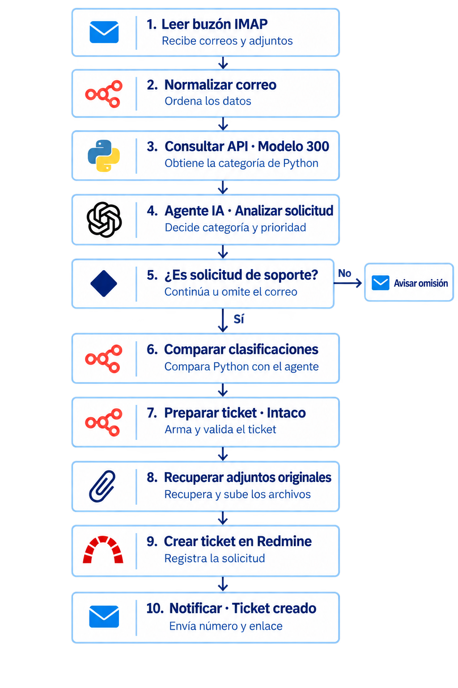

La imagen muestra el esquema anterior. El flujo vigente incorpora la limpieza previa y aplica la categoría final de Python en la etapa denominada «Comparar clasificaciones». Si falla la limpieza, la API o la validación de la predicción, deriva a revisión antes del agente; un proyecto, tipo o categoría inválidos bloquean la creación del ticket.

Ver el [diagrama completo y las responsabilidades de cada componente](python/docs/arquitectura.md#3-diagrama-de-flujo-del-sistema-completo) y el [proceso de automatización](PROCESO_AUTOMATIZACION.md).

La [guía de credenciales de n8n](workflows/GUIA_CONFIGURACION.md#credenciales-de-n8n-para-qué-sirven-y-cómo-se-usan) explica para qué sirve cada acceso, qué configurar y en qué nodos se utiliza: NexpAPI, OpenAI, PostgreSQL, SMTP, Redmine e IMAP.

## 6. Resultados

### Métricas finales del modelo

El modelo de **300 correos utilizado por la API de producción y n8n** obtiene **accuracy de 95,33 % y F1 macro de 0,9543**, mediante validación cruzada exploratoria de **4 particiones**. RMSE no aplica a esta clasificación por categorías.

Se verificaron en el contenedor el modelo (`SHA-256: 2905ce41…1bf6a87`) y sus parámetros: **C = 10.0**, sin ponderación de clases, calibración de **2 particiones**, TF-IDF de **palabras y pares de palabras**, `min_df: 1` y **semilla 42**. Coinciden con [config.yaml](python/config.yaml) y con el artefacto identificado en [version_evaluation.json](python/results/metrics/version_evaluation.json). YAML define los parámetros; el reporte contiene las métricas.

### Comparación con baseline y tabla de rendimiento

El baseline predice siempre la categoría mayoritaria.

| Correos de entrenamiento | Accuracy CV | F1 macro CV | F1 macro baseline CV |
|---:|---:|---:|---:|
| 10 | No viable | No viable | No viable |
| 100 | 0.9200 | 0.9201 | 0.0968 |
| 200 | 0.9450 | 0.9442 | 0.0968 |
| **300 — API de producción** | **0.9533** | **0.9543** | **0.1154** |

Los cuatro modelos reentrenados del portal ya tienen su [evaluación propia](python/results/produccion/metrics/version_evaluation.json), vinculada a sus hashes. El de 300 (`bd745b50…6988e`) obtuvo **accuracy CV de 95,33 % y F1 macro CV de 0,9543**. Los de 100 y 200 obtuvieron F1 macro de **0,9201 y 0,9442**; para 10 la CV no es viable. Los valores coinciden con los de referencia, pero se calcularon sobre los archivos actuales del portal.

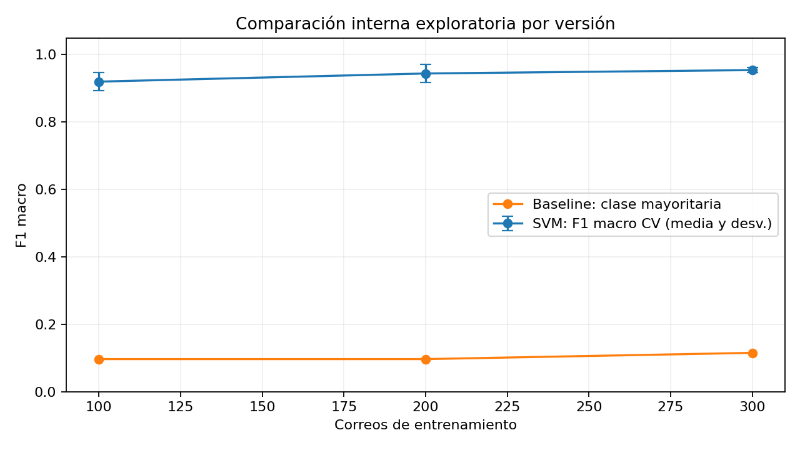

La interfaz muestra las métricas solo si el hash coincide con el modelo seleccionado. La CV es exploratoria, no una prueba externa independiente; los 25 correos siguen siendo pruebas funcionales sin accuracy o F1.

## 7. Instalación y uso

### Requisitos del sistema

- Git y Python **3.10**, la versión utilizada por las imágenes Docker; entorno virtual y dependencias de `requirements.txt`.
- CPU; **no requiere GPU**. No se han establecido mínimos medidos de RAM y disco.
- Docker con Compose para ejecutar los contenedores. Para el flujo completo se necesitan además Redmine, n8n y credenciales IMAP, SMTP y OpenAI.

### Versiones utilizadas en producción

Versiones verificadas en los contenedores y en el servidor:

| Componente | Versión |
|---|---|
| Python — portal y API | 3.10.22 |
| Streamlit | 1.41.1 |
| scikit-learn | 1.5.2 |
| pandas / NumPy | 2.2.3 / 1.26.4 |
| Altair | 5.5.0 |
| FastAPI / Uvicorn | 0.115.6 / 0.34.0 |
| n8n | 2.40.5 |
| Redmine | 6.1.4 |
| PostgreSQL | 16.15 |
| Docker Engine / Compose | 29.8.1 / 5.5.1 |
| Portainer CE | 2.45.1 |

El agente usa el identificador de modelo **`gpt-4.1-mini`** de OpenAI. Es una configuración del proveedor externo, no una dependencia Python instalada. Los paquetes del clasificador se fijan en `requirements.txt` y en los archivos de dependencias de `deploy/`.

### Instalación paso a paso en Linux

```bash
git clone https://github.com/n8nmquito/ProyectoIA.git
cd ProyectoIA/python
python3 -m venv .venv
source .venv/bin/activate
python -m pip install -r requirements.txt

# Los cuatro modelos entrenados ya están incluidos en models/

# Iniciar la interfaz
python -m streamlit run app/app.py
```

El [manifiesto de partición](python/data/processed/holdout_original.json) ya está incluido; permite reconstruir la reserva histórica de 280/20 al ejecutar los notebooks. Consulta la [guía de reproducibilidad](python/data/README.md#reproducir-la-partición-de-diagnóstico).

Abrir [la interfaz local](http://localhost:8501). Consultar el [manual de usuario](python/docs/manual_usuario.md) para los pasos, las capturas anotadas y la solución de problemas.

### Comandos y ejemplos de uso

Desde la carpeta `python`, con el entorno virtual activado, entrenar únicamente el tamaño elegido:

```bash
python -m src.train_versions --size 10
python -m src.train_versions --size 100
python -m src.train_versions --size 200
python -m src.train_versions --size 300
```

Los [modelos entrenados y sus hashes](python/models/README.md) ya se descargan con el repositorio. El reentrenamiento es opcional: cada comando reemplaza solo el modelo y el dataset de ese tamaño; no necesita un modelo previo. La fuente y los parámetros se definen en [config.yaml](python/config.yaml).

Probar un modelo con los 25 correos incluidos y actualizar la comparación por tamaños:

```bash
python evaluar_nuevos.py --model 300
python -m src.evaluate_versions

# Ejecutar las pruebas automatizadas
python -m pytest tests -q
```

El primer comando muestra título, categoría, confianza y revisión; guarda el CSV y el resumen en `results/new_test_25/modelo_clasificador_300/`. Cambiar `300` por `10`, `100` o `200` para probar otra versión.

### Ejecutar con Docker

Los modelos ya están incluidos. Desde la carpeta `python`:

```bash
docker compose up -d --build --wait
```

El portal queda en el puerto 8501 y conserva el historial en un volumen SQLite. Para desplegar la automatización completa, seguir la [guía de integración](workflows/GUIA_CONFIGURACION.md) y el [despliegue de la API](nexpapi/README.md); configurar las credenciales antes de activar el flujo, que puede crear tickets y enviar avisos.

## 8. Interfaz de usuario

### URL de los servicios desplegados

Servidor de producción: **185.208.207.203**.

| Servicio | URL | Uso |
|---|---|---|
| Portal de clasificación | [http://185.208.207.203:8501](http://185.208.207.203:8501) | Probar modelos, consultar resultados e historial |
| n8n | [http://185.208.207.203:5678](http://185.208.207.203:5678) | Administrar los flujos y consultar ejecuciones |
| Redmine | [http://185.208.207.203:3000](http://185.208.207.203:3000) | Consultar y gestionar tickets |
| Portainer | [https://185.208.207.203:9443](https://185.208.207.203:9443) | Administración de contenedores con cuenta autorizada |

**Servicios entre contenedores:** n8n limpia el texto con un nodo de código local; FastAPI recibe `POST http://nexpapi:8000/predict` y expone `GET /health`, sin publicar el puerto 8000 del host. PostgreSQL se utiliza mediante `postgres:5432` y no tiene interfaz web propia.

### Direcciones del navegador y red interna de Docker

Para ver tus tickets, abre [Redmine](http://185.208.207.203:3000/) e inicia sesión con tu cuenta.

| Dirección | Quién la utiliza | Para qué sirve |
|---|---|---|
| `http://185.208.207.203:3000` | Usuario desde su navegador | Abrir Redmine y consultar tickets |
| `http://185.208.207.203:5678` | Operador autorizado desde su navegador | Administrar n8n y revisar ejecuciones |
| `http://redmine:3000` | Nodos y herramientas de n8n dentro de Docker | Consultar la API de Redmine, subir adjuntos y crear tickets |
| `http://nexpapi:8000/predict` | Nodo de clasificación de n8n dentro de Docker | Consultar el modelo Python de 300 correos |
| `postgres:5432` | Servicios y nodos de base de datos autorizados | Conectar con PostgreSQL; no es una página web |

En las capturas también aparece `http://redmine:3000`. Es la dirección que usa n8n para hablar con Redmine dentro del servidor. Ambos están conectados a la red Docker **`correo-tickets_automatizacion`**. Es el mismo Redmine, pero se accede de otra manera.

Usa la IP del servidor en tu navegador. Los nombres `redmine`, `nexpapi` y `postgres` se usan dentro de Docker. `localhost` significa «este equipo» o «este contenedor», según desde dónde te conectes.

No necesitas cambiar esas direcciones para consultar un ticket. Hay más ejemplos en el [manual de usuario](python/docs/manual_usuario.md#8-direcciones-de-acceso-y-red-interna).

### Descripción y acceso

[**Aplicación desplegada**](http://185.208.207.203:8501) con tres vistas: **Clasificar**, **Acerca de** e **Historial y comparación**. Ofrece validación de entradas, indicador de procesamiento, mensajes de error, categoría, confianza, gráfico interactivo, ejemplos precargados, idioma español/inglés, tema claro/oscuro y descarga CSV/Excel. El selector lee los modelos existentes en `models/` y muestra su archivo.

### Cómo usarla

1. Seleccionar uno de los modelos disponibles.
2. Escribir título y descripción, o pulsar **Prueba con ejemplo**. Ejemplo: «Cuenta bloqueada» / «No puedo iniciar sesión; solicito revisar el bloqueo de mi usuario».
3. Pulsar **Clasificar** y revisar categoría, confianza y probabilidades.
4. Descargar el resultado o comparar predicciones en **Historial y comparación**; consultar métricas y limitaciones en **Acerca de**.
5. Recargar la página después de añadir o quitar modelos. El formulario prueba el clasificador; la creación de tickets pertenece al flujo de correo n8n.

### Capturas de pantalla

**Formulario y selección del modelo:**


**Predicción, probabilidades y exportación:**


<details>
<summary><strong>Ver 7 capturas adicionales del clasificador</strong></summary>

Capturas del portal desplegado con correos ficticios de ejemplo.

**1. Predicción y probabilidades**

Clasificación de un correo de ejemplo con categoría, confianza y gráfico.


**2. Información del modelo**

Archivo seleccionado, explicación del modelo y variables de entrada y salida.


**3. Parámetros del modelo**

Tamaño del corpus, vocabulario TF-IDF y parámetros del modelo cargado.


**4. Historial de predicciones**

Predicciones de ejemplo guardadas y opciones de descarga del historial.


**5. Comparación entre modelos**

El mismo correo clasificado con modelos de 100 y 300 correos; se comparan probabilidades, no aciertos.


**6. Idioma inglés y tema claro**

Controles de idioma y apariencia con el resultado de un ejemplo en español.


**7. Validación de entradas**

Mensaje de error al intentar clasificar sin completar el título.


</details>

### Uso del flujo completo de correo a Redmine

Este recorrido muestra cómo enviar una solicitud, revisar su procesamiento en n8n, consultar el ticket en Redmine y recibir los avisos por correo. Complementa las pruebas del portal Python descritas arriba. Las capturas documentan ejemplos de distintas ejecuciones; sus números de ticket, categorías y resultados no pertenecen necesariamente a una misma prueba.

#### 1. Enviar una solicitud de soporte por correo

Enviar un correo a **n8n.mquito@gmail.com** con un asunto concreto y una descripción del problema o de la ayuda solicitada. Por ejemplo: «Usuario bloqueado en JDE» y «No puedo ingresar con mi usuario; aparece un mensaje de bloqueo. Solicito revisar el acceso». Adjuntar una captura o un archivo cuando ayude a explicar el caso.

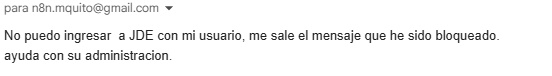

La recepción por IMAP inicia el flujo automáticamente cuando está publicado y configurado. Enviar esta solicitud puede crear un ticket real y generar notificaciones.

#### 2. Acceder a n8n y reconocer sus pantallas

Abrir [n8n](http://185.208.207.203:5678) e iniciar sesión con la cuenta autorizada para administrar o revisar el sistema. El solicitante puede enviar su correo sin acceder a n8n.

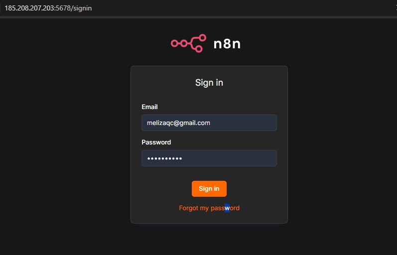

En **Credentials** se administran los accesos a los servicios. La [guía de credenciales](workflows/GUIA_CONFIGURACION.md#credenciales-de-n8n-para-qué-sirven-y-cómo-se-usan) explica la función, configuración y uso de cada una.

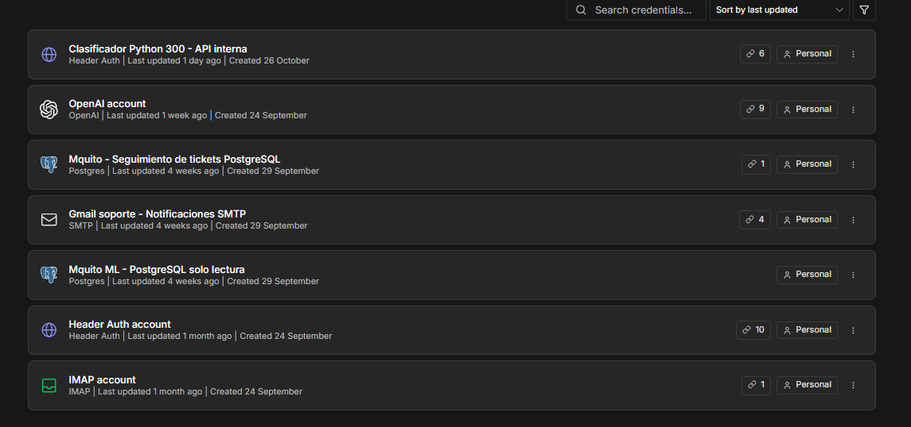

En **Executions** se revisan la fecha, duración y estado de cada ejecución. Abrir la ejecución correspondiente al correo y comprobar sus nodos y resultados. Un estado `success` también puede corresponder a una omisión controlada: confirmar el ID de ticket en **Resultado del ticket** o en Redmine.

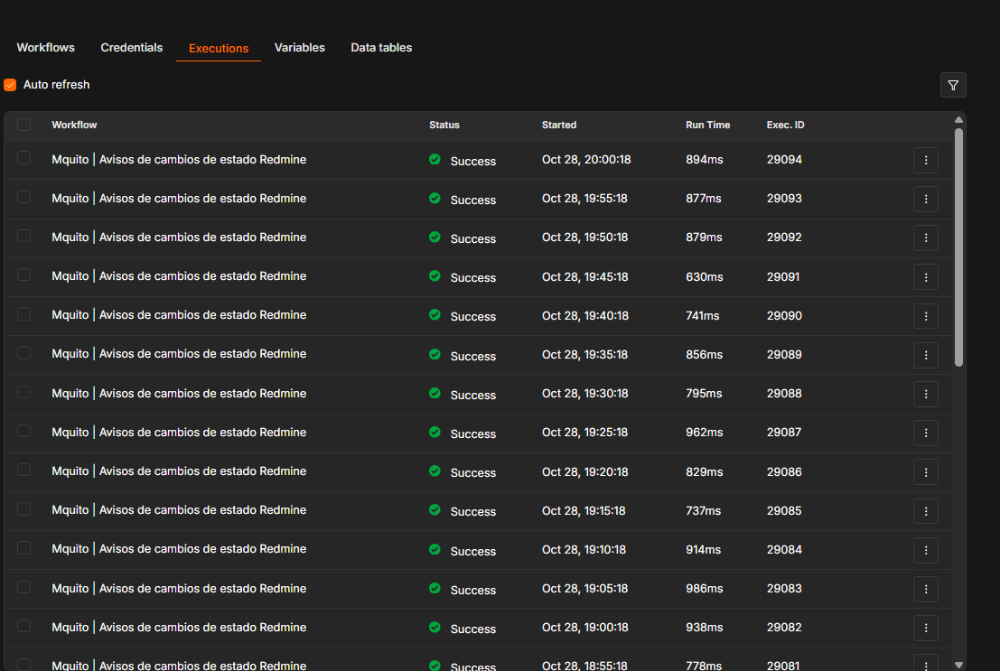

En **Workflows** aparecen los dos procesos publicados: **Mquito | Correo → IA → Ticket Redmine**, que procesa las solicitudes, y **Mquito | Avisos de cambios de estado Redmine**, que notifica su evolución.

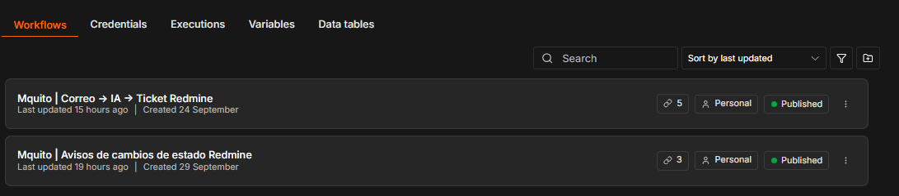

#### 3. Revisar el flujo principal y la clasificación Python

Abrir el [workflow principal](http://185.208.207.203:5678/workflow/opxBwpGpRDrbQeHn). La plantilla documentada tiene **41 nodos**: recepción y limpieza, consulta del modelo, análisis del agente, validaciones, tratamiento de adjuntos, creación del ticket y notificaciones.

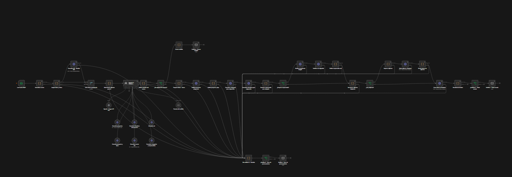

La vista general permite reconocer el recorrido. Abrir la imagen en su tamaño original o consultar los detalles siguientes para leer los nodos.

El nodo **Consultar API - Modelo 300** conecta n8n con **NexpAPI**. Recibe el texto del nodo **Limpiar firma y datos** y devuelve la predicción, que se reúne con el correo en **Unir correo y predicción**.

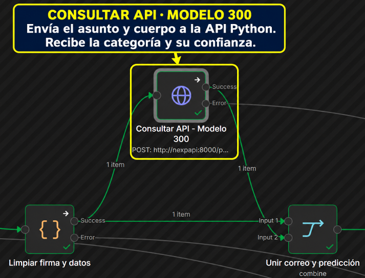

La consulta utiliza `POST http://nexpapi:8000/predict`, autenticación Header Auth y un JSON con `titulo` y `cuerpo` limpios. Los adjuntos no se incluyen en ese JSON. La respuesta contiene categoría, confianza, probabilidades e indicadores como `requiere_revision` y `sin_vocabulario`.

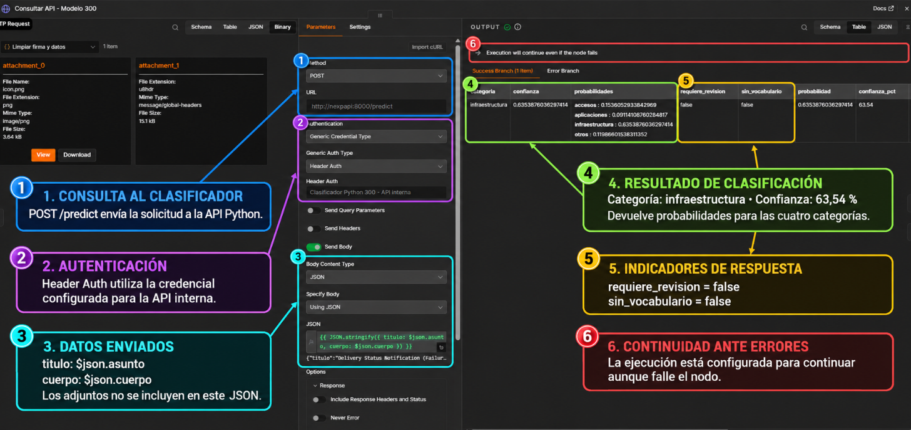

La captura muestra un ejemplo de clasificación, no una medida de precisión del sistema. La salida de error permite continuar hacia la rama de revisión; un fallo de la API no autoriza a crear un ticket sin una predicción válida.

#### 4. Comprender el análisis de OpenAI

**Agente IA - Analizar solicitud** recibe el correo limpio y la clasificación Python. El nodo del modelo OpenAI proporciona el modelo de lenguaje y las herramientas realizan consultas de solo lectura a Redmine para obtener proyectos, miembros, roles, tipos y categorías con sus responsables.

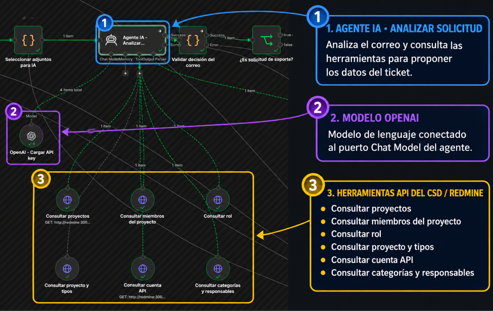

El agente evalúa si corresponde a soporte, resume el problema y propone prioridad, tipo, proyecto y responsable. La categoría final procede de Python y se reaplica antes de crear el ticket. La propuesta del agente pasa por las validaciones del flujo; sus IDs no se aceptan sin comprobarlos contra Redmine.

#### 5. Crear el ticket y revisar la respuesta al solicitante

Después de validar proyecto, tipo, categoría y asignación, el flujo recupera los adjuntos originales y reúne los tokens de los archivos subidos cuando corresponde. **Crear ticket en Redmine** registra la petición y **Resultado del ticket** prepara su resultado.

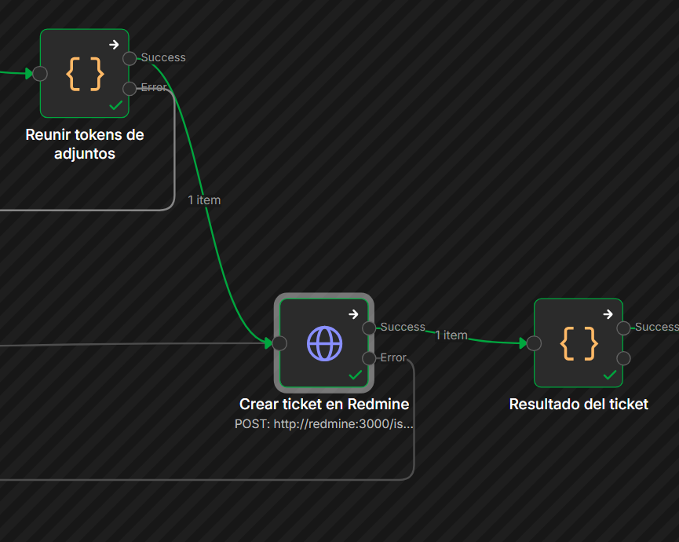

La creación utiliza `POST http://redmine:3000/issues.json` con la credencial de Redmine. En la captura se observa el ticket de ejemplo **#54**, de tipo **Soporte**, categoría **Accesos**, prioridad **Normal** y responsable **Soporte Accesos**. Son datos de esa ejecución, no valores fijos para todas las solicitudes.

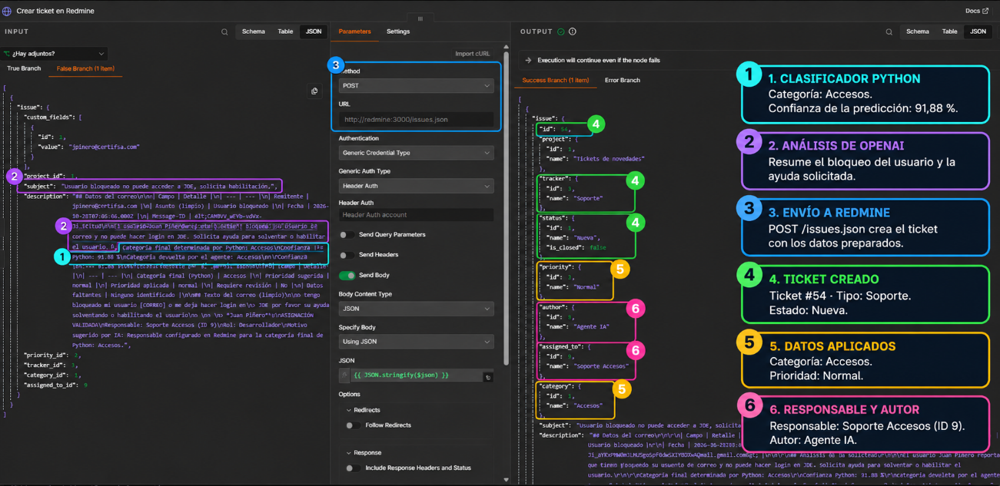

Si el procesamiento falla, el aviso informa que el caso quedó registrado para revisión. Antes de reenviar el correo, comprobar si ya existe un ticket para evitar duplicados. Este mensaje de error es distinto del aviso de omisión de contenido ajeno a soporte.

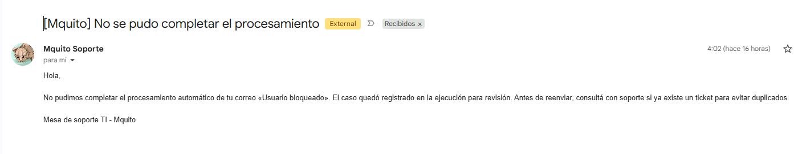

Cuando se crea el ticket y los filtros permiten la notificación, el solicitante recibe una confirmación con el número y el enlace. La captura siguiente corresponde al ticket **#53**, de otra ejecución.

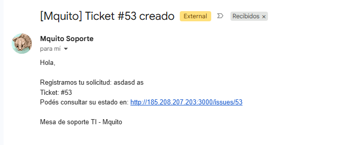

#### 6. Consultar el ticket en Redmine

Abrir [Redmine](http://185.208.207.203:3000/) e iniciar sesión con la cuenta autorizada. La pantalla de acceso del ejemplo muestra el formulario de identificación; utilizar la cuenta asignada a cada usuario.

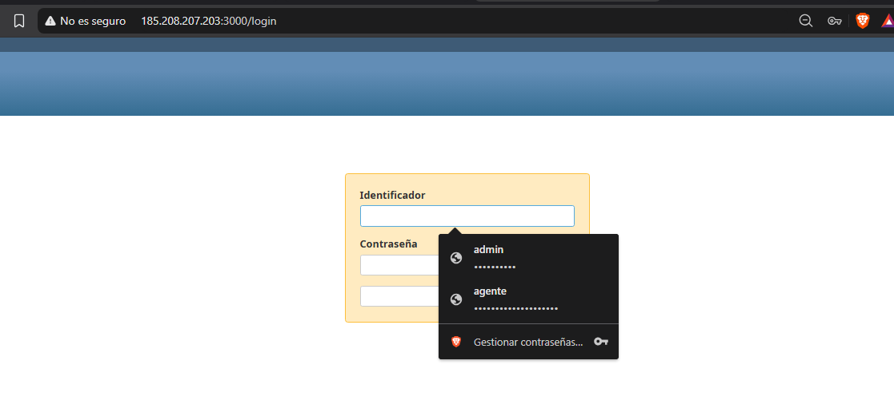

Seleccionar el proyecto **Tickets de novedades** desde el selector de proyectos.

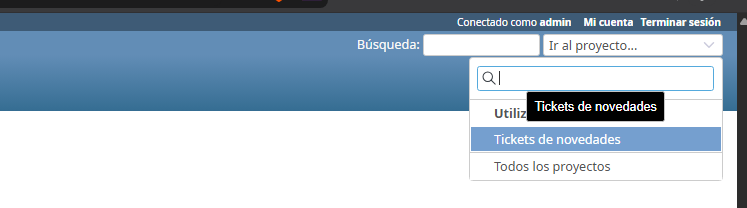

En la vista del proyecto, consultar las peticiones de tipo **Soporte** o **Errores**, según la solicitud registrada.

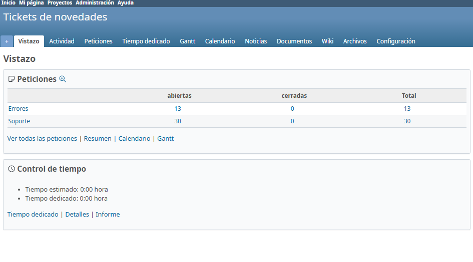

Buscar el ticket por el número recibido en la confirmación o por su asunto. Si se ordena por ID descendente, los números mayores aparecen primero; los filtros y el orden de la lista pueden cambiar esa presentación.

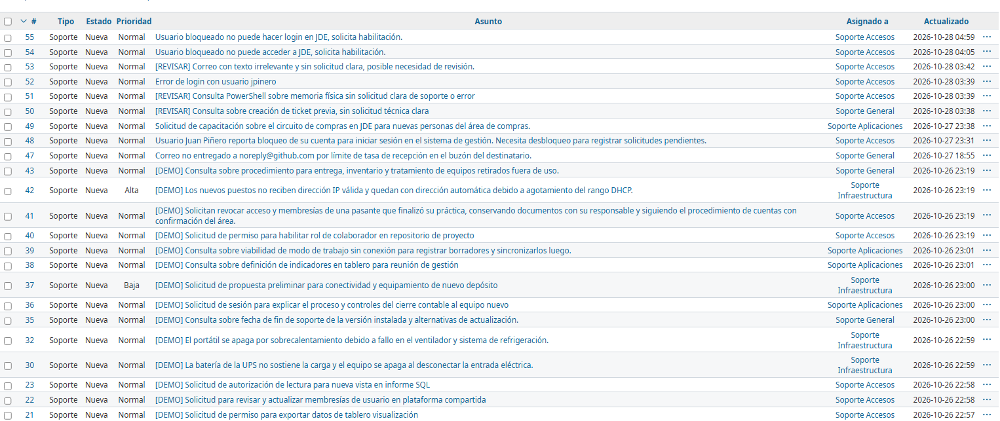

Abrir el ticket para revisar estado, prioridad, responsable, categoría, correo del solicitante, descripción y adjuntos disponibles. La descripción reúne los datos del correo y el análisis de la solicitud.

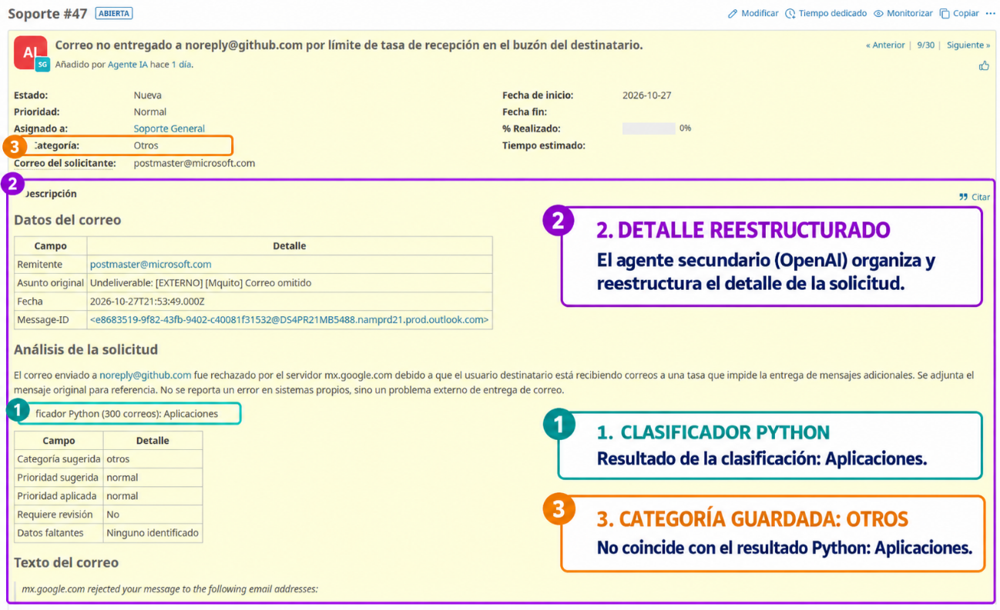

**La captura del ticket #47 documenta una discrepancia anterior:** muestra **Aplicaciones** en el resultado Python y **Otros** en la categoría guardada. Se conserva como evidencia de esa prueba. En el flujo vigente la categoría final de Python es obligatoria; esta diferencia no representa el resultado esperado. Consultar la [arquitectura](python/docs/arquitectura.md) para la regla actual.

#### 7. Recibir avisos de cambios de estado

Cuando un técnico cambia el estado en Redmine, el workflow **Mquito | Avisos de cambios de estado Redmine** lo detecta en sus consultas periódicas. Si ya existe una observación anterior y el campo **Correo del solicitante** contiene una dirección válida, prepara el aviso con número, asunto, estado anterior, nuevo estado y enlace.

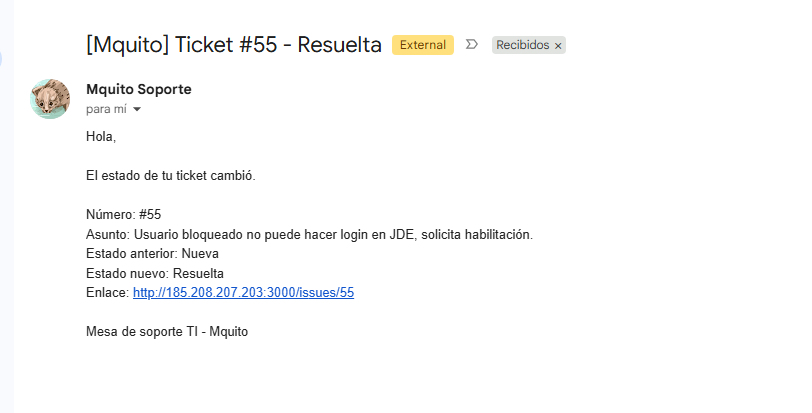

En este ejemplo el ticket **#55** pasa de **Nueva** a **Resuelta**. La primera observación de un ticket no envía correo; establece el estado de referencia. El seguimiento no utiliza IA ni cambia el estado del ticket. Ver [funcionamiento y límites del seguimiento](workflows/status-notifications/README.md).

## 9. Estructura del proyecto

| Carpeta | Contenido principal |
|---|---|
| `python/src/` | Procesamiento, modelos, entrenamiento, evaluación y API |
| `python/app/` | Interfaz Streamlit, estilos, exportación e historial |
| `python/data/` | Corpus, muestras de entrenamiento y correos de prueba |
| `python/models/` | Modelos entrenados de 10, 100, 200 y 300, copias de producción y hashes |
| `python/results/` | Métricas, predicciones e informes |
| `python/tests/` | Pruebas automatizadas |
| `python/notebooks/` | Análisis y experimentos reproducibles |
| `python/docs/` | Planificación, análisis de datos, arquitectura, optimización, consideraciones éticas y manual de usuario |
| `python/deploy/` | Dockerfile y dependencias del portal Streamlit |
| `nexpapi/` | API interna de clasificación, Dockerfile, dependencias y Compose |
| `python/workshop/` | Material de referencia del taller |
| `workflows/` | Flujos n8n, validaciones JavaScript y pruebas |
| `n8n/`, `redmine/`, `postgres/` | Configuración de n8n, Redmine e inicialización de bases, respectivamente |

## 10. Consideraciones éticas

- **Privacidad:** usamos correos simulados. El nodo **Limpiar firma y datos** elimina firmas habituales y redacta datos sensibles del título y cuerpo antes de enviarlos al clasificador Python y a OpenAI. La limpieza es parcial y no anonimiza los adjuntos.
- **Sesgos y límites:** los datos están en español y cubren escenarios limitados. El modelo puede fallar con otros idiomas o casos diferentes; no se evaluó equidad entre grupos demográficos.
- **Transparencia:** mostramos categoría, confianza y avisos de revisión. Una confianza alta no garantiza un acierto.
- **Responsabilidad:** el equipo debe supervisar los resultados y corregir errores que puedan retrasar o desviar solicitudes.
- **Uso adecuado:** no usar la clasificación como única decisión para cerrar tickets, conceder accesos o resolver incidentes críticos.

Ver las [consideraciones éticas completas](python/docs/consideraciones_eticas.md).

## 11. Autores y contribuciones

| Integrante | Rol | Contribución |
|---|---|---|
| **María Quito Castillo** | Líder del Proyecto y Desarrollador TI (desarrolladora full stack) | Liderazgo del proyecto y desarrollo full stack |
| &nbsp; | Data Scientist | &nbsp; |
| &nbsp; | Experto Soporte TI | &nbsp; |
| &nbsp; | Equipo IA | &nbsp; |
| &nbsp; | Soporte TI | &nbsp; |
| &nbsp; | TI | &nbsp; |
| &nbsp; | Mesa de Ayuda | &nbsp; |

<br>

## 12. Licencia

<br><br>

## 13. Agradecimientos y referencias

<br><br>

## 14. Videos

### Video pitch de 5 minutos

Enlace:

<br><br>

### Video de respuestas a las preguntas

Enlace:

<br><br>
