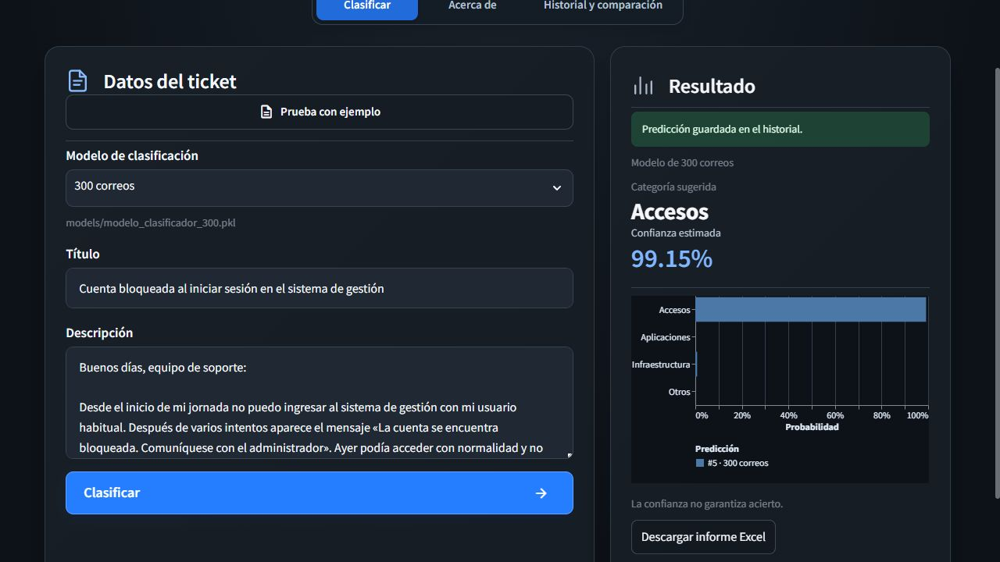
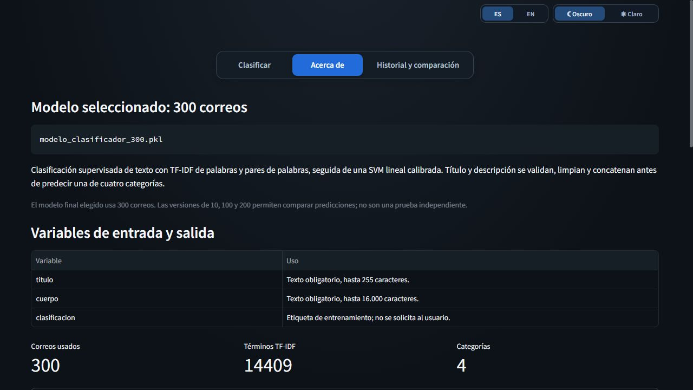
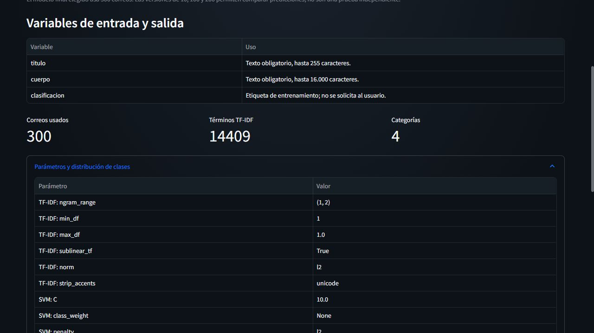
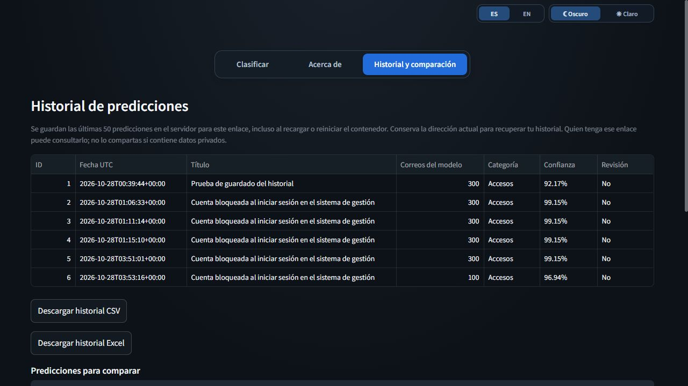
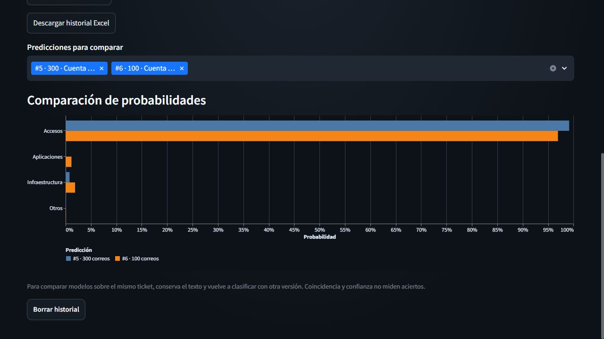
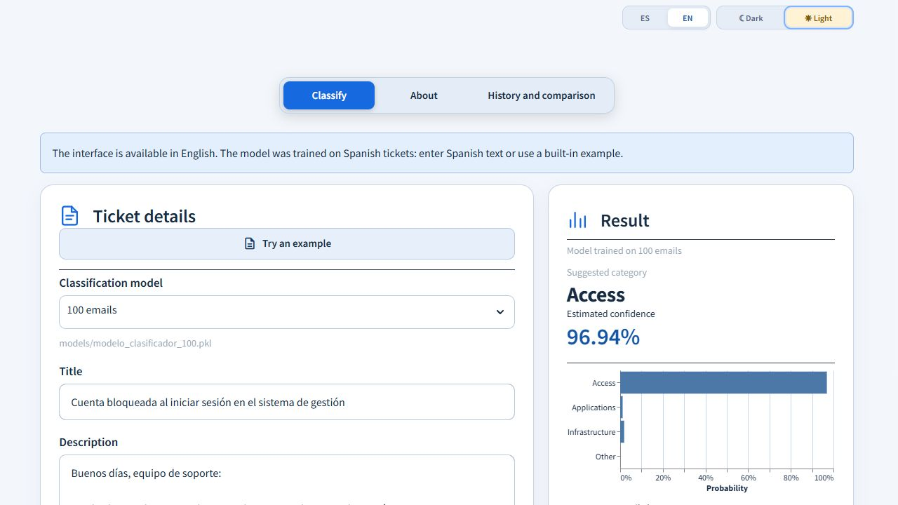
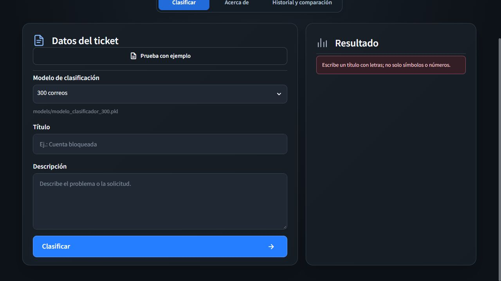

# Mquito Ticket

## 1. Encabezado y badges

<p>
   &nbsp;
   &nbsp;
   &nbsp;
   &nbsp;
   &nbsp;
   &nbsp;
  
</p>

<p>
   &nbsp;
   &nbsp;
   &nbsp;
   &nbsp;
   &nbsp;
  
</p>


[](python/LICENSE)

[](http://185.208.207.203:8501)

Automatiza la gestión de correos de soporte TI con n8n: un clasificador Python determina la categoría y un agente de OpenAI analiza la solicitud, genera el resumen y propone prioridad, tipo y proyecto del ticket en Redmine. Antes del análisis, un nodo Python filtra firmas y datos sensibles del texto; el flujo valida la categoría y el responsable antes de registrar el ticket. Incluye un portal Streamlit para probar modelos, comparar predicciones, consultar el historial y exportar resultados, con despliegue en contenedores Docker.

## 2. Tabla de contenidos

1. [Encabezado y badges](#1-encabezado-y-badges)
2. [Tabla de contenidos](#2-tabla-de-contenidos)
3. [Descripción del problema](#3-descripción-del-problema)
4. [Dataset](#4-dataset)
5. [Metodología](#5-metodología)
6. [Resultados](#6-resultados)
7. [Instalación y uso](#7-instalación-y-uso)
8. [Interfaz de usuario](#8-interfaz-de-usuario)
9. [Estructura del proyecto](#9-estructura-del-proyecto)
10. [Consideraciones éticas](#10-consideraciones-éticas)
11. [Autores y contribuciones](#11-autores-y-contribuciones)
12. [Licencia](#12-licencia)
13. [Agradecimientos y referencias](#13-agradecimientos-y-referencias)
14. [Videos](#14-videos)

## 3. Descripción del problema

- **¿Qué problema resuelve?** Centraliza la atención de solicitudes de soporte TI recibidas por correo. Automatiza su clasificación, la preparación del ticket y su asignación en Redmine para reducir tareas repetitivas y evitar derivaciones inconsistentes.
- **¿Por qué es importante?** Una solicitud mal clasificada o derivada puede retrasar su atención. El proyecto aplica criterios uniformes de categorización y asignación, conserva la trazabilidad en Redmine y facilita la supervisión del equipo; busca reducir el tiempo de gestión, aunque ese ahorro todavía no se ha medido.
- **¿Quiénes son los usuarios objetivo?** Operadores de mesa de ayuda que registran y derivan solicitudes, técnicos de soporte TI que atienden los tickets y responsables que supervisan su asignación y seguimiento. El portal Streamlit permite probar los modelos y revisar sus predicciones antes de valorar su uso operativo.

## 4. Dataset

### Descripción de los datos utilizados

Correos simulados en español que representan solicitudes de soporte TI de cuatro categorías: **accesos, aplicaciones, infraestructura y otros**. Se usan para entrenar los modelos y probar la clasificación de nuevas solicitudes.

### Fuente y licencia de los datos

- **Fuente:** conjuntos de **10, 100, 200 y 300 correos simulados**, creados para el proyecto. No proceden de correos reales de producción.
- **Licencia de los datos:** no se ha declarado una licencia específica. La licencia MIT del código no concede automáticamente derechos sobre el dataset.

### Características principales (tamaño y variables)

Hay cuatro muestras anidadas de **10, 100, 200 y 300 correos**, cada una con su modelo. El conjunto de 300 contiene **70 de accesos, 90 de aplicaciones, 70 de infraestructura y 70 de otros**.

| Variable | Contenido | Uso |
|---|---|---|
| `titulo` | Asunto del correo | Entrada del modelo |
| `cuerpo` | Texto de la solicitud | Entrada del modelo |
| `clasificacion` | Una de las cuatro categorías | Etiqueta para entrenar y evaluar |

Los **25 correos de prueba** contienen título y cuerpo y se utilizan para comprobar el funcionamiento del clasificador y revisar manualmente sus predicciones. Su contenido permite reconocer el tipo de solicitud; no necesitan etiquetas para ejecutar estas pruebas funcionales. Para calcular accuracy o F1 sí sería necesario registrar y validar una categoría esperada para cada correo.

### Link a los datos si son públicos

- [Corpus de 300 correos](python/data/raw/correos.json).
- [Muestras de entrenamiento de 10, 100, 200 y 300 correos](python/data/train/).
- [25 correos de prueba](python/data/test/correos_test_25.json).

Más detalle en el [análisis de datos](python/docs/analisis_datos.md).

## 5. Metodología

### Tipo de modelo utilizado y justificación

Clasificador supervisado multiclase con **TF-IDF y SVM lineal calibrada**. Se eligió por su F1 macro frente a regresión logística y porque permite obtener probabilidades estimadas para las cuatro categorías.

### Preprocesamiento aplicado

Validación de campos y etiquetas, limpieza de HTML, normalización Unicode y minúsculas, sustitución de enlaces, correos, IP y números largos, unión de título y cuerpo y control de duplicados. TF-IDF utiliza palabras y pares de palabras (`ngram_range: [1, 2]`), frecuencia sublineal, normalización de acentos, `min_df: 1` y `max_df: 1.0`, según [config.yaml](python/config.yaml).

### Técnicas de optimización empleadas

Búsqueda con `GridSearchCV` de `C: [0.1, 1.0, 10.0]`, `class_weight: [null, balanced]` y `min_df: [1, 2]`, usando F1 macro, **4 particiones estratificadas** y **semilla 42**. La configuración de entrenamiento en [config.yaml](python/config.yaml) utiliza **C = 10.0**, sin ponderación de clases y calibración sigmoide con **2 particiones**. El entrenamiento por tamaño aplica estos parámetros sin repetir la búsqueda.

### Métricas de evaluación seleccionadas

**F1 macro** como métrica principal para dar el mismo peso a cada categoría; **accuracy, precisión, recall y F1 por clase**, junto con la **matriz de confusión**, para analizar aciertos y errores. Se registran **log loss y Brier multiclase** para evaluar las probabilidades.

## 6. Resultados

### Métricas finales del modelo

El modelo de **300 correos utilizado por la API de producción y n8n** obtiene **accuracy de 95,33 % y F1 macro de 0,9543**, mediante validación cruzada exploratoria de **4 particiones**. RMSE no aplica a esta clasificación por categorías.

Se verificaron en el contenedor el modelo (`SHA-256: 2905ce41…1bf6a87`) y sus parámetros: **C = 10.0**, sin ponderación de clases, calibración de **2 particiones**, TF-IDF de **palabras y pares de palabras**, `min_df: 1` y **semilla 42**. Coinciden con [config.yaml](python/config.yaml) y con el artefacto identificado en [version_evaluation.json](python/results/metrics/version_evaluation.json). YAML define los parámetros; el reporte contiene las métricas.

### Comparación con baseline y tabla de rendimiento

El baseline predice siempre la categoría mayoritaria.

| Correos de entrenamiento | Accuracy CV | F1 macro CV | F1 macro baseline CV |
|---:|---:|---:|---:|
| 10 | No viable | No viable | No viable |
| 100 | 0.9200 | 0.9201 | 0.0968 |
| 200 | 0.9450 | 0.9442 | 0.0968 |
| **300 — API de producción** | **0.9533** | **0.9543** | **0.1154** |

Las cifras corresponden a los archivos identificados en el reporte; no se actualizan automáticamente al reentrenar. El modelo de 300 correos reentrenado en la carpeta del portal tiene otro hash y necesita su propia evaluación antes de atribuirle estas métricas. La validación cruzada es exploratoria y no sustituye una prueba externa independiente. Los 25 correos se usan para pruebas funcionales y revisión manual.

## 7. Instalación y uso

### Requisitos del sistema

- Git y Python **3.10**, la versión utilizada por las imágenes Docker; entorno virtual y dependencias de `requirements.txt`.
- CPU; **no requiere GPU**. No se han establecido mínimos medidos de RAM y disco.
- Docker con Compose para ejecutar los contenedores. Para el flujo completo se necesitan además Redmine, n8n y credenciales IMAP, SMTP y OpenAI.

### Versiones utilizadas en producción

Versiones verificadas en los contenedores y en el servidor:

| Componente | Versión |
|---|---|
| Python — portal y API | 3.10.22 |
| Streamlit | 1.41.1 |
| scikit-learn | 1.5.2 |
| pandas / NumPy | 2.2.3 / 1.26.4 |
| Altair | 5.5.0 |
| FastAPI / Uvicorn | 0.115.6 / 0.34.0 |
| n8n | 2.40.5 |
| Redmine | 6.1.4 |
| PostgreSQL | 16.15 |
| Docker Engine / Compose | 29.8.1 / 5.5.1 |
| Portainer CE | 2.45.1 |

El agente usa el identificador de modelo **`gpt-4.1-mini`** de OpenAI. Es una configuración del proveedor externo, no una dependencia Python instalada. Los paquetes del clasificador se fijan en `requirements.txt` y en los archivos de dependencias de `deploy/`.

### Instalación paso a paso en Linux

```bash
git clone https://github.com/n8nmquito/ProyectoIA.git
cd ProyectoIA/python
python3 -m venv .venv
source .venv/bin/activate
python -m pip install -r requirements.txt

# Crear los cuatro modelos desde cero; los .pkl no se incluyen en Git
python -m src.train_versions

# Iniciar la interfaz
python -m streamlit run app/app.py
```

Abrir [la interfaz local](http://localhost:8501). Las instrucciones de Windows y la solución de problemas están en el [manual](python/docs/manual_usuario.md).

### Comandos y ejemplos de uso

Desde la carpeta `python`, con el entorno virtual activado, entrenar únicamente el tamaño elegido:

```bash
python -m src.train_versions --size 10
python -m src.train_versions --size 100
python -m src.train_versions --size 200
python -m src.train_versions --size 300
```

Cada comando reemplaza solo el modelo y el dataset de ese tamaño; no necesita un modelo previo. La fuente y los parámetros se definen en [config.yaml](python/config.yaml).

Probar un modelo con los 25 correos incluidos y actualizar la comparación por tamaños:

```bash
python evaluar_nuevos.py --model 300
python -m src.evaluate_versions
```

El primer comando muestra título, categoría, confianza y revisión; guarda el CSV y el resumen en `results/new_test_25/modelo_clasificador_300/`. Cambiar `300` por `10`, `100` o `200` para probar otra versión.

### Ejecutar con Docker

Después de generar los modelos, desde la carpeta `python`:

```bash
docker compose up -d --build --wait
```

El portal queda en el puerto 8501 y conserva el historial en un volumen SQLite. Para desplegar la automatización completa, seguir la [guía de integración](workflows/GUIA_CONFIGURACION.md) y el [despliegue de la API](python/deploy/README.md); configurar las credenciales antes de activar el flujo, que puede crear tickets y enviar avisos.

## 8. Interfaz de usuario

### URL de los servicios desplegados

Servidor de producción: **185.208.207.203**.

| Servicio | URL | Uso |
|---|---|---|
| Portal de clasificación | [http://185.208.207.203:8501](http://185.208.207.203:8501) | Probar modelos, consultar resultados e historial |
| n8n | [http://185.208.207.203:5678](http://185.208.207.203:5678) | Administrar los flujos y consultar ejecuciones |
| Redmine | [http://185.208.207.203:3000](http://185.208.207.203:3000) | Consultar y gestionar tickets |
| Portainer | [https://185.208.207.203:9443](https://185.208.207.203:9443) | Administración de contenedores con cuenta autorizada |

**Servicios entre contenedores:** n8n limpia el texto con un nodo de código local; FastAPI recibe `POST http://clasificador-python:8000/predict` y expone `GET /health`, sin publicar el puerto 8000 del host. PostgreSQL se utiliza mediante `postgres:5432` y no tiene interfaz web propia.

### Descripción y acceso

[**Aplicación desplegada**](http://185.208.207.203:8501) con tres vistas: **Clasificar**, **Acerca de** e **Historial y comparación**. Ofrece validación de entradas, indicador de procesamiento, mensajes de error, categoría, confianza, gráfico interactivo, ejemplos precargados, idioma español/inglés, tema claro/oscuro y descarga CSV/Excel. El selector lee los modelos existentes en `models/` y muestra su archivo.

### Cómo usarla

1. Seleccionar uno de los modelos disponibles.
2. Escribir título y descripción, o pulsar **Prueba con ejemplo**. Ejemplo: «Cuenta bloqueada» / «No puedo iniciar sesión; solicito revisar el bloqueo de mi usuario».
3. Pulsar **Clasificar** y revisar categoría, confianza y probabilidades.
4. Descargar el resultado o comparar predicciones en **Historial y comparación**; consultar métricas y limitaciones en **Acerca de**.
5. Recargar la página después de añadir o quitar modelos. El formulario prueba el clasificador; la creación de tickets pertenece al flujo de correo n8n.

### Capturas de pantalla

**Formulario y selección del modelo:**


**Predicción, probabilidades y exportación:**


<details>
<summary><strong>Ver 7 capturas adicionales del clasificador</strong></summary>

Capturas del portal desplegado con correos ficticios de ejemplo.

**1. Predicción y probabilidades**

Clasificación de un correo de ejemplo con categoría, confianza y gráfico.



**2. Información del modelo**

Archivo seleccionado, explicación del modelo y variables de entrada y salida.



**3. Parámetros del modelo**

Tamaño del corpus, vocabulario TF-IDF y parámetros del modelo cargado.



**4. Historial de predicciones**

Predicciones de ejemplo guardadas y opciones de descarga del historial.



**5. Comparación entre modelos**

El mismo correo clasificado con modelos de 100 y 300 correos; se comparan probabilidades, no aciertos.



**6. Idioma inglés y tema claro**

Controles de idioma y apariencia con el resultado de un ejemplo en español.



**7. Validación de entradas**

Mensaje de error al intentar clasificar sin completar el título.



</details>

## 9. Estructura del proyecto

| Carpeta | Contenido principal |
|---|---|
| `python/src/` | Procesamiento, modelos, entrenamiento, evaluación y API |
| `python/app/` | Interfaz Streamlit, estilos, exportación e historial |
| `python/data/` | Corpus, muestras de entrenamiento y correos de prueba |
| `python/models/` | Modelos `.pkl` generados, excluidos de Git |
| `python/results/` | Métricas, predicciones e informes |
| `python/tests/` | Pruebas automatizadas |
| `python/notebooks/` | Análisis y experimentos reproducibles |
| `python/docs/` | Planificación, datos, arquitectura, optimización, ética y manual |
| `python/deploy/` | Dockerfiles, dependencias y operación del despliegue |
| `python/workshop/` | Material de referencia del taller |
| `workflows/` | Flujos n8n, validaciones JavaScript y pruebas |
| `n8n/`, `redmine/`, `postgres/` | Configuración de n8n, Redmine e inicialización de bases, respectivamente |

## 10. Consideraciones éticas

- **Privacidad:** usamos correos simulados. El nodo **Limpiar firma y datos** elimina firmas habituales y redacta datos sensibles del título y cuerpo antes de enviarlos al clasificador Python y a OpenAI. La limpieza es parcial y no anonimiza los adjuntos.
- **Sesgos y límites:** los datos están en español y cubren escenarios limitados. El modelo puede fallar con otros idiomas o casos diferentes; no se evaluó equidad entre grupos demográficos.
- **Transparencia:** mostramos categoría, confianza y avisos de revisión. Una confianza alta no garantiza un acierto.
- **Responsabilidad:** el equipo debe supervisar los resultados y corregir errores que puedan retrasar o desviar solicitudes.
- **Uso adecuado:** no usar la clasificación como única decisión para cerrar tickets, conceder accesos o resolver incidentes críticos.

Ver las [consideraciones éticas completas](python/docs/consideraciones_eticas.md).

## 11. Autores y contribuciones

| Integrante | Rol | Contribución |
|---|---|---|
| **María Quito Castillo** | Líder del Proyecto y Desarrollador TI (desarrolladora full stack) | Liderazgo del proyecto y desarrollo full stack |
| &nbsp; | Data Scientist | &nbsp; |
| &nbsp; | Experto Soporte TI | &nbsp; |
| &nbsp; | Equipo IA | &nbsp; |
| &nbsp; | Soporte TI | &nbsp; |
| &nbsp; | TI | &nbsp; |
| &nbsp; | Mesa de Ayuda | &nbsp; |

<br>

## 12. Licencia

<br><br>

## 13. Agradecimientos y referencias

<br><br>

## 14. Videos

### Video pitch de 5 minutos

Enlace:

<br><br>

### Video de respuestas a las preguntas

Enlace:

<br><br>
