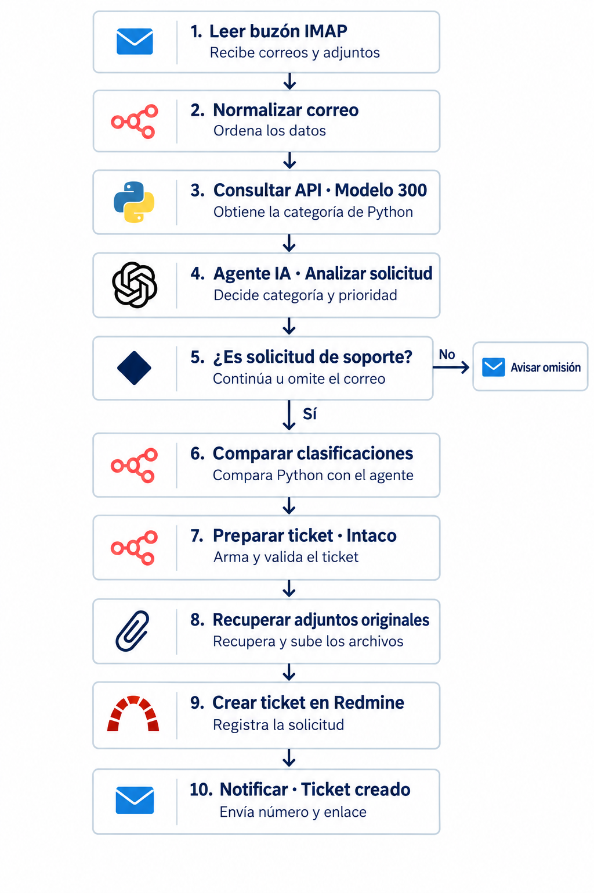
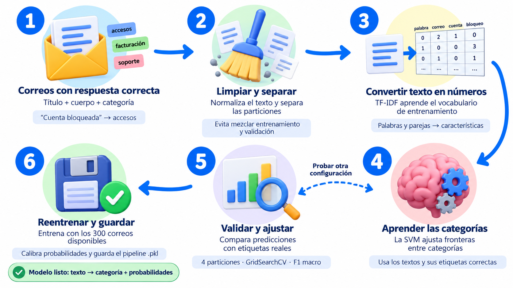
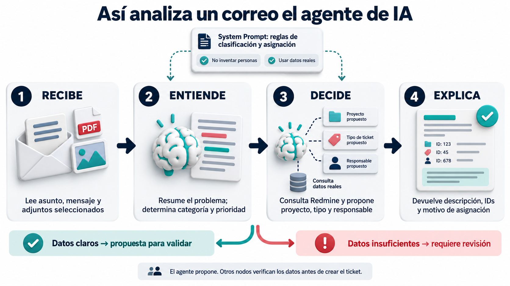

# Mquito Ticket

Automatización de soporte: **correo → n8n + IA → Redmine**.

Sistema desplegado con clasificador Python de 300 correos, agente OpenAI y
validación de tickets en Redmine. La consola y Streamlit permiten probar también
las versiones de 10, 100 y 200 correos. Ver [proyecto Python](python/README.md).

## Qué incluye

| Contenedor | Función | Puerto |
|---|---|---|
| **n8n** | Orquestación de automatizaciones | `5678` |
| **Redmine** | Tickets, con API REST habilitada | `3000` |
| **PostgreSQL** | Bases `n8n` y `redmine`, con usuarios separados | `5432` |

Los tres servicios de la base comparten red Docker y volúmenes. Además existe
un servicio separado clasificador-python en la misma red, sin puerto publicado,
con la API del modelo de 300. Ver [despliegue de la API](python/deploy/DESPLIEGUE_REALIZADO.md).
Desde n8n, Redmine se conecta mediante `http://redmine:3000`.

## Flujo de automatización

n8n recibe el correo y conserva sus adjuntos. Consulta el clasificador Python,
envía la solicitud al agente OpenAI y compara las categorías propuestas.
Para las solicitudes de soporte, prepara y valida el ticket antes de crearlo
en Redmine y enviar la notificación correspondiente.



El detalle de los nodos y la exportación importable están en la
[guía del flujo](workflows/README.md).

## Clasificador Python

El clasificador transforma título y cuerpo mediante TF-IDF y utiliza una SVM
calibrada para proponer accesos, aplicaciones, infraestructura u otros.
Se conservan versiones de 10, 100, 200 y 300 correos; la de 300 es la elegida
para el despliegue. Su predicción sirve para comparar con la decisión del agente.



La metodología, las métricas y sus límites se explican en el
[proyecto Python](python/README.md). El corpus y los modelos se conservan
fuera de Git mientras no se autorice su redistribución.

## Agente de IA y validaciones

El agente analiza el asunto, el mensaje y los adjuntos seleccionados.
Propone categoría, prioridad, proyecto, tipo de ticket y responsable a partir
de las consultas a Redmine. Los nodos posteriores verifican proyecto, tipo,
categoría, membresía y rol antes de crear el ticket.



Las herramientas del agente consultan proyectos, miembros, tipos de ticket,
roles y la cuenta de integración mediante peticiones GET.

<details>
<summary>Consultas del agente a la API de Redmine</summary>


</details>

La configuración de los nodos y las credenciales se describe en la
[guía de configuración](workflows/GUIA_CONFIGURACION.md).

## Inicio rápido

Requisitos: servidor Linux, Python 3, Docker Engine y Docker Compose v2.

```bash
git clone https://github.com/n8nmquito/ProyectoIA.git
cd ProyectoIA
cp .env.example .env
```

Completar `.env`: dirección del servidor, puertos, usuarios y contraseñas.
Si ya tenés el `.env` preparado para esta
instalación, copialo de forma privada en lugar de reemplazarlo con el ejemplo.

```bash
chmod 600 .env
python3 configurar.py
docker compose config --quiet
docker compose build --pull
docker compose up -d
docker compose ps
```

| Aplicación | Acceso | Usuario |
|---|---|---|
| n8n | `http://IP_SERVIDOR:5678` | Correo de `ADMIN_EMAIL` |
| Redmine | `http://IP_SERVIDOR:3000` | `admin` |

Las contraseñas se configuran en `.env`. Ese archivo **no se publica en Git**.
El configurador genera el hash y las claves internas en `.secrets/`, también
excluida de Git. Usa un contenedor temporal de httpd solo para generar bcrypt;
al finalizar siguen siendo tres servicios. Si la instalación ya tiene datos,
conservar y copiar también `.secrets/` antes de ejecutar el configurador.
HTTP está pensado para red privada o VPN; para acceso público, configurar HTTPS.

## Próximos pasos

- Completar la revisión humana de etiquetas de los mismos 25 casos conocidos.
- Mantener sin publicar el corpus inicial mientras no haya autorización.
- Completar la entrega académica y revisar privacidad antes de utilizar datos reales.
- Incorporar control de duplicados y seguimiento de respuestas; ajustar las reglas
  de asignación por proyecto y rol ya implementadas.

**Validación:** flujo probado en el servidor con datos ficticios, Gemini y Redmine,
incluyendo adjuntos y respaldo ante un PDF ilegible. Ver el detalle en la guía del flujo.

## Interfaz web del clasificador

Abrir http://185.208.207.203/. La página clasifica título y descripción con el
modelo Python de 300 correos y muestra sus probabilidades. No utiliza n8n ni
OpenAI y no crea tickets. El flujo de correo descrito arriba continúa separado.
Código y operación: [python/web](python/web/README.md).
