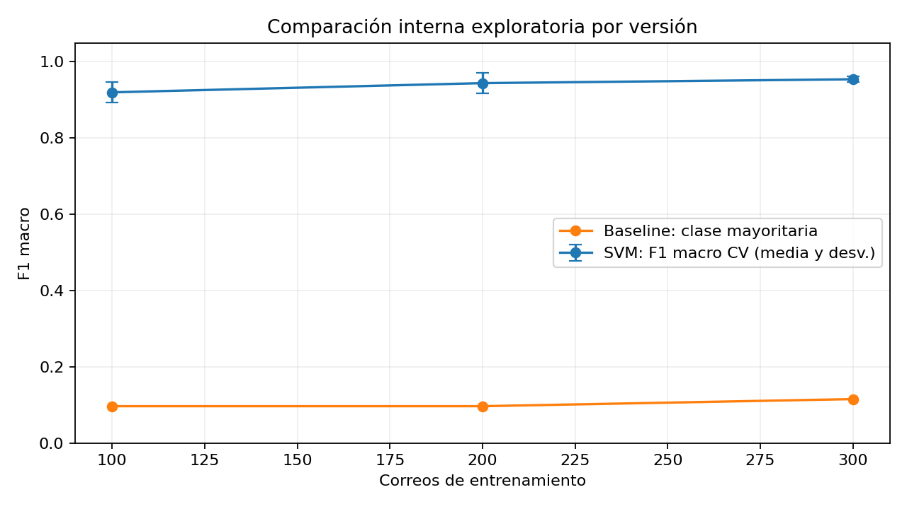
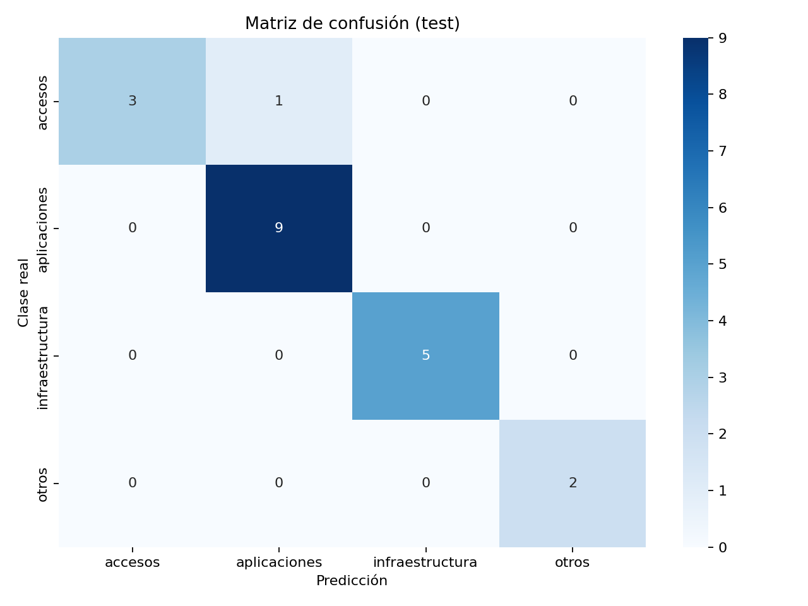

# Sistema de clasificación de tickets de soporte TI


Este proyecto recibe el título y el cuerpo de un correo y sugiere a qué equipo de soporte corresponde atenderlo. Incluye cuatro modelos entrenados con 10, 100, 200 y 300 correos, una prueba por consola, Streamlit y una API Python integrada con n8n, OpenAI y Redmine. Las categorías son accesos, aplicaciones, infraestructura y otros; la versión de 300 es el modelo final elegido.

## Tabla de contenidos

1. [Encabezado y badges](#sistema-de-clasificación-de-tickets-de-soporte-ti)
2. [Tabla de contenidos](#tabla-de-contenidos)
3. [Descripción del problema](#descripción-del-problema)
4. [Dataset](#dataset)
5. [Metodología](#metodología)
6. [Resultados](#resultados)
7. [Instalación y uso](#instalación-y-uso)
8. [Interfaz de usuario](#interfaz-de-usuario)
9. [Estructura del proyecto](#estructura-del-proyecto)
10. [Consideraciones éticas](#consideraciones-éticas)
11. [Autores y contribuciones](#autores-y-contribuciones)
12. [Licencia](#licencia)
13. [Agradecimientos y referencias](#agradecimientos-y-referencias)
14. [Videos](#videos)

## Descripción del problema

La mesa de ayuda recibe consultas mezcladas y debe decidir quién las atiende.
El sistema propone una categoría para apoyar ese primer paso y reducir tareas
repetitivas. Está pensado para personal de soporte y para la demostración del
proyecto universitario. En el flujo desplegado, el agente propone la categoría final y el ticket se crea
automáticamente después de las validaciones. El equipo de soporte debe supervisarlo;
no existe una aprobación humana obligatoria antes de cada alta.

## Dataset

`data/raw/correos.json` es la fuente principal: **300 correos simulados**,
con título, cuerpo y clasificación. La distribución es 70 accesos, 90 aplicaciones,
70 infraestructura y 70 otros. Los 100 iniciales fueron aportados por el usuario;
se añadieron 200 ejemplos ficticios para ampliar el corpus. No se presentan
como tickets reales ni se enviaron mensajes para producirlos.

| Modelo guardado en models/ | Dataset exacto en data/train/ | Cantidad |
|---|---|---:|
| modelo_clasificador_10.pkl | correos_10.json | 10 |
| modelo_clasificador_100.pkl | correos_100.json | 100 |
| modelo_clasificador_200.pkl | correos_200.json | 200 |
| modelo_clasificador_300.pkl | correos_300.json | 300 |

Los conjuntos son anidados: los correos de la versión pequeña también aparecen
en las versiones mayores. Todas usan los mismos ajustes para comparar el efecto
de la cantidad de ejemplos. Cada versión se ajusta desde cero con el dataset de su tamaño. La versión de 10 es demostrativa.

Los **25 correos de `data/test/correos_test_25.json`** solo tienen título y cuerpo.
No forman parte de ningún entrenamiento. Su prueba muestra predicciones y
confianza; al no tener respuestas esperadas, no calcula accuracy ni F1.
Esos casos ya fueron analizados durante el desarrollo y sirven como regresión,
no como una evaluación ciega nueva de las mejoras posteriores.

El [corpus maestro](data/raw/correos.json) y los [datasets de entrenamiento](data/train/)
se incluyen en Git por indicación de la responsable del proyecto. Los modelos
`.pkl`, las particiones procesadas y la hoja de revisión siguen excluidos.
La licencia MIT del código no se extiende automáticamente a los datos.
Ver [análisis de datos](docs/analisis_datos.md).

## Metodología

Se validan los campos, se limpian los textos y se combina título con cuerpo.
TF-IDF representa palabras individuales y pares de palabras. Se comparan una
referencia mayoritaria, regresión logística y SVM lineal calibrada.
La elección usa F1 macro y validación cruzada estratificada de cuatro grupos.

Para seleccionar ajustes se usan **280 correos**; se conservan **20 originales**
como diagnóstico de evaluación. Después se ajusta el modelo final con los 300.
Las versiones 10/100/200/300 se entrenan con la configuración elegida. La SVM
usa calibración sigmoide de dos grupos, compatible con el conjunto de 10.

### Integración desplegada y evidencia actual

El flujo principal es [Mquito | Correo → IA → Ticket Redmine](http://185.208.207.203:5678/workflow/opxBwpGpRDrbQeHn).
Recibe el correo, consulta `http://clasificador-python:8000/predict` en la red
Docker, ejecuta el modelo de 300, compara con OpenAI y crea el ticket en Redmine.
El agente externo conserva la decisión de categoría; la predicción Python es una
comparación operativa. Coincidir no demuestra exactitud.

El agente devuelve el nombre `tipo_ticket` (Errores/Soporte); el código obtiene
su ID del catálogo habilitado del proyecto. No se acepta un ID supuesto por el
agente. También se verifican proyecto, categoría, membresía y rol asignable.
Las copias importables están en `../workflows/` y no incluyen credenciales.

La prueba inicial de 24 correos produjo 20 tickets y cuatro bloqueos por tipo.
Después de corregirlos se repitieron solo los cuatro casos afectados: 4/4 crearon
su ticket. No es una nueva medición de accuracy ni una repetición completa de los
24 con la versión corregida. Evidencia: `results/n8n_produccion/`.

Pruebas actuales: **51 tests Python aprobados**, Ruff sin errores y las tres
suites JavaScript de normalización, asignación y adjuntos aprobadas. Se verifican también la integridad de los cuatro artefactos, sus probabilidades
en 25 entradas y la limitación de CV en la versión de 10.

Para reproducir el análisis S5 sin reentrenar:

```cmd
python -m src.optimization_analysis
```

Para revisar los mismos 25 correos y medir regresión conocida:

```cmd
python -m src.evaluate_reviewed --prepare
python -m src.evaluate_reviewed --reviewer "Nombre de quien revisó"
```

La hoja `data/evaluation/correos_para_revision.json` ya está creada con etiquetas
vacías; `--prepare` no la sobrescribe. Una persona debe completar las cuatro
categorías antes de evaluar. El JSON de `data/test/` conserva solo título/cuerpo.
Estos casos conocidos no demuestran generalización ni ausencia de sobreajuste.
Ver [protocolo de evaluación](docs/evaluacion_pruebas.md).

La API requiere clave y no publica su puerto. OpenAI puede recibir texto,
imágenes/PDF seleccionados y respuestas de herramientas de Redmine. No hay un
anonimizador general antes del agente ni una auditoría de cumplimiento normativo.
Ver [privacidad y límites](docs/consideraciones_eticas.md) y
[operación del servidor](deploy/DESPLIEGUE_REALIZADO.md).

## Resultados

### Modelo final elegido

Se prepararon cuatro versiones para las pruebas: 10, 100, 200 y 300 correos.
Las de 10, 100 y 200 se conservan para comparar sus predicciones con las de
la versión de 300 sobre los mismos correos de prueba.

**El modelo final elegido para usar en el proyecto es
`modelo_clasificador_300.pkl`.** Es el predeterminado en config.yaml y utiliza
los 300 correos del dataset completo. Los otros tres quedan como versiones
de comparación y evidencia del experimento.

Esta elección del proyecto no se presenta como una superioridad de accuracy
demostrada frente a los otros tamaños: la prueba de 25 correos muestra
predicciones y confianza, sin etiquetas para calcular aciertos por versión.

### Evaluación actual por versión (27 de octubre de 2026)

| Correos | F1 en entrenamiento | F1 macro CV | Accuracy CV | F1 baseline CV | Revisar de 25 |
|---:|---:|---:|---:|---:|---:|
| 10 | 0.5000 | No viable | No viable | No viable | 22 |
| 100 | 1.0000 | 0.9201 | 0.9200 | 0.0968 | 2 |
| 200 | 1.0000 | 0.9442 | 0.9450 | 0.0968 | 1 |
| 300 | 1.0000 | 0.9543 | 0.9533 | 0.1154 | 2 |

El F1 de entrenamiento usa los ejemplos conocidos del propio modelo; no mide
su generalización. La CV vuelve a ajustar clones del pipeline en cuatro folds
estratificados (semilla 42) y aprende TF-IDF dentro de cada fold. Los ajustes
se seleccionaron antes con datos relacionados: es CV **exploratoria**, no un
test externo ni una validación anidada de toda la búsqueda. Los datasets son
anidados y no aíslan causalmente el efecto del tamaño.

En 10 correos hay clases con dos registros: al reservar ejemplos para validar
quedan menos de dos para la calibración interna. No se fuerza una cifra de CV
ni se cambia el algoritmo para hacerla aparecer. Sus métricas de entrenamiento
son accuracy 0.40 y F1 macro 0.50; es una versión de demostración limitada.

Cada versión procesó los mismos 25 correos sin etiquetas. Los casos de baja
confianza no equivalen a errores comprobados. Esa prueba no produce F1 ni
accuracy y no demuestra ausencia de sobreajuste.
Las huellas SHA-256 confirman que los cuatro modelos y sus datasets no cambiaron.

```cmd
python -m src.evaluate_versions
```

Evidencia: `results/metrics/version_evaluation.json` y `.csv`, junto con los
cuatro directorios `results/new_test_25/modelo_clasificador_<tamaño>/`.



### Diagnóstico histórico de selección

Comparación por validación cruzada sobre los 280 de la etapa de selección:

| Modelo | F1 macro CV | Desviación CV | F1 train CV |
|---|---:|---:|---:|
| baseline | 0.1122 | 0.0019 | 0.1122 |
| logistic | 0.9373 | 0.0160 | 1.0000 |
| svm | 0.9617 | 0.0185 | 1.0000 |
| logistic_optimized | 0.9649 | 0.0211 | 1.0000 |
| svm_optimized | 0.9650 | 0.0161 | 1.0000 |

La SVM ajustada alcanza **0.9650 de F1 macro CV**. La diferencia
con la regresión logística ajustada es muy pequeña; no demuestra superioridad
estadística. La búsqueda mejora la SVM en 0.003275 de F1 absoluto.

En los 20 originales, el modelo diagnóstico de 280 obtiene **95.0%
de accuracy** y **0.9511 de F1 macro**. Son 19 aciertos y un error.
El baseline mayoritario obtiene 45.0% de accuracy y
0.1552 de F1 macro en esos mismos 20.

**Estas métricas no son una prueba independiente de las cuatro versiones entrenadas.**
El modelo de 300 ya aprendió de esos 20 y los subconjuntos menores pueden
contener algunos. No hay una tabla de accuracy de los cuatro tamaños sobre los
25 correos, porque esa prueba no tiene etiquetas para medir aciertos.



Ver [evaluación y pruebas](docs/evaluacion_pruebas.md) y
[optimización](docs/optimizacion.md) para interpretar las cifras y sus límites.

## Instalación y uso

Requisitos: Python 3.10 o 3.11, CPU y espacio para dependencias. No se necesita
GPU ni servicios externos para la consola o Streamlit. La automatización desplegada
sí utiliza buzón, API Python, OpenAI y Redmine. En Windows:

```cmd
cd /d F:\Maria\python
py -3.10 -m venv .venv
.venv\Scripts\python.exe -m pip install -r requirements.txt
```

Si ya tienes el entorno configurado, usa su `python`. Para elegir un modelo:

```cmd
python evaluar_nuevos.py --model 10
python evaluar_nuevos.py --model 100
python evaluar_nuevos.py --model 200
python evaluar_nuevos.py --model 300
```

Sin `--model` se usa el de 300. Cada versión guarda sus predicciones en una
carpeta propia dentro de `results/new_test_25/`. La consola muestra el título y
el cuerpo de los correos que requieren revisión. `--data` permite otro JSON
sin etiquetas; `--output` permite indicar dónde guardar los resultados.

Para regenerar los entrenamientos y los datasets:

```cmd
python -m src.train
python -m src.train_versions
python -m src.export_datasets
python -m src.evaluate
python -m src.evaluate_versions
python -m pytest -q
```

`src.train` selecciona ajustes y vuelve a entrenar el modelo de 300. Después,
`src.train_versions` actualiza los cuatro modelos con las mismas opciones y
guarda sus datasets. `src.export_datasets` solo exporta los datos exactos de los
modelos actuales, sin reentrenarlos. `src.evaluate` reconstruye en memoria el
modelo diagnóstico de 280 y repite sus métricas, sin guardar otro `.pkl`.

Los parámetros y rutas se cambian en `config.yaml`. Reentrenar sustituye los
archivos actuales de los mismos nombres. No se debe incorporar el test conocido
para después presentar sus resultados como si siguiera siendo independiente.

También se puede iniciar la interfaz con `Iniciar_clasificador.cmd`. El [manual de usuario](docs/manual_usuario.md) detalla instalación y uso.

## Interfaz de usuario

```cmd
python -m streamlit run app/app.py --browser.gatherUsageStats false
```

La aplicación usa fondo oscuro, tarjetas gris carbón y acentos azules. El
formulario queda a la izquierda y el resultado a la derecha. Los estilos se
guardan en `app/assets/style.css` y los elementos visuales en `app/presentation.py`.
Permite escribir un ticket, cargar ejemplos, obtener categoría
y probabilidades, y consultar información del modelo.
El selector Modelo de clasificación permite elegir 10, 100, 200 o 300 correos;
300 es la opción predeterminada. Cada opción carga su archivo `.pkl`. Cambiar
el modelo borra el resultado anterior y conserva el texto para reclasificarlo.
Streamlit se ejecuta localmente. La API Python está desplegada en Docker y el
flujo principal de n8n está activo en el servidor.


Las capturas son de la aplicación ejecutada el 26 de octubre de 2026. El
[manual](docs/manual_usuario.md) explica sus controles y mensajes.

## Estructura del proyecto

| Documento | Contenido |
|---|---|
| [Planificación](docs/planificacion.md) | Objetivos, alcance, etapas, recursos y riesgos |
| [Datos](docs/analisis_datos.md) | Procedencia, estadísticas, gráficos y datasets por modelo |
| [Arquitectura](docs/arquitectura.md) | Componentes, flujo, algoritmos y versiones |
| [Optimización](docs/optimizacion.md) | Grilla, sensibilidad, interacciones y resultados |
| [Ética](docs/consideraciones_eticas.md) | Sesgos, equidad, privacidad, responsabilidades y límites |
| [Manual](docs/manual_usuario.md) | Instalación, consola, interfaz y solución de problemas |
| [Evaluación y pruebas](docs/evaluacion_pruebas.md) | Evidencias, métricas, errores y pruebas automatizadas |

`src/` contiene la lógica; `tests/` las pruebas; `notebooks/` los cinco análisis;
`models/` únicamente los cuatro `.pkl` y su explicación; `data/raw/` el JSON
maestro; `data/train/` los cuatro datasets; `data/test/` los 25 nuevos sin
etiquetas; `data/processed/` las particiones y datos limpios; `results/` las
métricas e informes; `documentacion/imagenes/` los gráficos y capturas; `app/`
la interfaz Streamlit; `deploy/` la API y las instrucciones de despliegue.

## Consideraciones éticas

La confianza es una estimación, no una garantía de acierto. El corpus es pequeño,
sintético y de un dominio limitado. No se ha demostrado generalización a
correos reales ni equidad demográfica. No usar para conceder accesos, sancionar
personas, cerrar tickets o resolver incidentes críticos automáticamente.
No ingresar contraseñas ni datos personales innecesarios. La limpieza elimina
algunos identificadores, pero no garantiza anonimización completa.

## Autores y contribuciones

| Integrante | Rol | Contribución |
|---|---|---|
| **María Quito Castillo** | Líder del Proyecto y Desarrollador TI (desarrolladora full stack) | Liderazgo del proyecto y desarrollo full stack |
| &nbsp; | Data Scientist | &nbsp; |
| &nbsp; | Experto Soporte TI | &nbsp; |
| &nbsp; | Equipo IA | &nbsp; |
| &nbsp; | Soporte TI | &nbsp; |
| &nbsp; | TI | &nbsp; |
| &nbsp; | Mesa de Ayuda | &nbsp; |

## Licencia

<br><br>

## Agradecimientos y referencias

<br><br>

## Videos

### Video pitch de 5 minutos

Enlace:

<br><br>

### Video de respuestas a las preguntas

Enlace:

<br><br>
