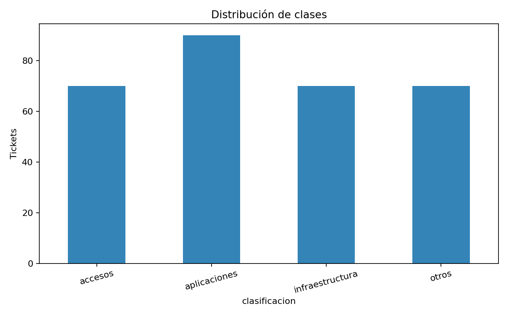
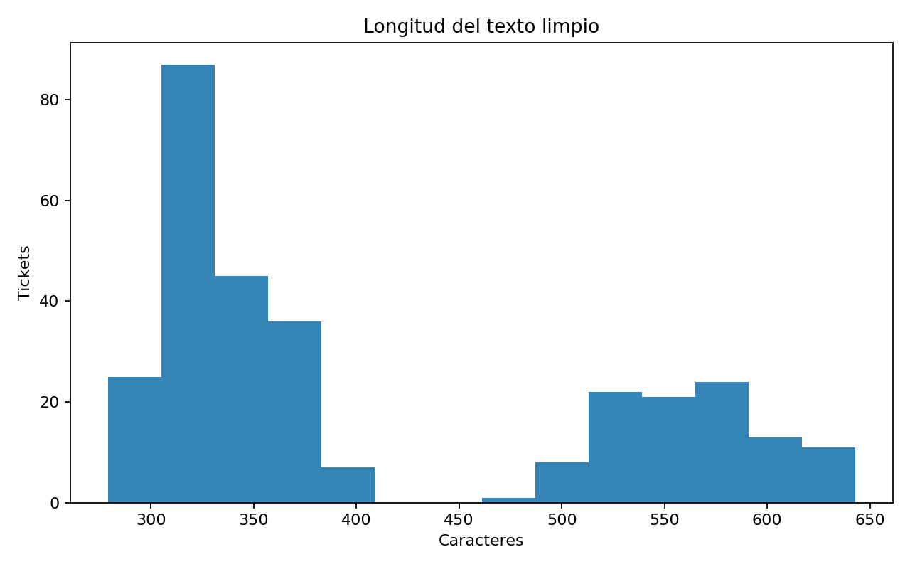
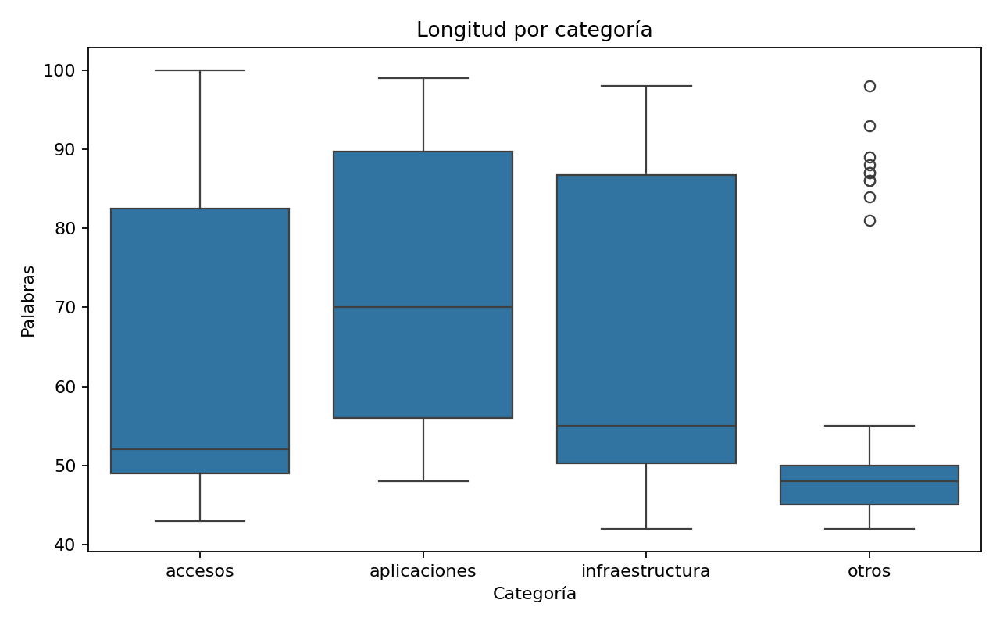
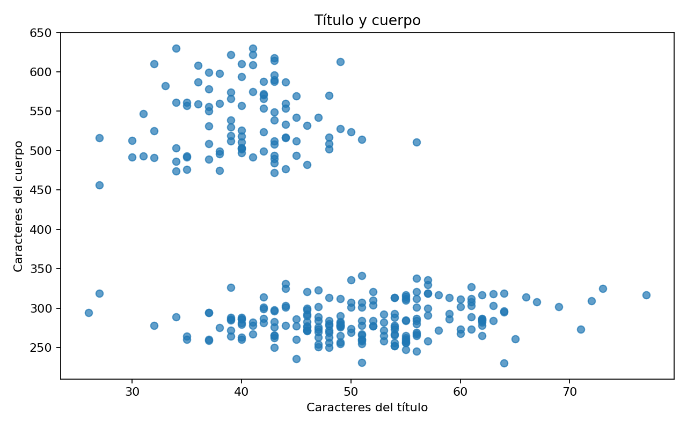
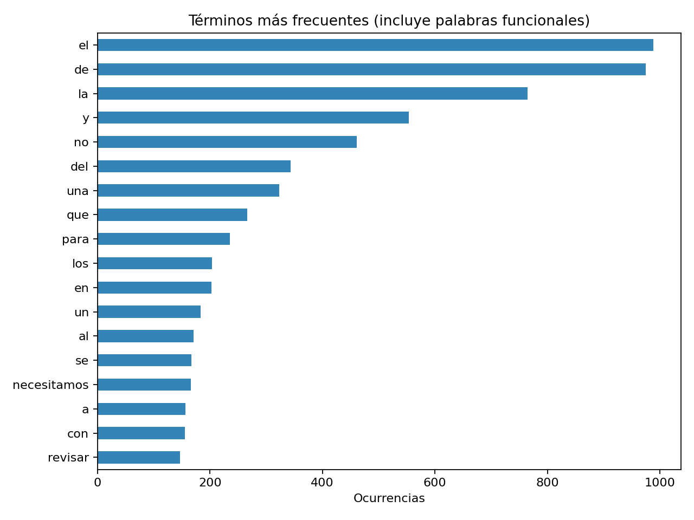
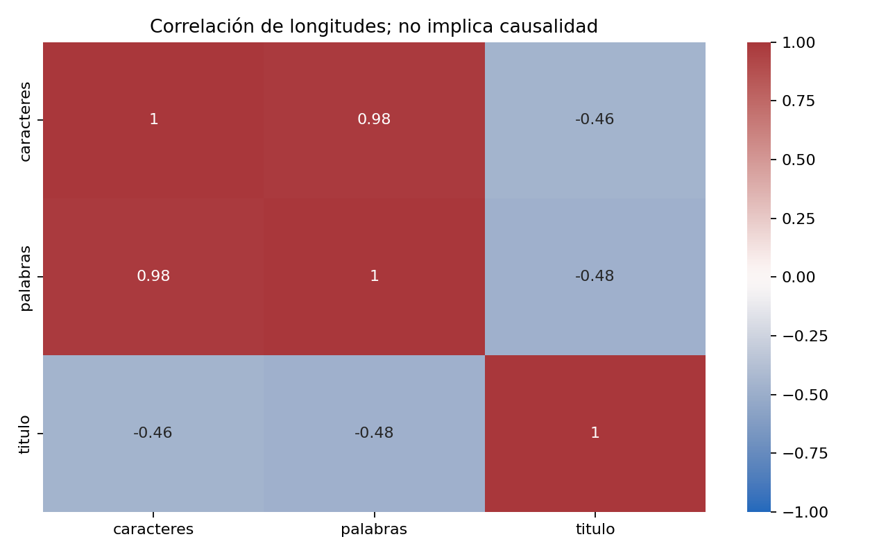

# Análisis de datos

## 1. Descripción detallada del dataset

Trabajamos con **10, 100, 200 y 300 correos simulados en español**. El [corpus maestro](../data/raw/correos.json) contiene los 300 registros y las [muestras de entrenamiento](../data/train/) son anidadas, con semilla 42. No son correos reales de producción.

| Variable | Tipo y contenido | Uso |
|---|---|---|
| `titulo` | Texto del asunto | Entrada del modelo |
| `cuerpo` | Texto de la solicitud | Entrada del modelo |
| `clasificacion` | Accesos, aplicaciones, infraestructura u otros | Etiqueta de entrenamiento y evaluación |
| `texto` | Título y cuerpo normalizados y concatenados; variable derivada | Representación utilizada para calcular TF-IDF |

La etiqueta no se incluye en la entrada del modelo. Las categorías cubren permisos y cuentas, fallos de software, infraestructura y otras consultas. Importa la necesidad descrita: pedir capacitación sobre JDE puede corresponder a **otros**.

Los [25 correos de prueba](../data/test/correos_test_25.json) tienen título y cuerpo y no se usan para entrenar. Sirven para probar el sistema y revisar sus respuestas. No necesitan etiquetas para esa tarea; para calcular accuracy o F1 sí harían falta categorías esperadas revisadas. Son casos conocidos, no una prueba externa independiente.

Los datos no tienen una licencia específica declarada. La [licencia MIT](../LICENSE) corresponde al código.

## 2. Estadísticas descriptivas

### Tamaño y distribución por categoría

| Conjunto | Accesos | Aplicaciones | Infraestructura | Otros | Total |
|---|---:|---:|---:|---:|---:|
| 10 correos | 3 | 3 | 2 | 2 | 10 |
| 100 correos | 25 | 25 | 25 | 25 | 100 |
| 200 correos | 50 | 50 | 50 | 50 | 200 |
| 300 correos | 70 | 90 | 70 | 70 | 300 |

En el conjunto de 300, aplicaciones representa **30,00 %** y las demás categorías **23,33 %** cada una. La relación mayor/menor es **1,29**. Los conjuntos de 100 y 200 están balanceados; dos clases de la muestra de 10 tienen solo dos ejemplos.

### Longitudes y calidad del corpus de 300 correos

Las siguientes cifras corresponden al **texto limpio combinado**, según [eda.json](../results/metrics/eda.json):

| Estadística | Caracteres | Palabras |
|---|---:|---:|
| Media | 409,26 | 63,84 |
| Mediana | 350 | 55 |
| Desviación estándar muestral | 112,72 | 18,55 |
| Mínimo | 279 | 42 |
| Primer cuartil | 320 | 49 |
| Tercer cuartil | 532 | 85 |
| Máximo | 643 | 100 |

El corpus tiene **300 registros únicos y ningún campo obligatorio faltante**. La correlación caracteres-palabras es **0,9788** y no hay outliers superiores de longitud según el criterio de 1,5 IQR.

## 3. Visualizaciones del EDA (mínimo 5-6 gráficos relevantes)

Los seis gráficos se generan mediante la función de EDA de [src/train.py](../src/train.py).

### Gráfico 1. Distribución de categorías

Hay 90 ejemplos de aplicaciones y 70 de cada categoría restante. Esta distribución describe el corpus simulado, no la frecuencia real de incidentes.

### Gráfico 2. Distribución de longitud del texto

Los textos tienen entre 279 y 643 caracteres. Las concentraciones de longitud pueden reflejar estilos repetidos.

### Gráfico 3. Cantidad de palabras por categoría

Compara la cantidad de palabras por clase y ayuda a detectar diferencias de estilo que podrían facilitar la clasificación.

### Gráfico 4. Relación entre longitud del título y del cuerpo

Muestra cómo varían ambos campos. Conservarlos permite aprovechar el resumen del título y el detalle del cuerpo.

### Gráfico 5. Términos frecuentes

Muestra las 18 palabras más frecuentes, incluidas las funcionales. Ayuda a detectar vocabulario y plantillas repetidos.

### Gráfico 6. Correlaciones de longitud

Relaciona las medidas de longitud. Una correlación alta no explica la causa del incidente ni garantiza mejores predicciones.

## 4. Identificación de patrones, correlaciones, outliers

| Aspecto | Hallazgo | Interpretación y decisión |
|---|---|---|
| Distribución de clases | Aplicaciones tiene 90 registros; las demás, 70 | Desbalance moderado; observar F1 macro y resultados por categoría |
| Estilo y vocabulario | Textos simulados en español con expresiones repetidas | Posible aprendizaje de plantillas; no asumir generalización a otros idiomas o empresas |
| Términos asociados | El reporte de entrenamiento incluye «referencia omitida» entre términos asociados a aplicaciones | Posible pista espuria; requiere revisión, sin atribuirle influencia causal demostrada |
| Correlación | Caracteres y palabras: **0,9788** | Ambas medidas describen tamaño; no se incorporan como variables numéricas adicionales al clasificador |
| Outliers de longitud | Q1=320, Q3=532 e IQR=212; límite superior **850 caracteres**; máximo observado 643 | No hay registros por encima de Q3 + 1,5×IQR; no se eliminan correos por este criterio |
| Similitud entre conjuntos | Las muestras de 10, 100 y 200 están contenidas en la de 300 | Las comparaciones comparten registros y no son pruebas independientes |

No tener outliers de longitud no descarta errores de etiqueta o mensajes ambiguos. Las categorías son nominales: no se les asignan números para calcular correlaciones. Los términos asociados están en [training_summary.json](../results/metrics/training_summary.json).

## 5. Decisiones de preprocesamiento justificadas

| Decisión | Implementación | Justificación |
|---|---|---|
| Validar estructura y contenido | Exigir los campos obligatorios, textos útiles y etiquetas permitidas; máximo de 20.000 caracteres por campo de entrada | Evitar entradas inválidas y errores silenciosos |
| Normalizar escritura | Decodificar entidades HTML, aplicar Unicode NFKC, minúsculas, retirar etiquetas HTML, puntuación y espacios repetidos | Reducir variantes que no aportan al tipo de incidente |
| Sustituir identificadores | Reemplazar correos, URLs, IPv4, nombres de archivos y números largos por términos genéricos | Reducir vocabulario irrelevante y pistas artificiales; no equivale a anonimización completa |
| Combinar título y cuerpo | Concatenar ambos una sola vez | Conservar el resumen breve del asunto y el contexto de la solicitud |
| Controlar duplicados y conflictos | Eliminar textos normalizados duplicados antes de dividir; detener la carga si tienen etiquetas contradictorias | Evitar repetición entre particiones y supervisión inconsistente |
| Conservar negaciones | No utilizar una lista genérica de stopwords | Mantener expresiones como «no puedo acceder», relevantes para interpretar la solicitud |
| Representar con TF-IDF | Unigramas y bigramas, frecuencia sublineal, normalización de acentos y L2 | Capturar términos y expresiones cortas con una representación dispersa adecuada para SVM lineal |
| Ajustar vocabulario en entrenamiento | Aprender TF-IDF dentro de cada partición externa de validación | Evitar aprender vocabulario de la partición externa de evaluación |

El código está en [data_processing.py](../src/data_processing.py) y [model.py](../src/model.py). La calibración interna reutiliza el vocabulario del entrenamiento externo.

Antes de enviar el correo a NexpAPI y OpenAI, un nodo de código de n8n limpia firmas y datos sensibles. No modifica los datasets ni anonimiza adjuntos.

## 6. Manejo de datos faltantes o desbalanceados

### Datos faltantes e inválidos

No hay faltantes en el corpus actual. El cargador rechaza campos ausentes, nulos, vacíos, no textuales, sin letras, demasiado largos o con etiquetas inválidas. Los datos se corrigen en origen; no se inventan textos ni etiquetas. También se detiene la carga si un texto duplicado tiene etiquetas contradictorias.

### Datos desbalanceados

Se conserva la distribución de los 300 correos y se usan particiones estratificadas, **F1 macro** y métricas por clase. Se probaron `class_weight=None` y `balanced`; se seleccionó **`None`**. Ver [config.yaml](../config.yaml) y [optimización](optimizacion.md).

No se aplican sobremuestreo, submuestreo ni generación de datos durante el ajuste. Las muestras de 100 y 200 se construyeron balanceadas. La de 10 es demostrativa: tener solo dos registros en algunas clases limita su evaluación.