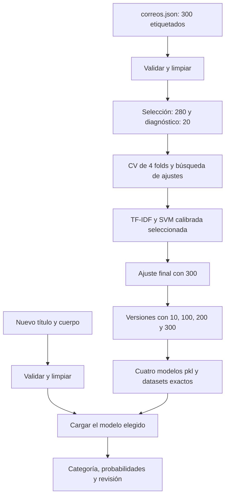
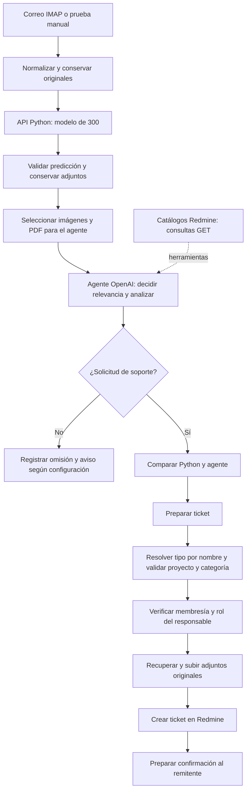

# Arquitectura y decisiones técnicas

El proyecto prueba versiones de 10, 100, 200 y 300 correos y adopta
**modelo_clasificador_300.pkl como modelo final**. Las tres versiones menores
se conservan para comparación; las métricas por versión se detallan en la evaluación actual.

## Vista general

El sistema tiene una capa de preparación de datos, una de entrenamiento, una
de predicción. Se usa desde consola, la interfaz principal Streamlit local y la API HTTP para n8n. La API usa el
mismo pipeline de clasificación y se integra con n8n. El flujo completo sí emplea
OpenAI como agente externo y Redmine para registrar y asignar tickets.

## Componentes del código

| Archivo | Responsabilidad |
|---|---|
| src/data_processing.py | Esquema, limpieza, duplicados y particiones |
| src/model.py | Pipelines, carga segura de artefactos propios y predicción |
| src/train.py | Comparación, optimización, gráficos y modelo final de 300 |
| src/train_versions.py | Misma configuración para tamaños 10/100/200/300 |
| src/export_datasets.py | Exportar los correos exactos de cada modelo |
| src/evaluate.py | Reconstruir en memoria el diagnóstico 280/20 y medir |
| src/evaluate_new.py | Clasificar nuevos correos sin etiquetas, sin fit |
| src/utils.py | Configuración, rutas, hashes y guardado de resultados |
| evaluar_nuevos.py | Entrada corta para ejecutar desde CMD |
| app/app.py | Interfaz Streamlit sobre el modelo configurado |
| src/api.py | API autenticada del modelo de 300 para n8n |
| src/optimization_analysis.py | Modelo sustituto, PDP e importancia S5 |
| src/evaluate_reviewed.py | Regresión con etiquetas humanas revisadas |

Las rutas predeterminadas se resuelven desde la raíz del proyecto. `config.yaml`
define datos, modelo, semilla, folds, búsqueda y umbral de revisión. No es
necesario editar rutas de la unidad F dentro del código para usar otra carpeta.

## Arquitectura detallada y representación del texto

Se combina título con cuerpo después de validarlos. `TfidfVectorizer` utiliza
unigramas y bigramas, frecuencia sublineal, normalización Unicode de acentos y
la normalización L2 predeterminada. El ajuste actual usa min_df=1.
La salida es una matriz dispersa: no se usa una red neuronal ni embeddings.
El vocabulario crece de 867 términos en la versión de 10 a 14.409 en la de 300.

## Tipo de modelo seleccionado y justificación

La selección compara DummyClassifier mayoritario, LogisticRegression y
LinearSVC envuelta en CalibratedClassifierCV. El resultado actual favorece
SVM por un margen mínimo de F1 CV frente a LR; no se afirma significancia.
La SVM se calibra mediante sigmoide y **dos folds internos** para producir
probabilidades de las cuatro clases y admitir el conjunto de 10, donde dos
categorías tienen solo dos ejemplos. Los dos estimadores internos se combinan
según el funcionamiento de la biblioteca.

Las cuatro versiones usan C=10, class_weight=None y min_df=1, elegidos en la
etapa mayor de selección. Se vuelve a aprender vocabulario y clasificador con
los registros de cada tamaño; no se reutilizan coeficientes ajustados con 300
para fingir un entrenamiento de 10. Los hiperparámetros sí son compartidos y
fueron elegidos con el conjunto mayor: las versiones no son experimentos de
diseño totalmente independientes.

El pipeline conserva su cantidad de ejemplos, recuentos por clase, índices,
huellas de texto y etiquetas. El exportador comprueba esas huellas para obtener
los datasets exactos. Cargar un `.pkl` ajeno puede ejecutar código; solo se deben
usar artefactos propios o de una fuente confiable.

## Decisión y revisión humana

La categoría propuesta es la de mayor probabilidad. Si la confianza máxima es
menor que 0,60 o el texto limpio no contiene términos del vocabulario aprendido,
se marca `requiere_revision`. Ese umbral es configurable y no fue validado como
umbral óptimo de seguridad. Un error puede superar 0,60 y un acierto quedar por
debajo. La confianza no es una medida directa de calidad global.

## Evaluación y artefactos del modelo

`src.train` mide el candidato de 280 y luego ajusta el final con 300.
`src.evaluate` puede reconstruir el candidato en memoria usando su partición
guardada y los ajustes del final; no crea otro `.pkl`. Las métricas resultantes
se etiquetan como pertenecientes al modelo diagnóstico, no al final de 300.
`models/` contiene únicamente las versiones de 10, 100, 200 y 300 correos y su README.

La consola acepta `--model 10`, `100`, `200`, `300` o una ruta a uno de esos
archivos. Verifica que los registros del corpus coincidan con las huellas de
la versión seleccionada y guarda las salidas en carpetas separadas.

## Pipeline de datos desde input hasta output

| Paso | Entrada | Transformación o control | Salida |
|---|---|---|---|
| 1 | Título y cuerpo | Validar texto, longitud y contenido; limpiar y concatenar | Texto normalizado |
| 2 | Texto normalizado | TF-IDF con unigramas y bigramas del modelo seleccionado | Vector disperso |
| 3 | Vector disperso | SVM lineal y calibración sigmoide de dos folds | Cuatro probabilidades |
| 4 | Probabilidades y vocabulario | Elegir máximo y comprobar umbral de 0.60 y términos conocidos | Categoría, confianza y requiere_revision |
| 5 | Resultado | Presentación en consola/Streamlit o respuesta de la API | Predicción visible o JSON para n8n |

Este modelo no tiene capas neuronales. Sus etapas son el vectorizador y el
clasificador calibrado; los parámetros principales son `ngram_range=(1, 2)`,
`sublinear_tf=True`, `norm=l2`, `strip_accents=unicode`, `min_df=1`, `C=10`,
`class_weight=None`, `dual=auto` y semilla 42. El flujo completo de n8n agrega
al pipeline la decisión del agente y las validaciones de Redmine, como muestra
el diagrama de extremo a extremo.

## Tecnologías y librerías utilizadas con versiones

Python de la ejecución verificada: 3.10.11.

| Biblioteca | Versión fijada |
|---|---|
| pandas | 2.2.3 |
| numpy | 1.26.4 |
| scipy | 1.14.1 |
| scikit-learn | 1.5.2 |
| streamlit | 1.41.1 |
| joblib | 1.4.2 |
| pytest | 8.3.4 |
| matplotlib | 3.9.4 |
| seaborn | 0.13.2 |
| nbformat | 5.10.4 |
| nbclient | 0.10.2 |
| ipykernel | 6.29.5 |
| ruff | 0.9.10 |
| PyYAML | 6.0.2 |

Las versiones principales efectivas se registran en `results/metrics/versions.json`.
No se ha probado toda combinación de sistema operativo y versión de Python.
El entorno de trabajo verificado es Windows con Python 3.10.

## Alternativas consideradas

La referencia mayoritaria permite saber si el modelo supera una regla trivial.
LR ofrece una solución lineal con probabilidades nativas y un resultado casi
igual al de SVM. Se conservó la SVM calibrada por su F1 CV ligeramente mayor y
para mantener la comparación de tamaños con el mismo método. No se entrenó una red neuronal ni un LLM con el corpus. El agente OpenAI del
flujo desplegado es un servicio aparte: resume, propone prioridad y consulta
catálogos; no sustituye el entrenamiento de los cuatro clasificadores.

La implementación sigue las interfaces documentadas de
[TF-IDF](https://scikit-learn.org/1.5/modules/generated/sklearn.feature_extraction.text.TfidfVectorizer.html)
y [calibración](https://scikit-learn.org/1.5/modules/generated/sklearn.calibration.CalibratedClassifierCV.html).

## Flujo desplegado de extremo a extremo

La API está en `/mquito/mquito-ticket/clasificador-python`, conectada a la red
Docker `correo-tickets_automatizacion`. Su dirección desde n8n es
`http://clasificador-python:8000/predict`. No tiene puerto publicado en Internet.
Exige `X-API-Key`, configurada fuera del código. Carga una vez al iniciar el
archivo `modelo_clasificador_300.pkl` y comprueba sus 300 muestras.

Python recibe solo título y cuerpo. Devuelve categoría, cuatro probabilidades,
confianza y señales de revisión. Si no responde o su respuesta no es válida,
el adaptador conserva el correo y registra clasificación no disponible; continúa
el agente existente. Python no llama a OpenAI y no concede permisos a usuarios.

El prompt del agente recibe asunto, cuerpo e inventario de adjuntos. Se pueden
enviar PNG/JPEG/WebP/PDF: hasta 4 archivos, 4 MiB por archivo y 8 MiB acumulados.
Los originales se conservan para Redmine, incluso si no fueron seleccionados
para análisis. La selección no garantiza que el agente lea correctamente el archivo.

OpenAI analiza relevancia, resumen, categoría, prioridad y responsable. Consulta
proyectos, miembros, roles, cuenta de integración y categorías en Redmine. Sus
respuestas pueden contener nombres y otra información de esas consultas.
La categoría Python no se utiliza para forzar la respuesta del agente.

El formato estructurado exige `tipo_ticket`: Errores o Soporte. El código
resuelve ese nombre contra los tipos realmente habilitados del proyecto; si
no hay una coincidencia única, detiene el alta. El agente ya no devuelve
`tracker_id`. En el catálogo verificado, Errores es ID 1 y Soporte ID 3, pero
esos números no se codifican como regla: se consultan en cada ejecución.

Se verifica que el proyecto esté activo, la categoría exista y el responsable
pertenezca al proyecto con rol asignable y permiso `view_issues`. Un responsable
inválido se omite y se marca revisión; un proyecto, categoría o tipo inválido
impide crear el ticket. La creación y asignación son automáticas tras esos
controles, sin una aprobación humana obligatoria.

La señal `requiere_revision` de Python no bloquea por sí sola un ticket ni
obliga al agente a marcarlo. Cuando el agente solicita revisión, el título lleva
`[REVISAR]` y la prioridad aplicada es normal. No existe aprendizaje en línea.

La versión probada usa OpenAI gpt-4.1-mini; Gemini está desconectado. Las
credenciales de buzón, modelo, Redmine y avisos se administran en n8n. La API usa
FastAPI 0.115.6 y Uvicorn 0.34.0; n8n verificado: 2.40.5; Python del contenedor:
3.10, con scikit-learn 1.5.2.

## Interfaz principal local: Streamlit

Se adopta la opción A de la página 4 de la descripción del proyecto.
`app/app.py` carga directamente el archivo elegido en el selector: modelos
de 10, 100, 200 o 300 correos. El de 300 es la opción predeterminada. La caché
distingue la ruta y la fecha del archivo; el cambio limpia el resultado previo.
Flujo: formulario local → limpieza → pipeline TF-IDF/SVM → categoría,
confianza, cuatro probabilidades y aviso de revisión. No hay llamadas HTTP
ni claves de API en este recorrido. La inferencia se ejecuta en esta computadora.
La interfaz muestra ejemplos, carga, errores, métricas y limitaciones. Incluye
los controles Español/English y claro/oscuro, exportación CSV e historial de
hasta 50 predicciones por sesión con comparación mediante gráficos Altair.
La interfaz en inglés no cambia el idioma del corpus: los ejemplos y el
modelo siguen centrados en texto español. Con `HISTORY_DB_PATH`, el historial
se guarda en SQLite, con transacciones, un contador por historial y retención
de 50 registros. El componente `app/history_component` recuerda un identificador
privado en el navegador; el enlace permite recuperar el mismo historial en otro
navegador. El servidor separa las filas mediante el hash de ese identificador.
`python/compose.yaml` monta el volumen `prediction_history` en `/history`.
Sin esa variable, la ejecución local conserva solo memoria de sesión.
`Iniciar_clasificador.cmd` inicia Streamlit ligado a 127.0.0.1; la pantalla se
abre en el navegador local. No se presenta como una ventana nativa de Windows.

La API en Docker y n8n continúan como integración
separada: no se detienen ni se modifican al ejecutar la aplicación local.

## Evaluación reproducible de las versiones

`src/evaluate_versions.py` verifica los cuatro manifiestos y datasets exactos,
calcula ajuste en entrenamiento y CV exploratoria cuando la calibración lo
permite, compara con baseline y repite los 25 casos por versión. Guarda
`version_evaluation.json`/`.csv` y el gráfico. No modifica los `.pkl`. La
interfaz solo muestra resultados por versión si la huella del modelo coincide.

La sección de parámetros de la interfaz inspecciona el pipeline seleccionado
y muestra vocabulario, clases, hiperparámetros TF-IDF/SVM, calibración y umbral
de revisión. No reutiliza una ficha fija del modelo de 300 para otras versiones.
