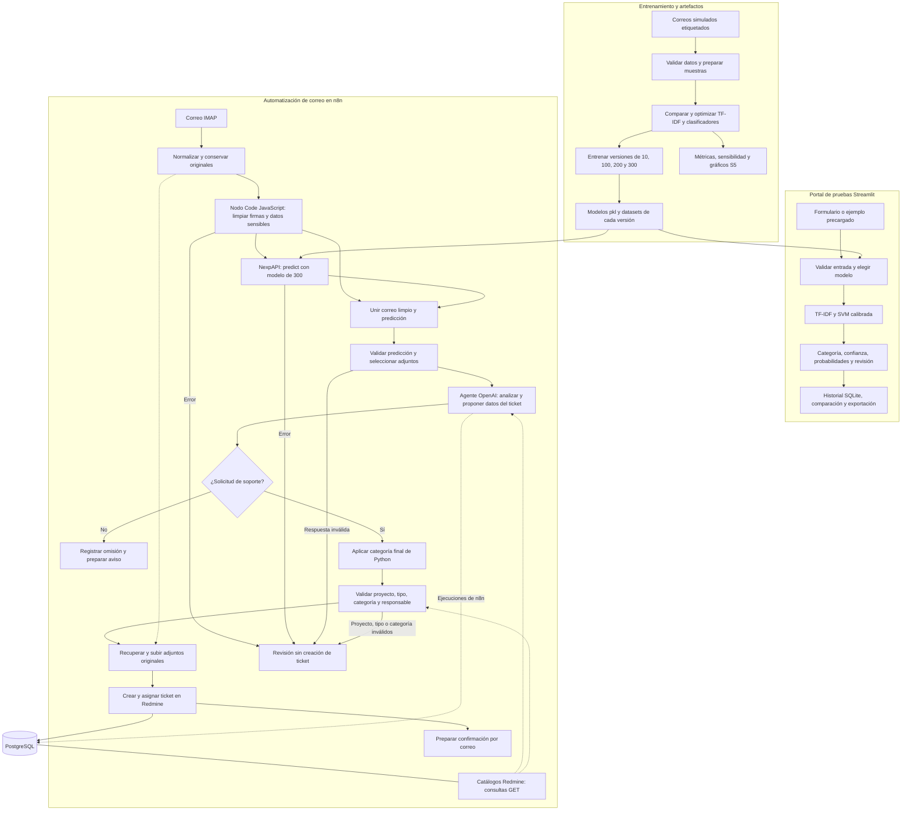

# Arquitectura del sistema

## 1. Tipo de modelo seleccionado y justificación

El modelo combina **TF-IDF y SVM lineal calibrada** (`TfidfVectorizer`, `LinearSVC` y `CalibratedClassifierCV`). Predice cuatro categorías: **accesos, aplicaciones, infraestructura y otros**.

Se comparó con un baseline mayoritario y regresión logística. La SVM optimizada obtuvo **F1 macro CV de 0.965000**, frente a **0.964939** de regresión logística. Se eligió por ese resultado y por sus probabilidades calibradas; la diferencia es pequeña y no prueba una ventaja en producción.

Hay modelos de **10, 100, 200 y 300 correos simulados**, con la misma configuración y vocabularios propios. **NexpAPI usa el de 300** y Streamlit carga los modelos válidos de `models/`. **Python fija la categoría final**; el agente **OpenAI gpt-4.1-mini** analiza el correo y propone resumen, prioridad, tipo y proyecto. No se entrenó una red neuronal ni un LLM.

Ver el proceso de selección en [optimización](optimizacion.md).

## 2. Arquitectura detallada (capas, parámetros, etc.)

### Etapas del modelo

No hay capas neuronales. El modelo sigue estas etapas:

| Etapa | Operación | Parámetros |
|---|---|---|
| Preparación | Validar título/cuerpo, limpiar y combinar el texto | Reglas compartidas en `src/data_processing.py` |
| TF-IDF | Convertir palabras y pares de palabras en una matriz dispersa | `ngram_range=(1, 2)`, `sublinear_tf=True`, `strip_accents=unicode`, `min_df=1`, `max_df=1.0`, normalización L2 |
| SVM lineal | Aprender las fronteras entre las cuatro categorías | `C=10.0`, `class_weight=None`, `dual=auto`, `random_state=42` |
| Calibración | Transformar las puntuaciones en probabilidades estimadas | Método sigmoide y `cv=2`; combinación de estimadores calibrados |
| Decisión | Elegir la categoría de mayor probabilidad | Marcar `requiere_revision` si confianza `< 0.60` o no hay términos conocidos |

Los ajustes están en [config.yaml](../config.yaml). El umbral de revisión no garantiza acierto ni obliga a aprobación humana. Las **4 particiones de evaluación** son distintas de las **2 de calibración**.

### Componentes y responsabilidades

| Componente | Responsabilidad | Código o configuración |
|---|---|---|
| Preparación y modelo | Limpieza, representación, carga y predicción | `python/src/data_processing.py`, `python/src/model.py` |
| Entrenamiento y análisis | Comparar modelos, optimizar, entrenar por tamaño y evaluar | `python/src/train.py`, `train_versions.py`, `evaluate_versions.py`, `optimization_analysis.py` |
| Portal Streamlit | Formulario, ejemplos, selector de modelos, resultados, exportación, historial y comparación | `python/app/`, `python/compose.yaml` |
| NexpAPI | Exponer el modelo de 300 mediante HTTP autenticado | `nexpapi/app.py`, `python/src/api.py`, `nexpapi/Dockerfile`, `nexpapi/compose.yaml` |
| Orquestación n8n | Recibir correo, limpiar texto, consultar NexpAPI, ejecutar el agente y validar el ticket | `workflows/correo-ia-redmine-python300.json`, `workflows/nodes/` |
| Agente OpenAI | Analizar relevancia, resumir y proponer datos del ticket; consultar catálogos por GET | Nodo de agente y herramientas de solo lectura de n8n |
| Redmine | Registrar, asignar y gestionar tickets y adjuntos | Servicio Redmine y API REST |
| Persistencia | PostgreSQL para n8n/Redmine; SQLite para el historial del portal | Volúmenes Docker; historial limitado por `history_limit: 50` |

### Despliegue y comunicación

NexpAPI está en `/mquito/mquito-ticket/nexpapi`, dentro de `correo-tickets_automatizacion`. n8n llama a **`POST http://nexpapi:8000/predict`** con `X-API-Key`; **`GET /health`** comprueba su estado. No publica el puerto 8000. Carga el modelo una vez al iniciar, sin reentrenarlo ni llamar a OpenAI.

Compose limita NexpAPI a **1 CPU y 512 MiB**, con usuario sin privilegios, archivos de solo lectura, espacio temporal y reinicio `unless-stopped`. Reutiliza `python/src` y `python/config.yaml`; en producción carga `nexpapi/models` mediante `NEXPAPI_MODEL_DIR`.

Los puertos son **8501** para Streamlit, **5678** para n8n, **3000** para Redmine y **9443** para Portainer. Streamlit clasifica directamente en el equipo o contenedor donde se ejecuta, sin NexpAPI ni OpenAI. Con `HISTORY_DB_PATH` guarda el historial en SQLite; sin esa variable lo mantiene en memoria de sesión.

## 3. Diagrama de flujo del sistema completo

### Flujo de automatización

El flujo transforma los correos de soporte en tickets de Redmine mediante n8n, el clasificador Python de 300 correos y el agente OpenAI. Estas son sus etapas principales:

1. **Leer buzón IMAP.** Recibir el correo con su asunto, cuerpo y adjuntos.
2. **Normalizar y limpiar el correo.** Ordenar los campos, conservar los originales y limpiar firmas y datos sensibles mediante JavaScript en n8n.
3. **Consultar API - Modelo 300.** Enviar el título y cuerpo limpios a NexpAPI; recuperar la categoría de Python, confianza y probabilidades. Unir la respuesta con el correo, validar la predicción y seleccionar los adjuntos permitidos para el agente.
4. **Analizar la solicitud con el agente IA.** OpenAI analiza la relevancia, resume el pedido y propone prioridad, tipo y proyecto con consultas de solo lectura a Redmine.
5. **Decidir si es una solicitud de soporte.** Si no corresponde, registrar la omisión y preparar el aviso; si corresponde, continuar con la preparación del ticket.
6. **Aplicar la categoría final de Python.** Conservar la clasificación del modelo aunque el agente discrepe; marcar revisión ante baja confianza o desacuerdo.
7. **Preparar y validar el ticket.** Resolver el tipo por nombre, comprobar proyecto y categoría, y validar la membresía y el rol del responsable antes de asignarlo.
8. **Recuperar adjuntos originales.** Recuperar los archivos conservados y subirlos a Redmine para asociarlos al ticket.
9. **Crear el ticket en Redmine.** Registrar la solicitud con los datos validados y la asignación que corresponda.
10. **Preparar la notificación de ticket creado.** Incluir el número y enlace del ticket; el envío depende de los filtros de notificación configurados.

Si falla la limpieza, la API o la validación de la predicción, el flujo deriva a revisión antes del agente. Un proyecto, tipo o categoría inválidos bloquean la creación del ticket.

**Imagen de referencia del flujo:**

La imagen conserva el esquema anterior de diez pasos. El recorrido vigente descrito arriba incorpora la limpieza previa y aplica la categoría final de Python en la etapa que la imagen llama «Comparar clasificaciones». La confirmación se prepara después de crear el ticket y se envía cuando los filtros lo permiten.

### Diagrama integrado del sistema

**La limpieza ocurre en un nodo de código de n8n, sin otra API**. NexpAPI clasifica. El entrenamiento se ejecuta aparte: el flujo de correo no aprende en línea.

## 4. Pipeline de datos (desde input hasta output)

### Correo → n8n → NexpAPI → OpenAI → Redmine

| Paso | Entrada | Procesamiento | Salida |
|---:|---|---|---|
| 1 | Correo y adjuntos del buzón | Normalizar remitente, asunto, cuerpo y metadatos; conservar originales | Correo normalizado |
| 2 | Asunto y cuerpo | El nodo `Limpiar firma y datos` elimina firmas habituales y redacta datos sensibles localmente en n8n | Texto limpio y contadores de limpieza |
| 3 | JSON con `titulo` y `cuerpo` limpios | NexpAPI valida la entrada, aplica el preprocesamiento compartido, TF-IDF, SVM y calibración | Categoría, confianza, cuatro probabilidades y aviso de revisión |
| 4 | Respuesta de la API y correo limpio | Unir datos, validar versión/300 muestras/probabilidades y seleccionar archivos para el agente | Texto limpio, predicción y adjuntos seleccionados |
| 5 | Resultado anterior y catálogos Redmine | OpenAI analiza relevancia, resume y propone prioridad, tipo y proyecto | Análisis estructurado o decisión de omitir |
| 6 | Análisis y predicción original | Reaplicar la categoría Python; resolver tipo por nombre, categoría y responsable con datos reales | Ticket validado o caso para revisión |
| 7 | Ticket validado y adjuntos originales | Verificar membresía y rol; cargar archivos y crear el ticket en Redmine | Ticket registrado, asignación válida si existe y confirmación preparada |

El agente recibe **PNG, JPEG, WebP o PDF**: hasta **4 archivos**, **4 MiB cada uno** y **8 MiB en total**. No se anonimizan; los originales quedan para Redmine. Si falla la limpieza o la clasificación, no se crea un ticket usando el texto original o una categoría inventada por el agente.

La categoría de Python es obligatoria. Si el responsable no es válido, el ticket puede quedar sin asignar y marcado para revisión. Si falla proyecto, tipo o categoría, no se crea. Tras los controles, el alta es automática, sin aprobación humana obligatoria.

### Formulario Streamlit → modelo → resultado

1. El usuario escribe título/cuerpo o carga un ejemplo y selecciona un modelo disponible.
2. El portal valida la entrada, carga el archivo seleccionado y aplica el pipeline compartido TF-IDF/SVM.
3. Muestra categoría, confianza, probabilidades, gráficos y advertencias.
4. Guarda la predicción en el historial configurado y permite compararla y descargar resultados.

Este recorrido no envía datos a n8n ni a OpenAI. El portal muestra métricas solo cuando el hash del modelo coincide con el reporte.

## 5. Tecnologías y librerías utilizadas con versiones

### Servicios y entorno de producción

Versiones verificadas en el servidor y sus contenedores:

| Tecnología | Versión | Uso |
|---|---|---|
| Python | 3.10.22 | NexpAPI y portal Streamlit |
| Docker Engine | 29.8.1 | Contenedores |
| Docker Compose | 5.5.1 | Despliegue de servicios |
| n8n | 2.40.5 | Orquestación y nodos de código JavaScript |
| Redmine | 6.1.4 | Gestión de tickets |
| PostgreSQL | 16.15 | Persistencia de n8n y Redmine |
| SQLite | 3.46.1 | Historial del portal |
| Portainer CE | 2.45.1 | Administración de contenedores |
| OpenAI | `gpt-4.1-mini` | Identificador del modelo externo del agente, no una versión de biblioteca |

### Librerías de clasificación e interfaz

| Librería | Versión | Uso |
|---|---|---|
| scikit-learn | 1.5.2 | TF-IDF, clasificación, calibración y evaluación |
| NumPy | 1.26.4 | Operaciones numéricas |
| SciPy | 1.14.1 | Matrices dispersas y soporte científico |
| pandas | 2.2.3 | Datos tabulares y resultados |
| joblib | 1.4.2 | Serialización y carga de modelos |
| PyYAML | 6.0.2 | Lectura de configuración |
| FastAPI | 0.115.6 | API HTTP |
| Uvicorn | 0.34.0 | Servidor ASGI de NexpAPI |
| Streamlit | 1.41.1 | Interfaz web |
| Altair | 5.5.0 | Visualizaciones interactivas |
| PyArrow | 17.0.0 | Intercambio de datos tabulares del portal |

### Herramientas de análisis y verificación

| Herramienta | Versión fijada | Uso |
|---|---|---|
| matplotlib | 3.9.4 | Gráficos de evaluación y optimización |
| seaborn | 0.13.2 | Visualizaciones estadísticas |
| pytest | 8.3.4 | Pruebas Python |
| httpx | 0.28.1 | Pruebas de la API |
| nbformat | 5.10.4 | Formato de notebooks |
| nbclient | 0.10.2 | Ejecución de notebooks |
| ipykernel | 6.29.5 | Kernel Python de notebooks |
| Ruff | 0.9.10 | Estilo, importaciones y docstrings |

Las versiones se fijan en [requirements.txt](../requirements.txt), [NexpAPI](../../nexpapi/requirements.txt) y [portal](../deploy/requirements-streamlit.txt). Las herramientas de análisis corresponden al desarrollo; no todas están instaladas en la API.
