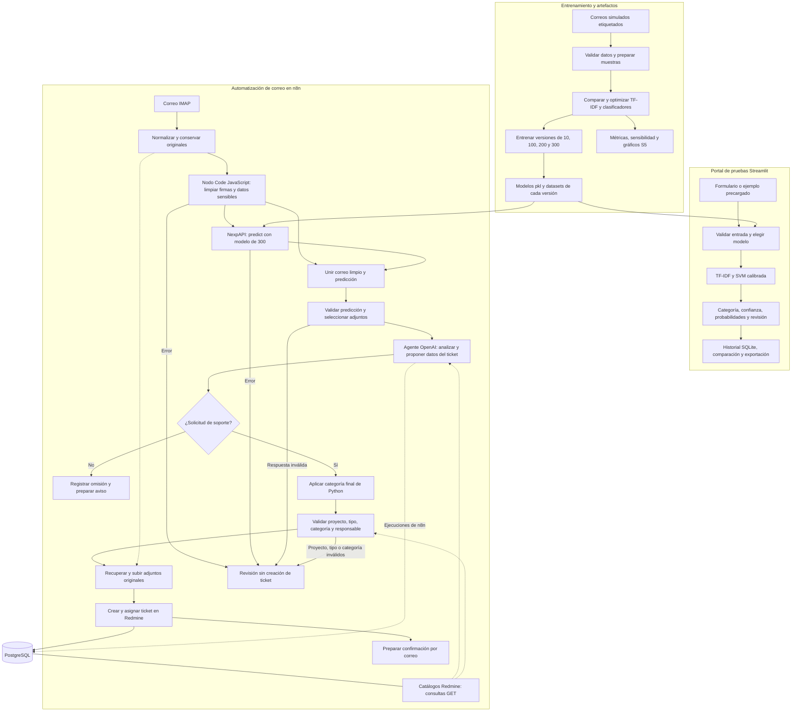

# Arquitectura del sistema

## 1. Tipo de modelo seleccionado y justificación

Se utiliza un clasificador supervisado multiclase formado por **TF-IDF y SVM lineal calibrada** (`TfidfVectorizer`, `LinearSVC` y `CalibratedClassifierCV`). Clasifica las solicitudes en **accesos, aplicaciones, infraestructura y otros**.

Se comparó con un baseline de categoría mayoritaria y regresión logística. La SVM optimizada obtuvo el mayor F1 macro de la etapa de selección: **0.965000**, frente a **0.964939** de regresión logística optimizada. La diferencia es pequeña; no demuestra una superioridad estadística o en producción. La calibración sigmoide permite obtener probabilidades por categoría y señalar casos de baja confianza.

Se conservan modelos entrenados con **10, 100, 200 y 300 correos simulados**, con la misma configuración y vocabularios aprendidos por separado. **NexpAPI utiliza el de 300 correos**; Streamlit permite elegir entre los archivos válidos de `models/`. El agente externo **OpenAI gpt-4.1-mini** analiza la solicitud y propone resumen, prioridad, tipo y proyecto; **Python determina la categoría final**. No se entrenó un LLM ni una red neuronal con estos correos.

Ver el proceso de selección en [optimización](optimizacion.md).

## 2. Arquitectura detallada (capas, parámetros, etc.)

### Etapas del modelo

Este modelo no tiene capas neuronales. Su arquitectura es un pipeline de representación del texto y clasificación calibrada:

| Etapa | Operación | Parámetros |
|---|---|---|
| Preparación | Validar título/cuerpo, limpiar y combinar el texto | Reglas compartidas en `src/data_processing.py` |
| TF-IDF | Convertir palabras y pares de palabras en una matriz dispersa | `ngram_range=(1, 2)`, `sublinear_tf=True`, `strip_accents=unicode`, `min_df=1`, `max_df=1.0`, normalización L2 |
| SVM lineal | Aprender las fronteras entre las cuatro categorías | `C=10.0`, `class_weight=None`, `dual=auto`, `random_state=42` |
| Calibración | Transformar las puntuaciones en probabilidades estimadas | Método sigmoide y `cv=2`; combinación de estimadores calibrados |
| Decisión | Elegir la categoría de mayor probabilidad | Marcar `requiere_revision` si confianza `< 0.60` o no hay términos conocidos |

Los valores configurables se definen en [config.yaml](../config.yaml). El umbral de revisión no garantiza acierto ni exige por sí solo aprobación humana. La búsqueda utiliza **4 particiones de validación cruzada**; estas son distintas de las **2 particiones internas de calibración**.

### Componentes y responsabilidades

| Componente | Responsabilidad | Código o configuración |
|---|---|---|
| Preparación y modelo | Limpieza, representación, carga y predicción | `python/src/data_processing.py`, `python/src/model.py` |
| Entrenamiento y análisis | Comparar modelos, optimizar, entrenar por tamaño y evaluar | `python/src/train.py`, `train_versions.py`, `evaluate_versions.py`, `optimization_analysis.py` |
| Portal Streamlit | Formulario, ejemplos, selector de modelos, resultados, exportación, historial y comparación | `python/app/`, `python/compose.yaml` |
| NexpAPI | Exponer el modelo de 300 mediante HTTP autenticado | `nexpapi/app.py`, `python/src/api.py`, `nexpapi/Dockerfile`, `nexpapi/compose.yaml` |
| Orquestación n8n | Recibir correo, limpiar texto, consultar NexpAPI, ejecutar el agente y validar el ticket | `workflows/correo-ia-redmine-python300.json`, `workflows/nodes/` |
| Agente OpenAI | Analizar relevancia, resumir y proponer datos del ticket; consultar catálogos por GET | Nodo de agente y herramientas de solo lectura de n8n |
| Redmine | Registrar, asignar y gestionar tickets y adjuntos | Servicio Redmine y API REST |
| Persistencia | PostgreSQL para n8n/Redmine; SQLite para el historial del portal | Volúmenes Docker; historial limitado por `history_limit: 50` |

### Despliegue y comunicación

NexpAPI reside en `/mquito/mquito-ticket/nexpapi`, usa el contenedor `nexpapi` y comparte la red `correo-tickets_automatizacion`. n8n consulta **`POST http://nexpapi:8000/predict`**, con `X-API-Key`; **`GET /health`** comprueba disponibilidad. El puerto 8000 no se publica en Internet. La API carga una vez el modelo de 300 al iniciar; no reentrena ni llama a OpenAI.

Su Compose limita el contenedor a **1 CPU y 512 MiB**, utiliza sistema de archivos de solo lectura, usuario sin privilegios, directorio temporal y reinicio `unless-stopped`. La construcción reutiliza `python/src` y `python/config.yaml`. En producción conserva el modelo en `nexpapi/models`, seleccionado mediante `NEXPAPI_MODEL_DIR`.

Streamlit se publica en el puerto **8501**, n8n en **5678**, Redmine en **3000** y Portainer en **9443**. El portal carga el modelo directamente en el proceso Python donde se ejecuta: en la computadora si se inicia localmente o en el contenedor del VPS si está desplegado. No utiliza NexpAPI ni OpenAI para sus predicciones. El historial persistente se guarda en SQLite mediante `HISTORY_DB_PATH`; sin esa configuración se conserva en memoria de sesión.

## 3. Diagrama de flujo del sistema completo

El diagrama representa el flujo vigente: **la limpieza se ejecuta en un nodo de código de n8n, sin endpoint adicional**, y NexpAPI realiza la clasificación. Los modelos se entrenan fuera del flujo de correo; no existe aprendizaje automático en línea.

## 4. Pipeline de datos (desde input hasta output)

### Correo → n8n → NexpAPI → OpenAI → Redmine

| Paso | Entrada | Procesamiento | Salida |
|---:|---|---|---|
| 1 | Correo y adjuntos del buzón | Normalizar remitente, asunto, cuerpo y metadatos; conservar originales | Correo normalizado |
| 2 | Asunto y cuerpo | El nodo `Limpiar firma y datos` elimina firmas habituales y redacta datos sensibles localmente en n8n | Texto limpio y contadores de limpieza |
| 3 | JSON con `titulo` y `cuerpo` limpios | NexpAPI valida la entrada, aplica el preprocesamiento compartido, TF-IDF, SVM y calibración | Categoría, confianza, cuatro probabilidades y aviso de revisión |
| 4 | Respuesta de la API y correo limpio | Unir datos, validar versión/300 muestras/probabilidades y seleccionar archivos para el agente | Texto limpio, predicción y adjuntos seleccionados |
| 5 | Resultado anterior y catálogos Redmine | OpenAI analiza relevancia, resume y propone prioridad, tipo y proyecto | Análisis estructurado o decisión de omitir |
| 6 | Análisis y predicción original | Reaplicar la categoría Python; resolver tipo por nombre, categoría y responsable con datos reales | Ticket validado o caso para revisión |
| 7 | Ticket validado y adjuntos originales | Verificar membresía y rol; cargar archivos y crear el ticket en Redmine | Ticket registrado, asignación válida si existe y confirmación preparada |

El agente puede recibir **PNG, JPEG, WebP y PDF**, hasta **4 archivos**, **4 MiB por archivo** y **8 MiB acumulados**. Los adjuntos no se anonimizan; los originales se conservan para Redmine. Si falla la limpieza o la clasificación, no se usa texto original ni una categoría del agente como respaldo para crear el ticket.

La categoría Python es obligatoria. Un responsable inválido puede dejar el ticket sin asignar y marcado para revisión; un proyecto, tipo o categoría inválidos impide el alta. La creación tras las validaciones es automática: no hay una aprobación humana obligatoria antes de cada ticket.

### Formulario Streamlit → modelo → resultado

1. El usuario escribe título/cuerpo o carga un ejemplo y selecciona un modelo disponible.
2. El portal valida la entrada, carga el archivo seleccionado y aplica el pipeline compartido TF-IDF/SVM.
3. Muestra categoría, confianza, probabilidades, gráficos y advertencias.
4. Guarda la predicción en el historial configurado y permite compararla y descargar resultados.

El portal no envía estos datos al flujo de n8n ni al agente OpenAI. Las métricas de cada modelo solo se muestran cuando su hash coincide con el reporte registrado.

## 5. Tecnologías y librerías utilizadas con versiones

### Servicios y entorno de producción

Versiones verificadas en el servidor y sus contenedores:

| Tecnología | Versión | Uso |
|---|---|---|
| Python | 3.10.22 | NexpAPI y portal Streamlit |
| Docker Engine | 29.8.1 | Contenedores |
| Docker Compose | 5.5.1 | Despliegue de servicios |
| n8n | 2.40.5 | Orquestación y nodos de código JavaScript |
| Redmine | 6.1.4 | Gestión de tickets |
| PostgreSQL | 16.15 | Persistencia de n8n y Redmine |
| SQLite | 3.46.1 | Historial del portal |
| Portainer CE | 2.45.1 | Administración de contenedores |
| OpenAI | `gpt-4.1-mini` | Identificador del modelo externo del agente, no una versión de biblioteca |

### Librerías de clasificación e interfaz

| Librería | Versión | Uso |
|---|---|---|
| scikit-learn | 1.5.2 | TF-IDF, clasificación, calibración y evaluación |
| NumPy | 1.26.4 | Operaciones numéricas |
| SciPy | 1.14.1 | Matrices dispersas y soporte científico |
| pandas | 2.2.3 | Datos tabulares y resultados |
| joblib | 1.4.2 | Serialización y carga de modelos |
| PyYAML | 6.0.2 | Lectura de configuración |
| FastAPI | 0.115.6 | API HTTP |
| Uvicorn | 0.34.0 | Servidor ASGI de NexpAPI |
| Streamlit | 1.41.1 | Interfaz web |
| Altair | 5.5.0 | Visualizaciones interactivas |
| PyArrow | 17.0.0 | Intercambio de datos tabulares del portal |

### Herramientas de análisis y verificación

| Herramienta | Versión fijada | Uso |
|---|---|---|
| matplotlib | 3.9.4 | Gráficos de evaluación y optimización |
| seaborn | 0.13.2 | Visualizaciones estadísticas |
| pytest | 8.3.4 | Pruebas Python |
| httpx | 0.28.1 | Pruebas de la API |
| nbformat | 5.10.4 | Formato de notebooks |
| nbclient | 0.10.2 | Ejecución de notebooks |
| ipykernel | 6.29.5 | Kernel Python de notebooks |
| Ruff | 0.9.10 | Estilo, importaciones y docstrings |

Las dependencias se fijan en [requirements.txt](../requirements.txt), [dependencias de NexpAPI](../../nexpapi/requirements.txt) y [dependencias del portal](../deploy/requirements-streamlit.txt). Las versiones de herramientas de análisis son las fijadas para el entorno de desarrollo; no se afirma que estén instaladas en el contenedor de la API.
