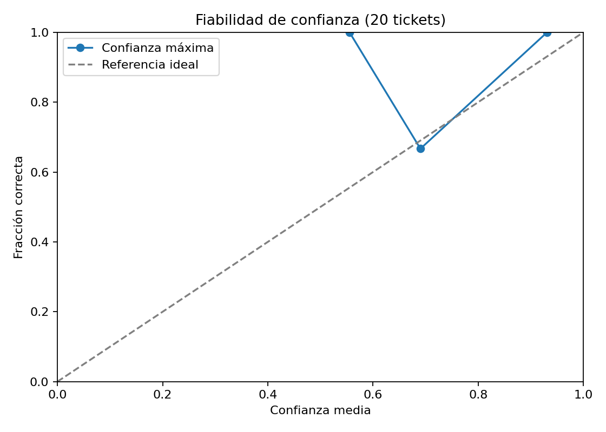
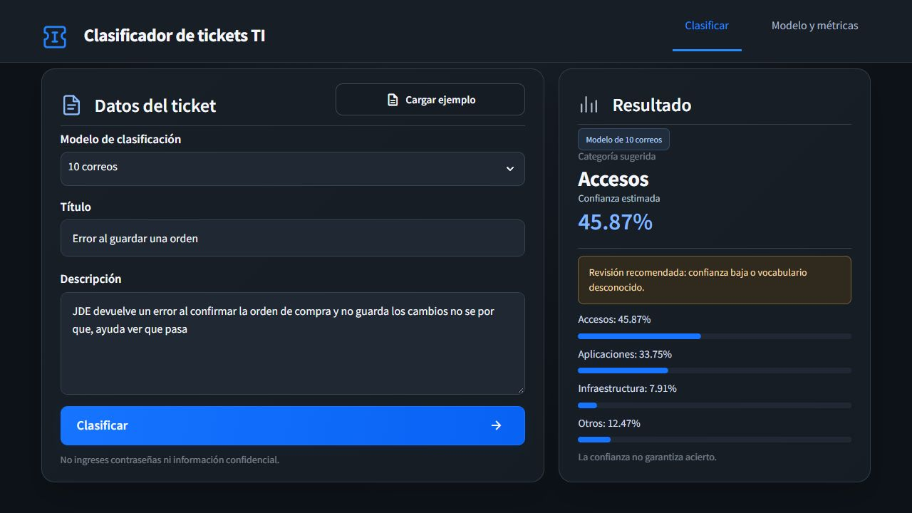

# Evaluación, pruebas y evidencias

Revisión: 27 de octubre de 2026. Este documento separa pruebas del código, métricas del
clasificador y observación manual de predicciones.

## Revisión documental frente a la consigna

La revisión toma como referencia la descripción del Proyecto Final 2026,
especialmente los requisitos de documentación de las páginas 5 a 7. La lista
de 14 apartados corresponde a los README de presentación; cada documento
técnico conserva el contenido específico que le exige la consigna.

| Documento obligatorio | Contenido contrastado | Estado documental |
|---|---|---|
| [Planificación](planificacion.md) | Problema y objetivos, relevancia, alcance incluido/excluido, cronograma planificado/real, recursos y riesgos con mitigación | Contenido cubierto; nombres del resto del equipo por completar |
| [Análisis de datos](analisis_datos.md) | Dataset, estadísticas, seis gráficos, patrones/correlaciones/outliers, decisiones de preprocesamiento y tratamiento de faltantes/desbalance | Contenido cubierto con límites del corpus sintético declarados |
| [Arquitectura](arquitectura.md) | Modelo y justificación, etapas y parámetros, diagramas completos, pipeline input/output y versiones | Contenido cubierto; se distinguen Streamlit local y automatización desplegada |
| [Optimización](optimizacion.md) | Workshop S5, rangos, sensibilidad, PDP, importancia, interacciones, configuración justificada y comparación antes/después | Contenido cubierto; la mejora medida es pequeña y no se exagera |
| [Ética](consideraciones_eticas.md) | Sesgos, equidad, privacidad, transparencia, impacto social, responsabilidad/monitoreo, uso dual y límites | Ocho dimensiones documentadas; medidas propuestas diferenciadas de las implementadas |
| [Manual](manual_usuario.md) | Instalación, pasos de interfaz, capturas y anotaciones de lectura, funcionalidades, problemas, FAQ y soporte | Falta el canal oficial de soporte; las anotaciones son textuales junto a las capturas, sin marcas superpuestas |

También se revisaron los README de datos, modelos, despliegue y experimento
histórico; las guías de automatización, configuración y notificaciones; y los
informes de resultados. No se aplican los 14 apartados de presentación a cada
informe generado ni a cada guía de un componente.

### Pendientes para cumplimiento estricto de la entrega

- Completar los nombres del resto del equipo y el canal de soporte.
- Incorporar marcas visuales sobre las capturas si se exige una interpretación
  literal de «capturas de pantalla anotadas»; las explicaciones actuales están
  debajo de las imágenes y en la tabla de lectura del manual.
- Completar Licencia, Agradecimientos y referencias y los dos enlaces de videos
  en los README. Esos espacios se mantienen vacíos por indicación del equipo.
- Resolver la correspondencia de carpetas: la consigna presenta `docs/`,
  `requirements.txt`, `LICENSE`, `src/`, `models/` y `app/` en la raíz del
  proyecto académico; en este repositorio están bajo `python/`. Documentarlo
  no equivale a tener la misma estructura literal.
- Verificar acceso público a la entrega y disponibilidad autorizada de los
  artefactos necesarios para ejecutarla desde una instalación nueva. La revisión
  de Markdown no cambia permisos del repositorio ni publica datos o modelos.

Estas diferencias impiden declarar que la entrega completa cumple al 100 %,
aunque los documentos describan correctamente lo implementado. Esta revisión
es documental; no constituye una nueva ejecución de pruebas ni del despliegue.

## Funcionalidades obligatorias de la interfaz

La exportación ofrece CSV y un informe Excel con resumen, gráfico nativo,
porcentajes numéricos y tabla completa. Las nuevas predicciones conservan el
umbral, la señal de vocabulario desconocido, archivo y SHA-256 del modelo y
tiempo de inferencia. Los registros antiguos no se completan con supuestos.
Las pruebas de Excel verifican valores tipados, datos de las series del gráfico,
protección del texto contra fórmulas y tratamiento de metadatos ausentes.

| Grupo de la consigna | Implementación |
|---|---|
| Input de datos | Título y descripción con límites de longitud, validación de tipos y contenido con letras |
| Procesamiento | Botón Clasificar, spinner mientras predice y mensajes de error de configuración, modelo, entrada y ejecución |
| Output y resultados | Categoría sugerida, confianza, revisión recomendada y gráfico interactivo de las cuatro probabilidades |
| Información del modelo | Vista Acerca de con descripción, parámetros leídos del archivo, métricas por huella y advertencias |
| Ejemplos de uso | Botón Prueba con ejemplo con cuatro tickets precargados en español |

También se incorporan los elementos adicionales: diseño adaptable, modos claro
y oscuro, interfaz Español/English, exportación CSV/Excel, historial de 50 registros
por sesión, comparación de predicciones y gráficos interactivos Altair. El
modelo no se traduce ni se reentrena al cambiar el idioma de la interfaz.

Las pruebas de interfaz incluyen historial sin duplicación al volver a renderizar,
cambio de idioma/tema conservando resultados, invalidación al editar textos,
borrado de historial y comparación. Las pruebas de exportación comprueban
Unicode, saltos de línea, valores reales de probabilidades y protección frente
a fórmulas en celdas de texto. Se comprueba además el límite de retención sin
reutilizar identificadores.

### Guardado persistente del historial

El portal confirma el guardado después de cada clasificación correcta. SQLite
almacena hasta 50 registros por historial en el volumen Docker
`mquito-portal_prediction_history`, fuera del sistema de archivos efímero del
contenedor. Un componente propio recuerda el identificador privado en el
navegador; el enlace permite recuperar ese mismo historial en otro navegador.
Sin `HISTORY_DB_PATH`, se mantiene el modo local de memoria de sesión.

`tests/test_persistent_history.py` verifica restauración en una instancia nueva,
aislamiento entre identificadores, borrado independiente, escrituras concurrentes
sin IDs duplicados, retención y recuperación desde una sesión de interfaz nueva.
La verificación en el portal incluye entrada manual, consulta inmediata del
historial, nueva visita a la URL inicial y recreación real del contenedor.

## Pruebas por tamaño y modelo final elegido

Se prepararon cuatro versiones para las pruebas: 10, 100, 200 y 300 correos.
Las de 10, 100 y 200 se conservan para comparar sus predicciones con las de
la versión de 300 sobre los mismos correos de prueba.

**El modelo final elegido para usar en el proyecto es
`modelo_clasificador_300.pkl`.** Es el predeterminado en config.yaml y utiliza
los 300 correos del dataset completo. Los otros tres quedan como versiones
de comparación y evidencia del experimento.

Esta elección del proyecto no se presenta como una superioridad de accuracy
demostrada frente a los otros tamaños: la prueba de 25 correos muestra
predicciones y confianza, sin etiquetas para calcular aciertos por versión.

## Qué está medido y a qué corresponde

| Evidencia | Entrenamiento implicado | Qué permite afirmar |
|---|---|---|
| CV de algoritmos y búsqueda | 280, divididos en cuatro folds externos | Rendimiento interno para elegir ajustes |
| Diagnóstico de 20 originales | Modelo reconstruido con 280 | Resultado en esos 20 ya conocidos en el desarrollo |
| Versiones de prueba 10/100/200/300 | Cada uno con su dataset exacto completo | Artefactos entrenados con esas cantidades |
| Predicciones de 25 sin etiquetas | Modelo elegido, sin fit adicional | Qué categoría y confianza propone; no cuántas acierta |
| pytest | Funciones y aplicación con casos controlados | Que los comportamientos comprobados funcionan |

No hay un experimento nuevo etiquetado que compare accuracy de los cuatro
tamaños. Ninguna prueba automatizada demuestra por sí sola ausencia de
sobreajuste. Las confianzas tampoco reemplazan las respuestas esperadas.

## Comparación actual de las cuatro versiones

| Correos | F1 en entrenamiento | F1 macro CV | Accuracy CV | F1 baseline CV | Revisar de 25 |
|---:|---:|---:|---:|---:|---:|
| 10 | 0.5000 | No viable | No viable | No viable | 22 |
| 100 | 1.0000 | 0.9201 | 0.9200 | 0.0968 | 2 |
| 200 | 1.0000 | 0.9442 | 0.9450 | 0.0968 | 1 |
| 300 | 1.0000 | 0.9543 | 0.9533 | 0.1154 | 2 |

El F1 de entrenamiento usa los ejemplos conocidos del propio modelo; no mide
su generalización. La CV vuelve a ajustar clones del pipeline en cuatro folds
estratificados (semilla 42) y aprende TF-IDF dentro de cada fold. Los ajustes
se seleccionaron antes con datos relacionados: es CV **exploratoria**, no un
test externo ni una validación anidada de toda la búsqueda. Los datasets son
anidados y no aíslan causalmente el efecto del tamaño.

En 10 correos hay clases con dos registros: al reservar ejemplos para validar
quedan menos de dos para la calibración interna. No se fuerza una cifra de CV
ni se cambia el algoritmo para hacerla aparecer. Sus métricas de entrenamiento
son accuracy 0.40 y F1 macro 0.50; es una versión de demostración limitada.

Cada versión procesó los mismos 25 correos sin etiquetas. Los casos de baja
confianza no equivalen a errores comprobados. Esa prueba no produce F1 ni
accuracy y no demuestra ausencia de sobreajuste.
Las huellas SHA-256 confirman que los cuatro modelos y sus datasets no cambiaron.

```cmd
python -m src.evaluate_versions
```

Evidencia: `results/metrics/version_evaluation.json` y `.csv`, junto con los
cuatro directorios `results/new_test_25/modelo_clasificador_<tamaño>/`.


## Métricas del diagnóstico histórico 280/20

| Métrica | Valor |
|---|---:|
| Casos | 20 |
| Aciertos | 19 |
| Accuracy | 0.9500 |
| F1 macro | 0.9511 |
| F1 ponderado | 0.9477 |
| Log loss | 0.2249 |
| Brier multiclase, suma por clase | 0.1116 |
| Baseline accuracy | 0.4500 |
| Baseline F1 macro | 0.1552 |

Accuracy es la proporción de aciertos. F1 combina precisión y recall; el
promedio macro da el mismo peso a cada categoría y se usa para seleccionar
porque el corpus no tiene exactamente el mismo número de ejemplos por clase.
Log loss y Brier permiten observar la calidad de las probabilidades, pero con
20 casos no certifican una calibración fiable.

| Clase | Precisión | Recall | F1 | Casos |
|---|---:|---:|---:|---:|
| accesos | 1.000 | 0.750 | 0.857 | 4 |
| aplicaciones | 0.900 | 1.000 | 0.947 | 9 |
| infraestructura | 1.000 | 1.000 | 1.000 | 5 |
| otros | 1.000 | 1.000 | 1.000 | 2 |




## Un error concreto

La fila 7 del corpus, sobre permisos de acceso de un usuario nuevo, tiene
etiqueta accesos. El modelo diagnóstico la asignó a aplicaciones con confianza
aproximada de 61,9 %. El mensaje permite ingresar a JDE, pero describe una
asociación de perfil y una unidad no autorizada. También menciona funciones
del programa, lo que puede generar una confusión entre permisos y aplicación.
Esa explicación es una hipótesis de revisión, no una causa demostrada mediante
contribuciones locales.

El caso muestra un límite importante: el umbral de 60 % no detecta todos los
errores. El cuerpo local está disponible en data/processed/test.csv y la salida
medida en results/metrics/errors.csv. Este ejemplo corresponde al diagnóstico
de 280; no se atribuye como fallo nuevo al modelo final de 300, que ya vio el
registro durante su ajuste completo.

## Prueba manual con 25 correos

El archivo de entrada solo contiene título y cuerpo. La tabla por consola
presenta la categoría, confianza y aviso de revisión. El texto completo se
muestra para los casos marcados. Las entradas contienen título y cuerpo, sin etiquetas de referencia.

Los 25 no se incorporaron a los datasets, pero se revisaron y orientaron el
refuerzo posterior. Por ello no se presentan como un test ciego de todo el
proceso. Si se decide medir aciertos en el futuro, las etiquetas deben revisarse
por una persona y se necesita un conjunto nuevo para confirmar mejoras después
de haber inspeccionado esos casos.

## Pruebas automatizadas

Última ejecución verificada: **63 pruebas aprobadas, cero fallos o errores**.
Evidencia legible por herramientas: results/metrics/pytest.xml.

| Archivo | Comportamientos comprobados |
|---|---|
| test_data_processing.py | Limpieza, entradas inválidas, faltantes, etiquetas, duplicados, particiones y manifiesto |
| test_model.py | Cuatro probabilidades normalizadas, persistencia, vocabulario desconocido, refit y CSV bloqueado |
| test_excel_export.py | Excel con valores numéricos, gráfico, tabla, metadatos ausentes explícitos, textos literales y descarga estable |
| test_app.py | Formulario vacío, ejemplo, modelo ausente y predicción en la aplicación real mediante AppTest |
| test_evaluate_new.py | Entradas sin etiquetas, duplicados, solapamiento y predicción sin fit ni cambio del modelo |
| test_api.py | Autenticación, validación y paridad de los 25 entre HTTP y Python |
| test_evaluate_reviewed.py | Hoja separada, bloqueo de etiquetas vacías, correspondencia de casos y evaluación sin fit |
| test_train_versions.py | Tamaños, conjuntos anidados, exportación, verificación de los cuatro artefactos reales, probabilidades de 25 entradas y límite de CV en 10 |

```cmd
python -m pytest -q --junitxml=results/metrics/pytest.xml
```

Las pruebas usan fixtures pequeñas o los artefactos locales donde corresponde.
AppTest ejercita el script de Streamlit, pero no equivale a una prueba completa
en todos los navegadores. Las capturas del manual se tomaron adicionalmente en
el navegador con la aplicación real. No se hizo un estudio con usuarios externos.

## Evidencia de sobreajuste y límites

F1 sobre los propios datos finales: 1.0000. F1 CV en los 280:
0.9650. Hay una diferencia que exige cautela; ni un resultado
alto ni una muestra sin errores prueban ausencia de sobreajuste. El corpus
sintético puede compartir estilo, plantillas o vocabulario entre particiones.

Una respuesta defendible para la presentación es: «Usamos CV estratificada y
registramos train, validación y errores. Conservamos casos fuera del fit para
observar predicciones. Reconocemos que la evaluación es pequeña, sintética y
ya inspeccionada; aún no podemos afirmar generalización a producción».

## Trazabilidad

training_summary.json registra particiones, hashes y ajustes; model_versions.json
relaciona los cuatro modelos con sus datasets. Cada pipeline guarda índices,
huellas y etiquetas. La exportación se verifica contra esos datos, no contra
una nueva selección. Esto comprueba correspondencia de archivos y cantidades,
pero no prueba representatividad de los datos.

## Pruebas del flujo desplegado y corrección del tipo de ticket

La prueba de 24 correos se hizo en el flujo principal `opxBwpGpRDrbQeHn`,
consumiendo la API Python publicada. Fueron ejecuciones manuales con entradas
controladas, sin consumir mensajes del buzón, marcadas DEMO y sin confirmaciones.
No equivalen a probar una entrega real por IMAP ni a una evaluación con etiquetas.

La primera versión creó 20 tickets y bloqueó los casos 5, 6, 13 y 22: el agente
propuso tipo ID 2, que el proyecto no habilita. n8n muestra esas ejecuciones como
success porque el nodo entrega el error por una salida controlada; no debe
confundirse ese estado con ticket creado. Python y el agente coincidieron en
21/24 categorías. Los casos 21, 23 y 24 discreparon; no se calcula accuracy con
esa coincidencia. Python marcó baja confianza en los casos 12 y 23.

Se corrigió el esquema: el agente devuelve `tipo_ticket` por nombre; el código
busca su ID entre los tipos habilitados del proyecto. No se usa un ID supuesto.
Los tests JS cubren IDs equivocados, tipos ausentes, nombres ambiguos y tipos no
permitidos. Luego se repitieron únicamente los cuatro bloqueados:

| Caso original | Ejecución después del cambio | Ticket DEMO | Tipo aplicado |
|---:|---:|---:|---|
| 5 | 28517 | 40 | Soporte |
| 6 | 28518 | 41 | Soporte |
| 13 | 28519 | 42 | Soporte |
| 22 | 28520 | 43 | Soporte |

Resultado: 4/4 altas comprobadas, sin avisos por correo. No se presenta como
una repetición completa de los 24 ni como un aumento del F1 del clasificador.
Evidencia: `results/n8n_produccion/resultados.json` y
`results/n8n_produccion/regresion_tipo_ticket.json`. Versiones anteriores del
flujo permanecen en backups privados del servidor.

## Evaluación de los mismos 25 con revisión humana

Los mismos 25 correos se utilizan como prueba de regresión.
`data/test/correos_test_25.json` no se modificó: solo título y cuerpo.
Se creó una copia separada `data/evaluation/correos_para_revision.json` con
`clasificacion: null`, para que una persona del área la complete sin copiar
las predicciones de Python ni las respuestas del agente como verdad.

Pasos: leer cada correo, acordar su categoría según las definiciones del
proyecto, revisar los casos ambiguos y completar la etiqueta. Es recomendable
que otra persona contraste los desacuerdos. Registrar quién hizo la revisión.
No se modifican textos ni se incorporan los casos al entrenamiento.

```cmd
python -m src.evaluate_reviewed --reviewer "Nombre de quien revisó"
```

El script comprueba cobertura, texto exacto, categorías válidas y revisor;
rechaza etiquetas vacías, no reentrena y verifica que el modelo no cambie.
Guarda `results/reviewed_regression/reviewed_regression_metrics.json` con
accuracy, F1 y `independent_test=false`. Por ahora las etiquetas están vacías:
**no hay una nueva cifra de F1/accuracy que pueda declararse revisada por personas**.

Aunque se complete esa revisión, el resultado corresponderá a casos conocidos.
La evaluación independiente del modelo de 300 requiere un conjunto nuevo
con etiquetas revisadas. Esto no impide usar los mismos
correos para detectar regresiones, pero limita la defensa de generalización.

## Interfaz local seleccionada

`tests/test_app.py` prueba la aplicación Streamlit real mediante AppTest:
entrada vacía, carga de ejemplo, modelo ausente y predicción con el modelo
entregado. La selección de interfaz no reentrena los modelos ni cambia sus métricas.

Se comprueba además la paridad de las probabilidades de la interfaz con cada
uno de los cuatro archivos seleccionables, y que cambiar de modelo borre la
predicción anterior sin perder el texto del ticket.

## Caso visible con el modelo de 10

En la prueba manual del ticket «Error al guardar una orden», el modelo de 10
sugirió Accesos con 45.87 %, aunque el texto describe un fallo funcional de una
aplicación. Mostró el aviso de revisión. Es un ejemplo de limitación por tamaño
y vocabulario; no una métrica agregada ni una etiqueta humana de los 25.



La descarga CSV se comprobó en el navegador integrado. La descarga XLSX quedó pendiente en ese navegador; se verificaron la generación del archivo, sus datos y su presentación mediante renderizado.
