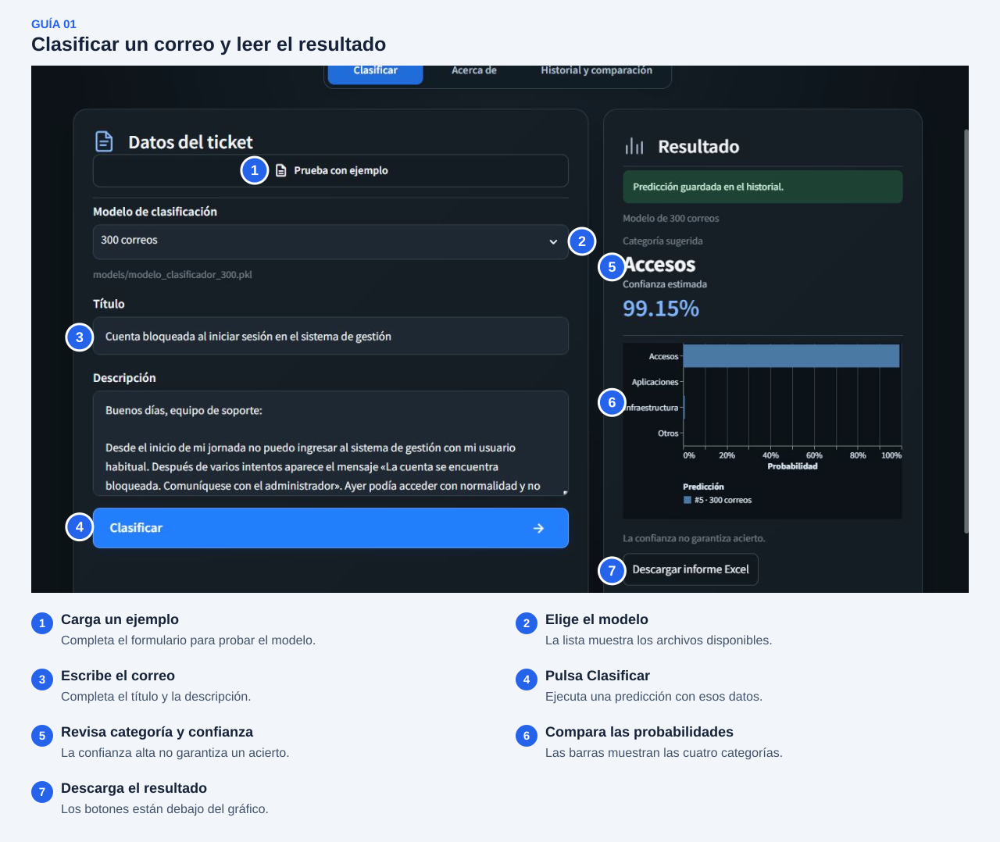
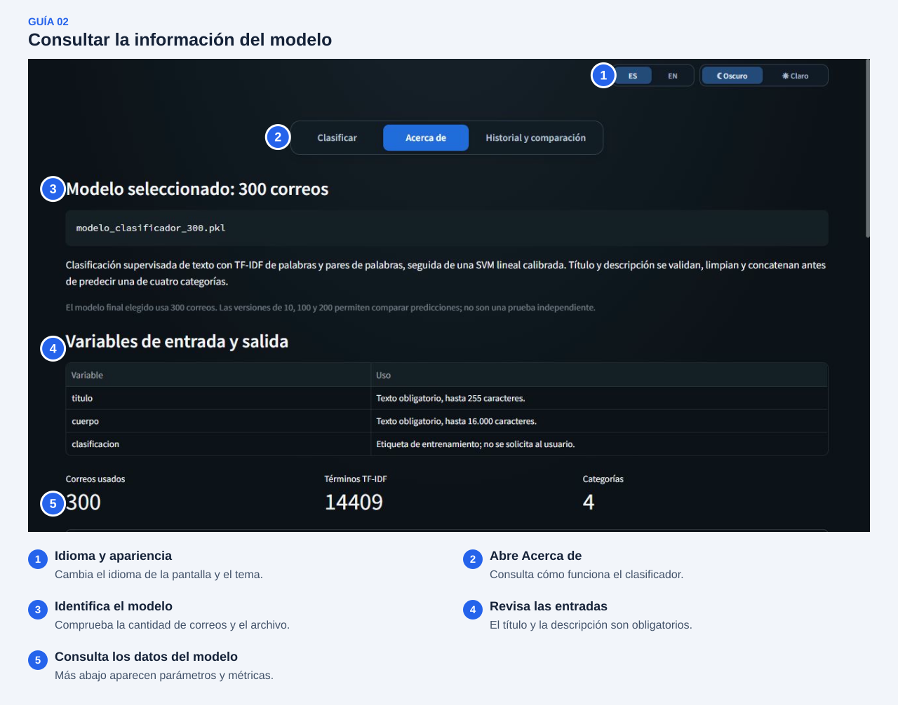
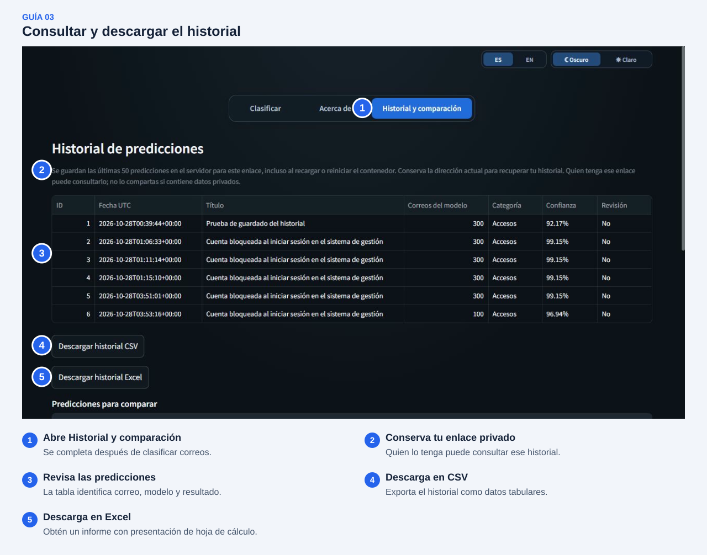
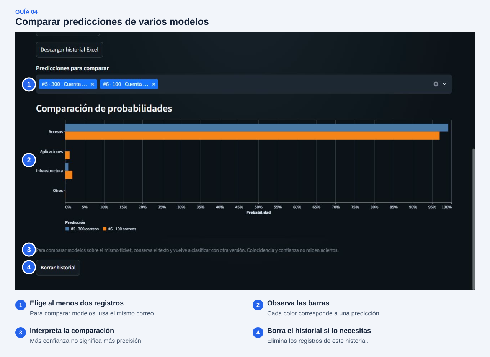
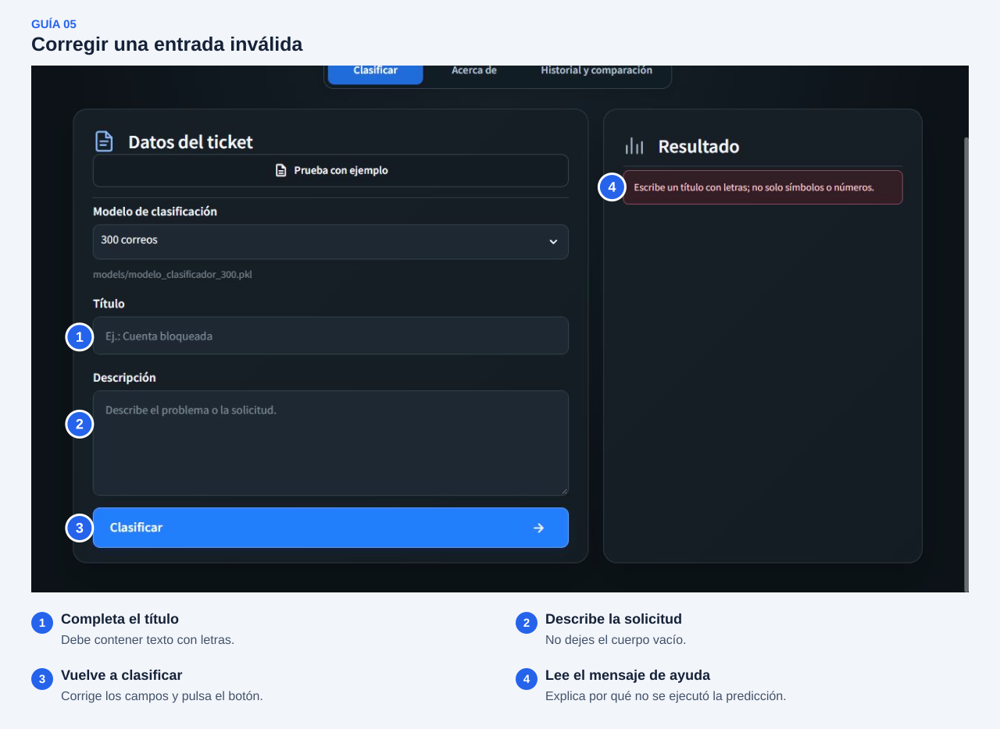

# Manual de usuario

## 1. Guía paso a paso para usar la interfaz

1. Abre el [portal del clasificador](http://185.208.207.203:8501). Para ejecutarlo en tu computadora, sigue [Instalación y uso](../README.md#7-instalación-y-uso) y abre `http://localhost:8501`.
2. Elige **ES / EN** y el tema **Oscuro / Claro**, arriba a la derecha. El idioma cambia la pantalla; el modelo está entrenado con correos en español.
3. Entra en **Clasificar** y selecciona un modelo disponible. Se propone el de 300 correos si existe; las otras versiones permiten comparar resultados.
4. Escribe el **Título** y la **Descripción**, o pulsa **Prueba con ejemplo** para cargar un correo ficticio. Cada pulsación carga otro de los cuatro ejemplos.
5. Comprueba los datos: ambos campos deben tener letras. El formulario admite hasta **255 caracteres en el título y 16.000 en la descripción**. Para las pruebas, usa textos sin contraseñas ni información personal.
6. Pulsa **Clasificar** y espera el indicador de procesamiento. Si aparece un error, corrige lo indicado y vuelve a intentarlo.
7. En **Resultado**, revisa la categoría, la confianza y las probabilidades de las cuatro clases. Si hay un aviso de revisión, comprueba el correo manualmente. Una confianza alta tampoco garantiza un acierto.
8. Descarga la predicción en **Excel o CSV** con los botones situados debajo del gráfico.
9. Abre **Historial y comparación** para consultar las predicciones, descargarlas o seleccionar al menos dos para compararlas. Para comparar modelos, clasifica el mismo correo con otra versión.

El portal prueba el clasificador: **no crea tickets en Redmine ni ejecuta el flujo de correo de n8n**. Cambiar el modelo tampoco lo reentrena. Las capturas siguientes usan ejemplos ficticios; las cifras y los modelos disponibles pueden cambiar tras un nuevo entrenamiento.

## 2. Capturas de pantalla anotadas

Las marcas numeradas señalan los controles y sus funciones. Debajo de cada captura se explica cada número; las imágenes originales se conservan.

### Clasificar y leer el resultado

Usa las referencias **1–4** para cargar y clasificar el correo, y **5–7** para interpretar y descargar el resultado. Desplázate hacia abajo si algún botón queda fuera de la pantalla.

### Consultar Acerca de

Aquí puedes identificar el modelo y revisar sus entradas. Más abajo aparecen parámetros, métricas disponibles y limitaciones. Si no hay un reporte que corresponda al archivo actual, se informa en pantalla.

### Revisar el historial

La tabla muestra título, modelo, categoría, confianza y revisión. Conserva tu enlace para recuperar el historial y no lo compartas si contiene datos privados.

### Comparar predicciones

Selecciona al menos dos registros. Los colores distinguen las predicciones; una barra más alta no demuestra que un modelo sea más preciso. **Borrar historial** elimina los registros de ese historial.

### Corregir una entrada inválida

El mensaje explica qué campo debes corregir. En este ejemplo el título está vacío: no se ejecuta la predicción hasta introducir un texto válido.

## 3. Explicación de cada funcionalidad

| Función | Cómo se utiliza |
|---|---|
| Idioma y tema | Los controles superiores cambian entre español/inglés y claro/oscuro |
| Selector de modelo | Muestra los archivos activos `modelo_clasificador_<cantidad>.pkl` de `models/`; no busca en carpetas de respaldo |
| Prueba con ejemplo | Carga título y descripción de un correo ficticio; vuelve a pulsar para probar otro |
| Formulario y validación | Introduce título y descripción; los mensajes indican campos vacíos, inválidos o demasiado largos |
| Clasificar | Ejecuta una predicción y muestra el estado de procesamiento o un mensaje de error |
| Resultado | Presenta una de las cuatro categorías, confianza, probabilidades y avisos de revisión |
| Gráfico interactivo | Compara las cuatro probabilidades; al pasar el cursor puedes consultar sus valores |
| Descargas | Guarda la predicción o el historial en CSV o Excel, con textos, modelo, probabilidades y datos de revisión |
| Acerca de | Explica el modelo, sus parámetros, métricas disponibles, limitaciones y advertencias |
| Historial | Conserva hasta 50 predicciones con la configuración actual. En el portal Docker persiste en el servidor; sin almacenamiento configurado, la ejecución local usa memoria de sesión |
| Comparación | Selecciona dos o más registros para comparar sus probabilidades. Usa el mismo correo si quieres comparar modelos |
| Borrar historial | Elimina las predicciones del historial actual; no borra los modelos ni archivos ya descargados |

La categoría es la de mayor probabilidad. El umbral actual de revisión es **60 %**; también se avisa cuando el texto no contiene vocabulario conocido. Son señales para revisar, no una comprobación de que la respuesta sea correcta.

## 4. Troubleshooting (problemas comunes y soluciones)

| Problema | Qué hacer |
|---|---|
| El portal no abre | Comprueba la conexión y la dirección. Si el problema continúa, informa a soporte; el servicio puede estar detenido |
| No aparecen modelos | Pide al responsable que compruebe `models/`. Los `.pkl` ya están incluidos en Git: actualiza el repositorio o consulta la guía de modelos. Recarga después de añadirlos |
| Se muestra un error al cargar el modelo | Comunica el nombre del archivo a soporte. No descargues modelos de una fuente desconocida ni cambies su nombre para forzar la carga |
| El formulario rechaza el correo | Completa ambos campos con letras y respeta los límites de 255 y 16.000 caracteres |
| La confianza es baja o la categoría parece incorrecta | Revisa el caso completo. Prueba una descripción más clara sin inventar datos; no uses la predicción como decisión definitiva |
| No aparecen métricas en Acerca de | El modelo puede haberse reentrenado sin actualizar su evaluación. La clasificación puede funcionar, pero soporte debe evaluar ese archivo; no se reutilizan métricas de otro modelo |
| El historial está vacío | Primero pulsa Clasificar. Si ya lo hiciste, abre el enlace del historial original; otro enlace puede corresponder a un historial distinto |
| El historial se pierde en una instalación local | Sin almacenamiento persistente se conserva solo durante la sesión. Descarga los resultados antes de cerrarla o consulta a soporte |
| No aparece el gráfico de comparación | Selecciona al menos dos predicciones en Historial y comparación |
| El CSV se abre en una sola columna | Usa la opción de importar texto/CSV con separador **punto y coma** y codificación **UTF-8**, o descarga el informe Excel |
| No ves las descargas o el gráfico completo | Desplázate por la página y por la tabla; en pantallas pequeñas algunos elementos quedan más abajo |

Para informar un fallo, utiliza el correo del apartado 6. Incluye los pasos y el mensaje de error, sin claves ni contenido confidencial.

## 5. FAQ (preguntas frecuentes)

**¿Necesito una cuenta para probar el portal?**

El portal actual no tiene inicio de sesión. El enlace del historial permite acceder a sus registros, por lo que debes conservarlo en privado.

**¿Qué modelo conviene usar?**

El de 300 es la referencia del proyecto. Los de 10, 100 y 200 sirven para comparar; más datos o más confianza no garantizan acertar cada correo.

**¿Puedo escribir en inglés?**

La pantalla puede mostrarse en inglés, pero el entrenamiento usa español. Prueba con texto español o con los ejemplos incluidos.

**¿El portal lee adjuntos o crea tickets?**

No. Este formulario clasifica título y descripción. El procesamiento de correo, adjuntos y tickets pertenece al flujo separado de n8n.

**¿Cambiar de modelo borra el historial?**

No. Se limpia el resultado anterior y puedes volver a clasificar el mismo texto. Las predicciones ya guardadas siguen disponibles para comparar.

**¿La confianza es el porcentaje de aciertos del modelo?**

No. Es la probabilidad estimada para esa entrada. Accuracy y F1 se calculan con datos etiquetados y pertenecen a una evaluación concreta.

**¿Puedo recuperar una predicción borrada?**

No desde la interfaz. Borrar historial elimina sus registros; conserva antes una descarga si la necesitas.

**¿Dónde se procesan mis datos?**

En el VPS cuando usas el portal desplegado, o en tu computadora si lo ejecutas localmente. Streamlit no envía esas predicciones a OpenAI ni a NexpAPI. El historial y las descargas sí pueden conservar el texto ingresado.

## 6. Información de contacto para soporte

- **Responsable:** María Quito Castillo, líder del proyecto y desarrolladora full stack.
- **Correo:** [maelizabethquito@uees.edu.ec](mailto:maelizabethquito@uees.edu.ec).
- **Repositorio de referencia:** [ProyectoIA](https://github.com/n8nmquito/ProyectoIA).

Al escribir, indica el problema, los pasos para reproducirlo, el modelo seleccionado, la fecha aproximada y el mensaje de error. Puedes adjuntar una captura con datos ficticios o anonimizados. **No envíes contraseñas, tokens ni correos reales con información sensible.**
