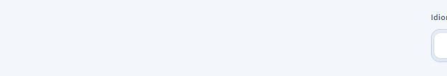
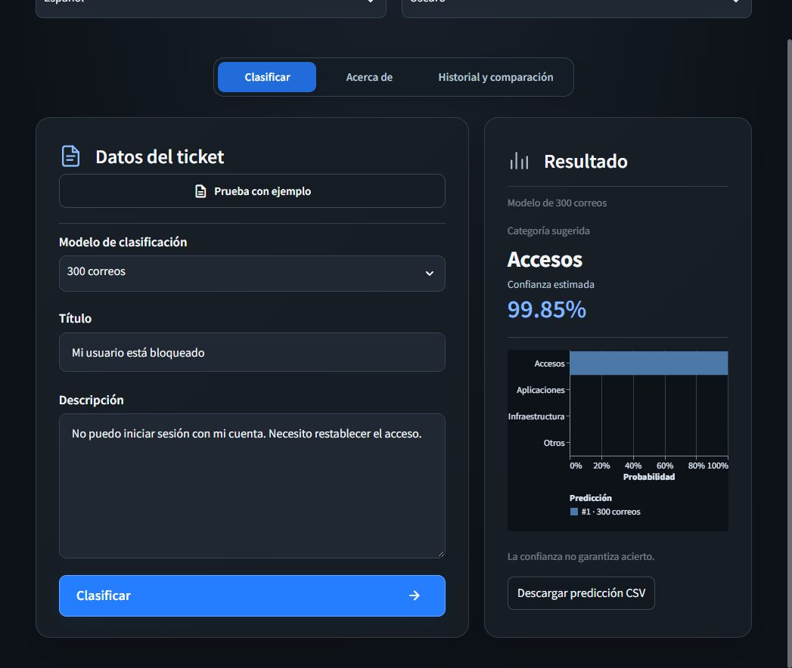
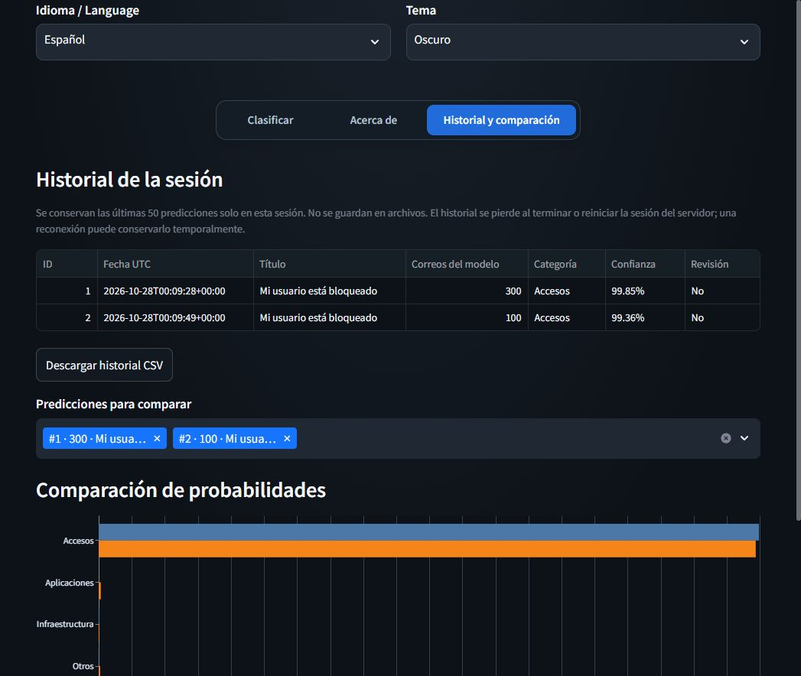
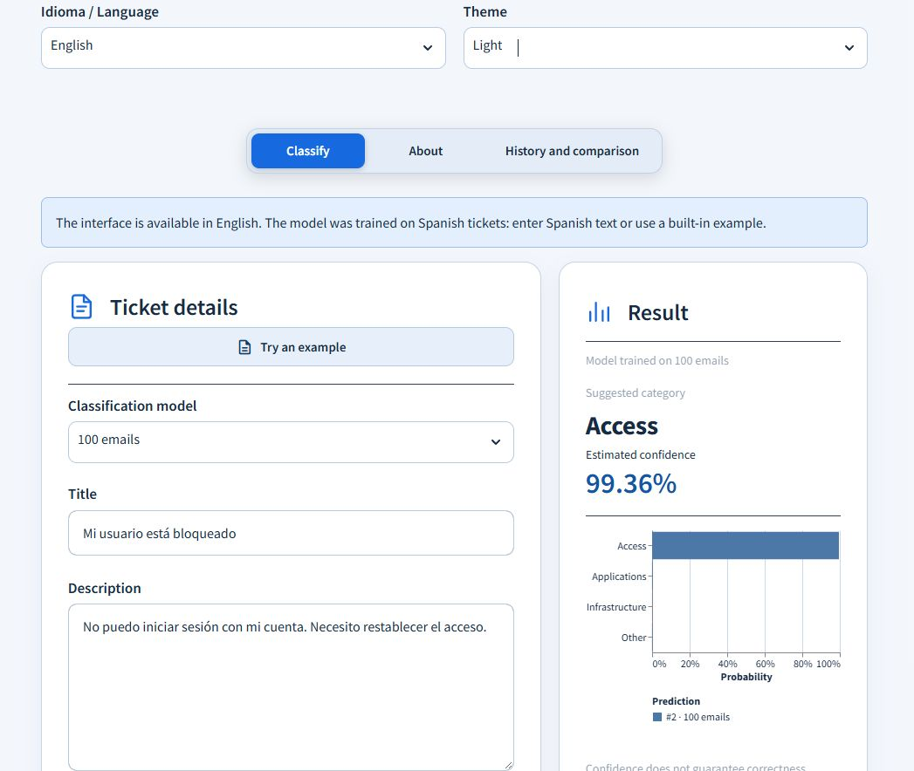
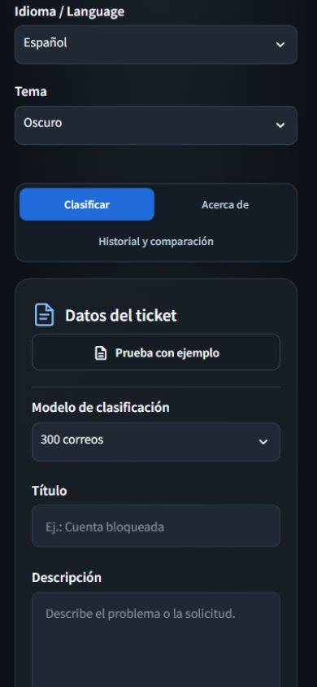
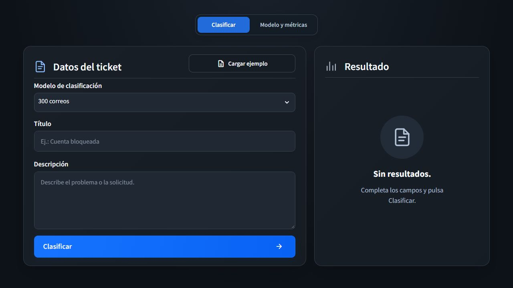
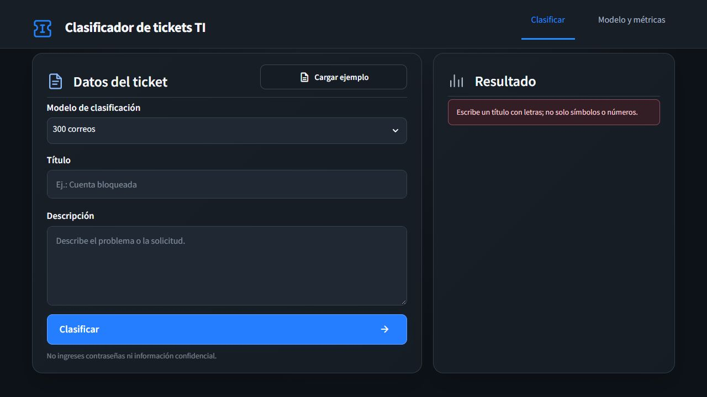
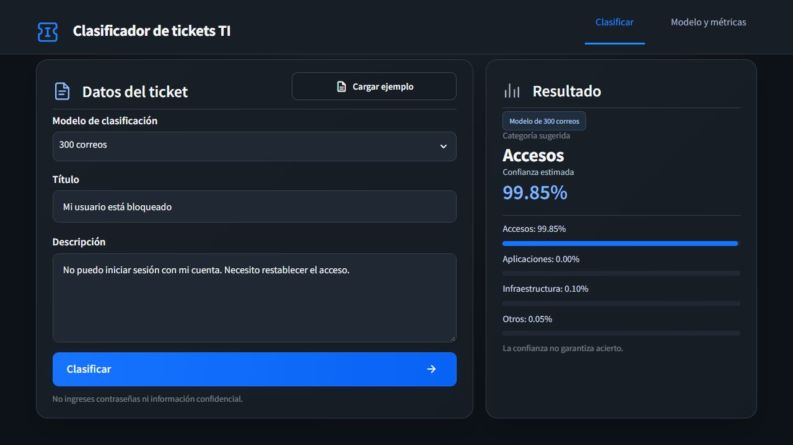
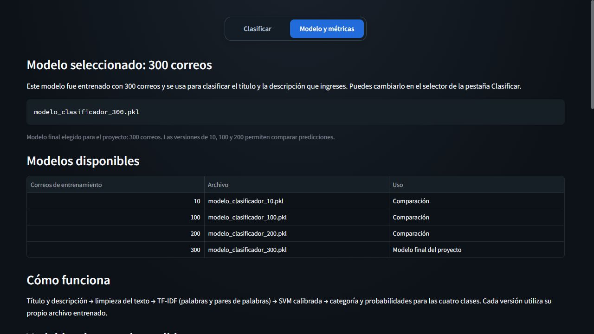
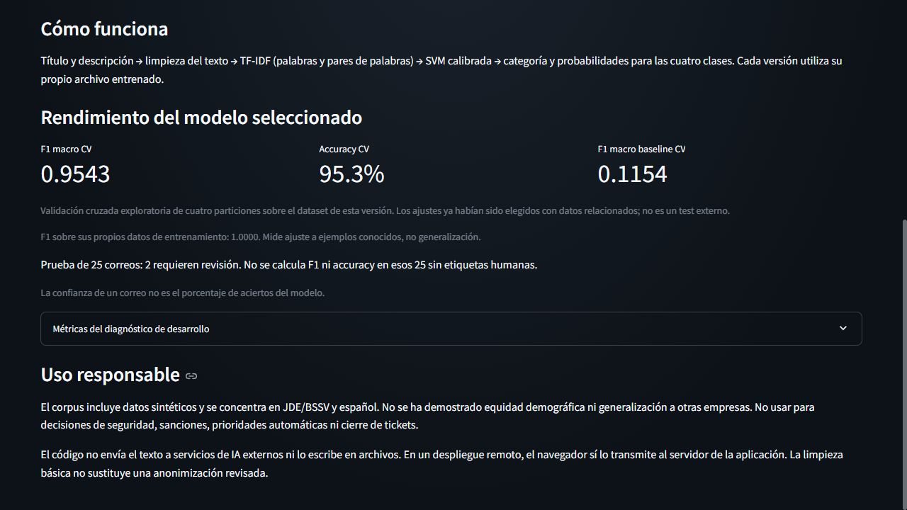

# Manual de usuario

Actualizado: 27 de octubre de 2026.

## Requisitos e instalación

Se necesita Python 3.10 o 3.11, CPU y espacio para las dependencias; no se usa
GPU. Antes de ejecutar, obtener las copias privadas de los modelos y colocarlas
en `models/`. Un clon de Git no contiene esos archivos. Para la consola se
necesitan también los datos de prueba; entrenar requiere el corpus y el
manifiesto de particiones. Ver [datos](../data/README.md).

Desde CMD, entrar en la carpeta `python` de la copia descargada. Sustituir
la ruta del ejemplo por la de esa instalación:

```cmd
cd /d C:\ruta\ProyectoIA\python
py -3.10 -m venv .venv
.venv\Scripts\activate
python -m pip install -r requirements.txt
python -m streamlit run app/app.py
```

En Linux, desde esa misma carpeta, crear el entorno con `python3 -m venv .venv`
y activarlo con `. .venv/bin/activate`; después usar los comandos `python -m`
anteriores. Los detalles de descarga están en [Instalación y uso](../README.md#instalación-y-uso).

## Iniciar y detener la interfaz

### Ejecución en Docker en el VPS

```bash
cd /mquito/mquito-ticket/python
docker compose up -d --build --wait
docker compose ps
```

Abrir [el portal](http://185.208.207.203:8501). El contenedor sigue activo al
cerrar SSH y se reinicia con Docker. Consultar registros con
`docker compose logs --tail=100 streamlit`; detener con `docker compose stop`
y volver a iniciar con `docker compose start`. Se necesitan los cuatro modelos
en `models/`, montados en solo lectura. El servicio de API para n8n es independiente.

El formulario del portal se procesa en el VPS. Este acceso usa HTTP y no tiene
autenticación; utilizar ejemplos sin información sensible.

### Ejecución local

También puedes hacer doble clic en `Iniciar_clasificador.cmd`. La pantalla se
abre en http://127.0.0.1:8501. Si Streamlit pregunta un correo de bienvenida,
deja el campo vacío y pulsa Enter. Detén la aplicación con Ctrl+C en la consola.
La opción A de la rúbrica admite Streamlit: se ejecuta en tu computadora y usa
el navegador como pantalla. El procesamiento utiliza el modelo guardado en esta computadora.

## Clasificar y comparar modelos

1. En Clasificar, elige **10, 100, 200 o 300 correos** en el selector. Por defecto se usa 300.
2. Introduce Título y Descripción. Ambos deben contener letras.
3. Prueba con ejemplo completa el formulario; cada pulsación recorre otro de los cuatro ejemplos.
4. Pulsa Clasificar. En Resultado aparece el indicador de análisis mientras se procesa.
5. Revisa el modelo usado, la categoría, la confianza y las cuatro probabilidades.
6. Ante confianza menor al 60 % o vocabulario desconocido, revisa el caso manualmente.
7. Para comparar, cambia de modelo y vuelve a clasificar. Se conserva el texto y se limpia el resultado anterior.

La versión de 300 es la elegida para el proyecto. Las menores permiten observar
cambios de predicción; más ejemplos no garantizan acertar todos los correos.
La pantalla no reentrena ni ejecuta n8n o crea tickets. Conserva hasta 50
predicciones por historial y permite descargarlas en CSV. En Docker se
guardan en un volumen persistente y el navegador recuerda su identificador.
En una ejecución local sin almacenamiento configurado solo se conservan en memoria.
No ingreses contraseñas, secretos o datos personales innecesarios.

## Acerca de

Los controles superiores permiten cambiar entre **Español** y **English**, y
entre tema **Oscuro** y **Claro**. El idioma afecta a la interfaz, no al corpus:
para clasificar se recomienda texto español o los ejemplos incorporados.

La apariencia se cambia con un selector de dos botones: luna para Oscuro y sol
para Claro. La opción activa aparece resaltada y ambos controles admiten teclado.



Esta pestaña identifica la versión elegida y su archivo, lista los cuatro
modelos y explica el pipeline TF-IDF + SVM calibrada. Detalla titulo, cuerpo y
la etiqueta clasificacion; limpieza y conversión a variables TF-IDF; cantidad
de términos, clases y correos; ngram_range, min_df, max_df, sublinear_tf, norm,
strip_accents, C, class_weight, penalty/loss, max_iter, semilla y calibración.
Los valores se leen del modelo elegido y el umbral desde config.yaml. La
distribución de clases se muestra en un desplegable. Muestra las métricas
registradas para el archivo actual, comprobando su huella SHA-256.

Para 100/200/300 muestra F1 macro y accuracy de CV exploratoria con cuatro
particiones, más el baseline. Para 10 explica que faltan ejemplos por clase
para la calibración interna en los folds; no inventa un resultado de CV.
El F1 sobre entrenamiento mide ajuste a ejemplos conocidos. Las predicciones
de 25 correos sin etiquetas no producen accuracy ni F1. Las métricas históricas
del diagnóstico de desarrollo se consultan en un desplegable separado.

Para regenerar la comprobación de las versiones sin cambiar los modelos:

```cmd
python -m src.evaluate_versions
```

Actualiza `results/metrics/version_evaluation.json` y `.csv`, repite los 25
correos con cada modelo y exporta el gráfico de CV. No es un test externo.

## Exportación historial y comparación

**Descargar informe Excel** genera un archivo con un resumen de la última
predicción, porcentajes, gráfico, texto completo y datos del modelo. La hoja
Historial reúne todos los registros incluidos, con filtros y encabezados fijos.
En Historial y comparación también se ofrece **Descargar historial Excel**.

Las nuevas predicciones guardan archivo y SHA-256 del modelo, umbral aplicado,
tiempo de inferencia, señal de vocabulario desconocido y motivo de revisión.
Cuando un registro anterior no contiene estos datos, el informe indica
**No registrado**. La confianza pertenece al correo y no equivale a accuracy.

1. Clasificar un ticket y pulsar **Descargar predicción CSV** para obtener el
   texto, modelo, categoría, confianza, señal de revisión y cuatro probabilidades.
   El archivo usa UTF-8 con BOM, separador de punto y coma y una primera línea
   `sep=;` para que Excel detecte las columnas al abrirlo. Los campos entrecomillados
   conservan los párrafos del correo dentro de una sola celda. Para importarlo
   con otra herramienta, omitir esa primera línea y elegir el separador `;`.
   El CSV contiene 18 campos, incluidos los metadatos y el motivo de revisión.
2. Abrir **Historial y comparación**. Cada clasificación correcta agrega una
   fila; cambiar de pestaña, tema o idioma no repite la predicción.
3. Para comparar modelos sobre el mismo ticket, conservar el texto, cambiar
   de modelo y pulsar Clasificar. Elegir al menos dos filas en el selector de
   comparación; el gráfico agrupa sus probabilidades por categoría y muestra
   valores al pasar el cursor. También admite desplazamiento y zoom.
4. Pulsar **Descargar historial CSV** para descargar todas las filas retenidas.
   Se incluyen hasta 50 resultados; al superar ese límite se elimina el más antiguo.
5. **Borrar historial** elimina las filas de este historial en el servidor y
   en la sesión, sin borrar un resultado actual visible ni CSV ya descargados.
6. Después de clasificar, comprobar la confirmación de guardado. El mismo
   navegador recupera el historial al volver a abrir el portal. Conservar el
   enlace actual para recuperarlo en otro navegador; quien tenga ese enlace
   puede consultarlo. Un fallo de almacenamiento se muestra como advertencia.

Editar título, descripción o modelo invalida el resultado actual para evitar
descargar una predicción de un texto anterior. El historial conserva sus copias
independientes en el almacenamiento del portal hasta que se borran o superan
el límite de 50 registros. Sin almacenamiento configurado, termina con la sesión. Las descargas contienen
texto ingresado; no incluir secretos. Comparar confianza no mide accuracy.

## Capturas de la aplicación real

### Portal actual



La vista Clasificar presenta el modelo utilizado, la categoría, la confianza,
el gráfico de probabilidades y la descarga CSV de la predicción.



El historial permite seleccionar resultados del mismo ticket con distintos
modelos y comparar sus probabilidades. La tabla identifica cada modelo y fecha UTC.



Cambiar idioma y tema conserva el ticket, el modelo y los resultados. El aviso
superior recuerda que el modelo se entrenó con texto español.



En móvil las columnas se apilan y la navegación ocupa dos filas; el resultado
aparece debajo del formulario.

### Capturas históricas

Las capturas siguientes documentan la versión del 26 de octubre. La versión
actual agrega controles de idioma y tema, la vista Historial y comparación y
descargas CSV; renombra Cargar ejemplo a Prueba con ejemplo y Modelo y métricas
a Acerca de.



El selector centrado superior alterna Clasificar y Acerca de.
La tarjeta izquierda contiene el selector del modelo, los dos campos y el botón azul.
La derecha presenta el resultado y el nombre del modelo que lo produjo.

Anotaciones de lectura del formulario:

| Zona de la captura | Función | Acción del usuario |
|---|---|---|
| Selector superior Clasificar / Acerca de | Cambiar de vista | Elegir clasificación o información del modelo |
| Prueba con ejemplo, arriba a la derecha del formulario | Completar los campos con un caso precargado | Pulsar para probar sin escribir un ticket |
| Modelo de clasificación | Seleccionar el archivo de 10, 100, 200 o 300 correos | Elegir la versión antes de clasificar |
| Título y Descripción | Introducir los dos textos obligatorios | Describir el incidente con contexto suficiente |
| Botón Clasificar, al pie del formulario | Ejecutar la predicción | Pulsar y esperar el indicador de análisis |
| Panel Resultado, a la derecha | Consultar la salida | Leer categoría, confianza, probabilidades y advertencias |



Con los campos vacíos se pide un título con letras. Solo símbolos o números
también se rechazan. Si falta o falla el modelo, se muestra un mensaje de error
en lugar de fabricar una predicción; ese escenario se prueba con AppTest.



La categoría es una sugerencia. El porcentaje pertenece a este correo; no es
accuracy global. El aviso ámbar solicita revisión cuando corresponde.



La versión elegida actualiza la información del modelo; no se atribuyen a
los cuatro archivos los resultados de un diagnóstico diferente.



Se distinguen CV, ajuste sobre entrenamiento y predicciones sin etiquetas.
Los resultados exploratorios no demuestran ausencia de sobreajuste.

## Prueba por consola de los mismos 25 correos

```cmd
python evaluar_nuevos.py --model 10
python evaluar_nuevos.py --model 100
python evaluar_nuevos.py --model 200
python evaluar_nuevos.py --model 300
```

La entrada es `data/test/correos_test_25.json`, con título y cuerpo únicamente.
Las salidas son `predicciones.csv`, `resumen.json` y `reporte.md` en
`results/new_test_25/modelo_clasificador_<tamaño>/`. Sin selector se usa 300 y
su misma carpeta; no se generan copias sueltas. Los casos de revisión incluyen
el texto completo en consola. El CSV registra las cuatro probabilidades.

Para probar un JSON diferente con la misma estructura:

```cmd
python evaluar_nuevos.py --model 300 --data ruta/a/correos.json --output results/mi_prueba
```

## Entrenar y verificar

```cmd
python -m src.train
python -m src.train_versions
python -m src.export_datasets
python -m src.evaluate_versions
python -m pytest -q --junitxml=results/metrics/pytest.xml
```

Entrenar sustituye los artefactos del mismo nombre. `src.train` compara técnicas
y optimiza; `src.train_versions` ajusta las cuatro versiones y `export_datasets`
exporta los registros exactos sin reentrenar. `evaluate_versions` verifica,
calcula y exporta resultados sin guardar otros modelos. `src.evaluate` conserva
el diagnóstico histórico de selección como evaluación adicional.

Los datasets están en `data/train/`. Los `.pkl` deben ser de una fuente confiable.
La hoja de revisión humana está separada en `data/evaluation/`; no se añaden
etiquetas al JSON de prueba. Ver [evaluación](evaluacion_pruebas.md).

## Problemas comunes

| Problema | Solución |
|---|---|
| No module named streamlit u otra dependencia | Ejecuta `python -m pip install -r requirements.txt` con el mismo Python |
| Streamlit pide un correo | Deja vacío y pulsa Enter |
| Falta el modelo elegido | Comprueba el archivo en models; para regenerar las cuatro versiones usa `python -m src.train_versions` tras el entrenamiento principal |
| Archivo incompatible o corrupto | Usa las versiones de requirements y el artefacto original, o reentrena |
| Puerto ocupado | Cierra la sesión anterior con Ctrl+C o añade `--server.port 8502` |
| Falta la evaluación o el modelo cambió | Ejecuta `python -m src.evaluate_versions` |
| El modelo se equivoca con confianza alta | Revisa manualmente; confianza no garantiza exactitud |
| Campos inválidos | Escribe título y descripción con letras y contexto suficiente |

## Preguntas frecuentes

**¿Cuál es el modelo final?** El de 300; se guardan 10/100/200 para comparar.

**¿El selector reentrena?** No. Carga el archivo elegido y limpia el resultado anterior.

**¿Se envía el formulario a OpenAI o n8n?** No. La aplicación local usa el modelo
local. El flujo de correo desplegado es un componente separado que sí puede
enviar texto y adjuntos al agente y crear tickets.

**¿25 casos sin etiquetas miden accuracy?** No. Se necesita una referencia revisada;
además son casos conocidos del desarrollo, no una evaluación independiente.

**¿Se guardan los textos del formulario?** Se conservan hasta 50 predicciones
con sus textos en una base SQLite del portal Docker. El volumen sobrevive a
recargas y recreaciones del contenedor; el navegador guarda un identificador
privado para recuperarlos. Eliminar el volumen elimina los historiales. En
modo local sin `HISTORY_DB_PATH` solo se conserva memoria. La descarga CSV
también incluye esos textos en el equipo del usuario.
Borrar historial elimina esas filas; el resultado actual puede seguir visible.
Evita datos sensibles.

## Operación separada de n8n

El flujo del servidor mantiene su propia API de 300 y su agente OpenAI/Redmine.
El selector local no cambia ese modelo ni dispara ejecuciones del flujo. Las
pruebas de producción y sus IDs se conservan en `results/n8n_produccion/`.
No repitas envíos de producción para probar el diseño: pueden crear tickets reales.

## Contacto de soporte

Responsable del proyecto: **María Quito Castillo**, líder del proyecto y
desarrolladora full stack.

| Canal de soporte | Contacto |
|---|---|
| Correo electrónico | &nbsp; |
| Canal alternativo | &nbsp; |

El equipo debe completar un canal oficial antes de publicar la entrega.
Al solicitar ayuda, indicar sistema operativo, versión de Python, modelo,
pasos para reproducir y mensaje de error. No incluir contraseñas ni texto sensible.
