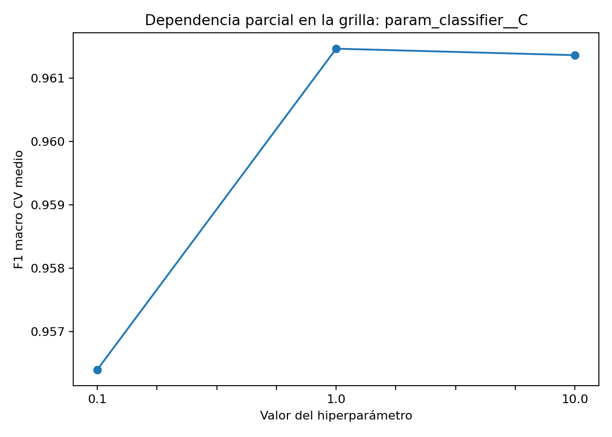
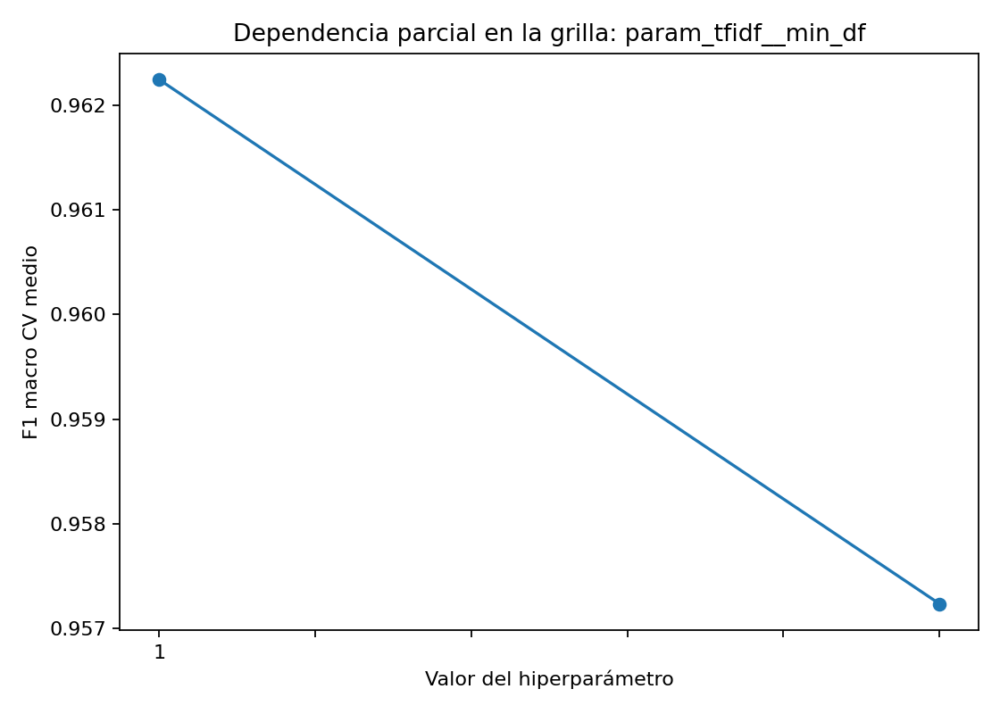
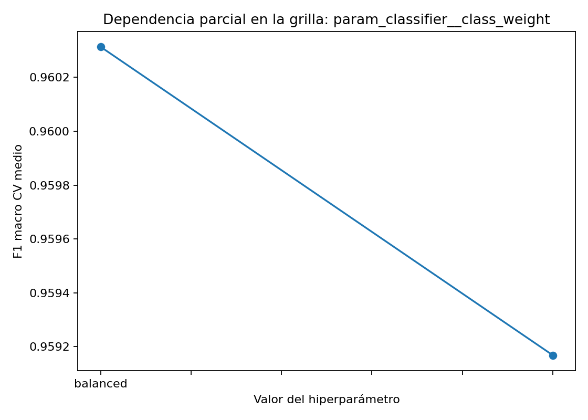
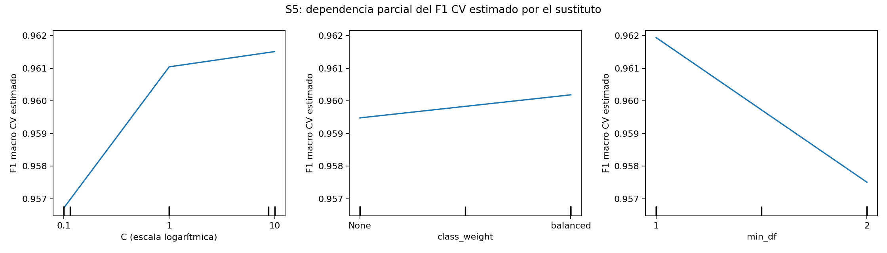
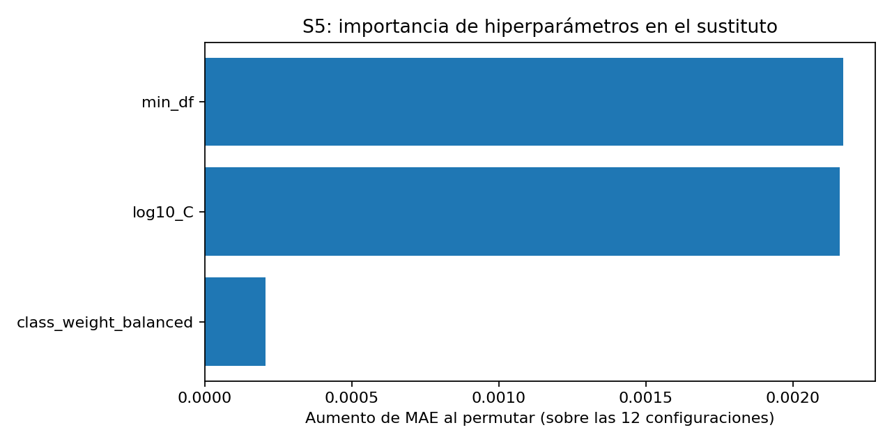
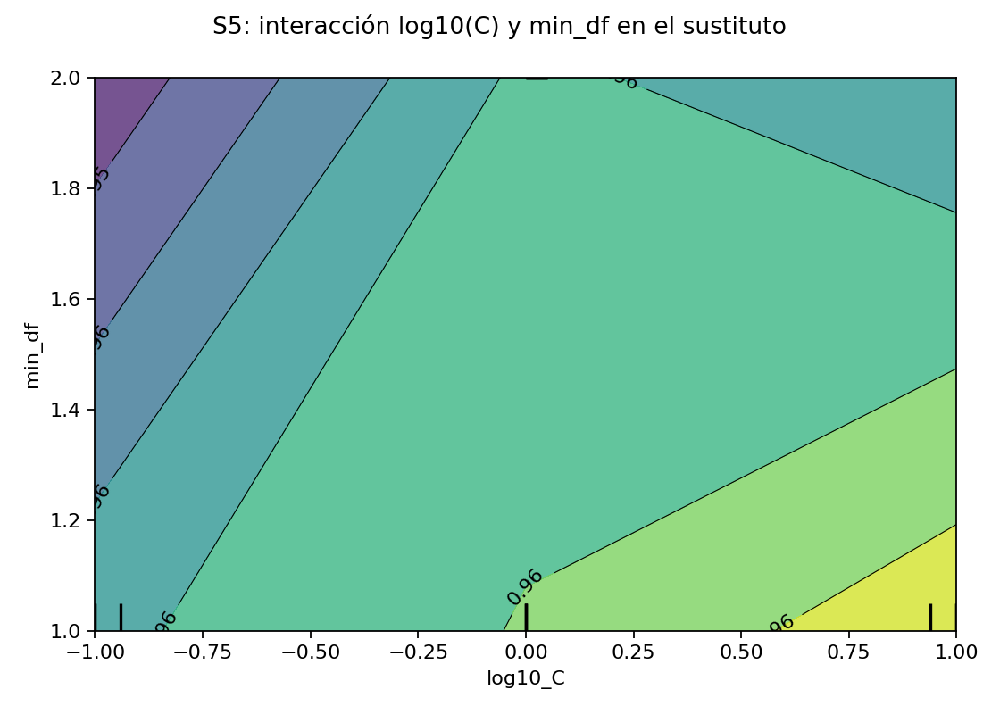
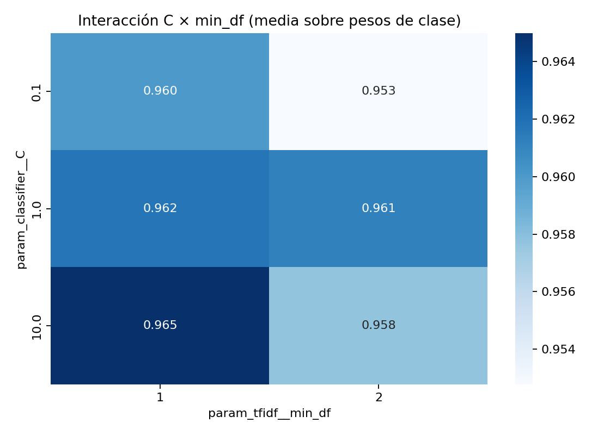

# Optimización de hiperparámetros

## 1. Proceso de optimización de hiperparámetros (del Workshop S5)

Se aplicó búsqueda en grilla con `GridSearchCV` a pipelines **TF-IDF + regresión logística** y **TF-IDF + SVM lineal calibrada**, seleccionando por **F1 macro**. La búsqueda registrada utiliza **280 correos**, validación cruzada estratificada de **4 particiones**, barajado y **semilla 42**. TF-IDF se ajusta dentro de cada partición; la SVM utiliza calibración sigmoide interna de **2 particiones**.

Se evaluaron **12 combinaciones por familia**, es decir, **24 configuraciones y 96 ajustes externos de validación**, además de la calibración y el reajuste final. Los 20 correos reservados se utilizaron como diagnóstico, no para puntuar la grilla; ya habían sido inspeccionados durante el desarrollo. Los 25 correos de pruebas funcionales no se usan para seleccionar hiperparámetros.

Para el análisis del **Workshop S5**, se ajustó un modelo sustituto `RandomForestRegressor` sobre las **12 configuraciones SVM** y su F1 macro observado: **300 árboles, profundidad máxima 3 y semilla 42**. Permite generar PDP, importancia e interacciones sin reentrenar los clasificadores de tickets.

Implementación: [entrenamiento y búsqueda](../src/train.py), [análisis S5](../src/optimization_analysis.py) y [notebook de optimización](../notebooks/04_optimizacion.ipynb). Para repetir únicamente el análisis de los resultados guardados, desde `python/`:

```bash
python -m src.optimization_analysis
```

## 2. Hiperparámetros explorados y rangos

| Hiperparámetro | Valores explorados | Función |
|---|---|---|
| `C` | `0.1`, `1.0`, `10.0` | Controla la regularización del clasificador |
| `class_weight` | `None`, `balanced` | Define si se ponderan las clases durante el ajuste |
| `min_df` | `1`, `2` | Frecuencia documental mínima para conservar un término |

Los valores están definidos en `search` de [config.yaml](../config.yaml). Se mantuvieron fijos TF-IDF con `ngram_range: [1, 2]`, frecuencia sublineal, normalización de acentos y `max_df: 1.0`. El registro completo de las combinaciones está en [grid_search.csv](../results/metrics/grid_search.csv).

## 3. Resultados del análisis de sensibilidad

Se calculó, para cada hiperparámetro de SVM, la diferencia entre el mayor y el menor **F1 macro medio por valor**, promediando las demás combinaciones de la grilla.

| Hiperparámetro | Medias marginales de F1 macro CV | Amplitud |
|---|---|---:|
| `C` | 0.1: **0.956399**; 1: **0.961463**; 10: **0.961361** | 0.005065 |
| `min_df` | 1: **0.962246**; 2: **0.957235** | 0.005011 |
| `class_weight` | None: **0.959169**; balanced: **0.960313** | 0.001145 |

**C y min_df presentan mayor sensibilidad; class_weight tiene menor efecto.** El promedio marginal favorece `C=1`, pero la mejor combinación conjunta utiliza `C=10`. Promediar los demás ajustes no equivale a seleccionar una configuración completa.







Fuente: [sensitivity.json](../results/metrics/sensitivity.json). Estas amplitudes describen la grilla; no demuestran causalidad ni significancia estadística.

## 4. Partial dependence plots

Los PDP se generaron con `PartialDependenceDisplay` sobre el modelo sustituto del Workshop S5. Muestran el **F1 macro CV estimado** al variar un hiperparámetro y promediar los demás.



El sustituto recibe `log10(C)`, `class_weight` codificado como None=0/balanced=1 y `min_df`. Las líneas entre los valores discretos son una representación visual, no nuevas configuraciones evaluadas. Estos gráficos explican el rendimiento estimado frente a hiperparámetros, no las palabras ni la predicción de un correo individual.

La validación leave-one-out del sustituto obtuvo **MAE = 0.002389** y **R² = 0.4712**, sobre un rango observado de F1 de **0.9510 a 0.9650**. Su aproximación es exploratoria y no justifica extrapolar fuera de la grilla. Fuente: [s5_surrogate_analysis.json](../results/metrics/s5_surrogate_analysis.json).

## 5. Ranking de importancia de hiperparámetros

El ranking principal utiliza el **aumento del MAE al permutar cada variable**, con **40 repeticiones** sobre las configuraciones ajustadas al sustituto. Se incluye también la importancia por reducción de impureza del bosque (MDI).

| Puesto por permutación | Hiperparámetro | Aumento medio de MAE | Importancia MDI |
|---:|---|---:|---:|
| 1 | `min_df` | 0.002172 | 0.4035 |
| 2 | `log10_C` | 0.002160 | 0.5396 |
| 3 | `class_weight_balanced` | 0.000206 | 0.0568 |



**min_df y C están prácticamente empatados por permutación**; MDI sitúa C primero. La sensibilidad marginal del apartado 3 también sitúa C ligeramente por encima de min_df. Son medidas diferentes, por lo que sus órdenes pueden variar. La permutación se calcula sobre las 12 configuraciones ajustadas, no sobre una muestra independiente; no representa importancia causal.

Fuente: [s5_hyperparameter_importance.csv](../results/metrics/s5_hyperparameter_importance.csv).

## 6. Análisis de interacciones

Se analizó la combinación **C × min_df** mediante un PDP bidimensional del sustituto y una matriz de medias observadas en la grilla.





| C | F1 macro CV medio con min_df=1 | F1 macro CV medio con min_df=2 |
|---:|---:|---:|
| 0.1 | 0.960015 | 0.952783 |
| 1.0 | 0.961725 | 0.961202 |
| 10.0 | 0.965000 | 0.957722 |

Las medias se calculan sobre las dos opciones de `class_weight`. El efecto de `min_df` depende de C: su diferencia es pequeña con `C=1` y mayor con `C=0.1` o `C=10`. La combinación `C=10, min_df=1` obtiene la mayor media de esta tabla. Es una interacción descriptiva dentro de la grilla, no una prueba causal ni una garantía para datos reales.

## 7. Configuración final seleccionada y justificación

| Componente | Valor seleccionado |
|---|---|
| Clasificador | SVM lineal con calibración sigmoide |
| `C` | `10.0` |
| `class_weight` | `None` (`null` en YAML) |
| `min_df` | `1` |
| `ngram_range` | `[1, 2]` |
| Particiones de calibración | `2` |
| Semilla | `42` |

La combinación obtuvo el **mayor F1 macro CV registrado: 0.965000**, frente a 0.964939 de regresión logística optimizada. `min_df=1` conserva términos infrecuentes, `C=10` aplica menos regularización que los valores menores explorados y `class_weight=None` no añade ponderación por clase. La elección corresponde al resultado conjunto, no a una superioridad aislada de cada valor.

Los parámetros seleccionados están en [config.yaml](../config.yaml) y [training_summary.json](../results/metrics/training_summary.json). Posteriormente se ajustó el modelo final con los **300 correos**. Las versiones de **10, 100, 200 y 300** se entrenan con estos mismos parámetros, sin repetir una búsqueda por tamaño. La ventaja sobre regresión logística es pequeña y no demuestra superioridad en producción.

## 8. Comparación antes/después de la optimización

Comparación registrada sobre los **280 correos de la etapa de selección**, con el mismo esquema de validación cruzada:

| Modelo | F1 macro CV antes | F1 macro CV después | Mejora absoluta |
|---|---:|---:|---:|
| Regresión logística | 0.937289 | 0.964939 | +0.027650 |
| SVM calibrada | 0.961725 | 0.965000 | +0.003275 |

La SVM seleccionada mejora aproximadamente **0.328 puntos porcentuales de F1 macro**. Su desviación entre particiones pasa de **0.018527 a 0.016136**. El baseline de categoría mayoritaria obtiene **F1 macro CV de 0.112179**. Fuente: [model_comparison.csv](../results/metrics/model_comparison.csv).

La mejora es moderada y la selección sobre la misma validación introduce optimismo. Los PDP y el sustituto analizan los resultados; no incrementan por sí mismos el rendimiento del clasificador. Estas cifras de optimización no deben confundirse con la evaluación posterior del modelo de 300 correos de producción: **accuracy CV de 0.9533 y F1 macro CV de 0.9543**, registrada en [version_evaluation.json](../results/metrics/version_evaluation.json).
