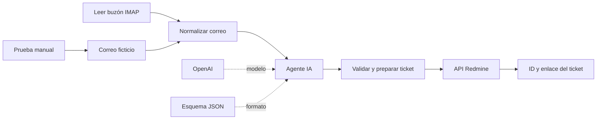

# Flujo de correo → IA → ticket

El flujo **Mquito | Correo → IA → Ticket Redmine** está guardado en el n8n del
servidor, sin activar:

[Abrir el flujo](http://185.208.207.203:5678/workflow/opxBwpGpRDrbQeHn)

`correo-ia-redmine.json` es una copia importable sin credenciales.

## Completar antes de ejecutar

1. **Leer buzón IMAP:** crear/seleccionar una credencial IMAP con usuario,
   contraseña o contraseña de aplicación, host, puerto y TLS según el proveedor.
   La carpeta configurada es `INBOX`. Si el proveedor requiere OAuth y no permite
   este acceso IMAP, reemplazar el disparador por el conector de Gmail/Microsoft.
2. **OpenAI - Cargar API key:** crear/seleccionar una credencial OpenAI y pegar
   la API key. El modelo configurado es `gpt-4.1-mini`, editable.
3. **Crear ticket en Redmine:** crear/seleccionar una credencial **Header Auth**:
   - **Name:** `X-Redmine-API-Key`
   - **Value:** pegar la clave API de Redmine, disponible en **Mi cuenta → Clave
     de acceso de la API**, de un usuario que pueda crear peticiones en Intaco.
   Guardar y seleccionar esa credencial en el nodo. La clave queda en el almacén
   de credenciales de n8n; no pegarla en el JSON ni en un encabezado de texto fijo.

La URL de creación es `http://redmine:3000/issues.json`, accesible desde la red
Docker de esta instalación. La URL para las personas es
`http://185.208.207.203:3000`. Si se importa en otro servidor n8n, ajustar la URL
del nodo HTTP a una dirección de Redmine accesible desde ese servidor.

## Qué hace



- Extrae asunto, remitente y texto. Limita el cuerpo a 16000 caracteres y señala
  en el ticket si fue recortado.
- Envía asunto y cuerpo al modelo, sin enviar deliberadamente el campo separado
  de remitente. El texto puede contener datos personales escritos en el correo.
- Clasifica en aplicaciones, infraestructura, accesos u otros y sugiere prioridad.
- Valida la salida con un esquema y nuevamente antes del alta. El contenido del
  correo no puede cambiar el proyecto, la URL ni las credenciales del flujo.
- Crea una petición en **Intaco (ID 1)**, tipo **Soporte (ID 3)**.
- Para casos ambiguos, crea el ticket con prefijo `[REVISAR]` y prioridad Normal.
- Devuelve el ID del ticket y su enlace web.

Los IDs del proyecto, tipo y prioridades se verificaron contra esta instalación.
Se pueden editar en **Preparar ticket - Intaco**; en otro Redmine deberán revisarse.

## Prueba y activación

1. Cargar las credenciales de OpenAI y Redmine.
2. Ejecutar la rama **Prueba manual**: genera un correo ficticio sobre acceso a JDE.
   La prueba llama a OpenAI y crea un ticket real con prefijo `[DEMO]`.
3. Revisar el resultado y el ticket en Redmine.
4. Configurar el disparador IMAP y probar con un correo controlado.
5. Publicar/activar el workflow cuando las pruebas sean correctas.

El flujo se entregó inactivo. No se ejecutaron llamadas al modelo ni se creó un
ticket de prueba, porque las credenciales se cargarán después.

## Límites de esta primera demo

- No descarga ni adjunta archivos y no envía respuestas por correo.
- No asigna técnicos ni actualiza tickets existentes cuando llega una respuesta.
- Cada ejecución exitosa crea un ticket: no hay deduplicación persistente.
- IMAP usa `UNSEEN` y seguimiento de mensajes nuevos, sin marcar como leído.
  Ante un fallo, revisar/reintentar la ejecución guardada; no asumir que el
  disparador volverá a emitir el correo al reconectarse.
- El POST de creación no tiene reintentos automáticos. Si hay timeout, buscar
  primero el `Message-ID` en Redmine para evitar repetir un alta ya realizada.
- Si OpenAI o el parser fallan, el flujo se detiene y guarda el error en
  **Executions**; no se crea un ticket incompleto.

## Verificación

Se comprobó el guardado por la API de n8n, los tipos/versiones de nodos instalados,
la API de Redmine y los catálogos de proyecto, tipo y prioridades. Las pruebas
locales de normalización y validación se ejecutan con:

```bash
node workflows/test-workflow.cjs
```

La prueba completa de IMAP + OpenAI + creación queda pendiente de credenciales.

Referencias: [modelo GPT-4.1 mini](https://developers.openai.com/api/docs/models/gpt-4.1-mini)
y [API de tickets de Redmine](https://www.redmine.org/projects/redmine/wiki/rest_issues).
