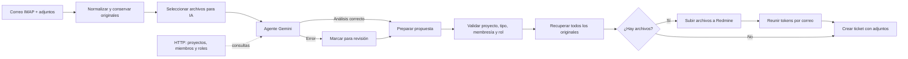

# Flujo de correo y adjuntos → Gemini → Redmine

[**Abrir el flujo en n8n**](http://185.208.207.203:5678/workflow/opxBwpGpRDrbQeHn)

El flujo está guardado **sin activar**. La copia `correo-ia-redmine.json` es
importable y no incluye credenciales. La instancia usa Gemini; el antiguo nodo
OpenAI permanece desconectado y no participa.

## Credenciales

- **Leer buzón IMAP:** usuario, contraseña o contraseña de aplicación, host,
  puerto y TLS. Usa `INBOX` y formato `Resolved` para descargar los adjuntos.
- **Google Gemini Chat Model:** seleccionar una credencial Google Gemini válida.
- **Todos los nodos HTTP de Redmine**, incluidas las herramientas del agente:
  seleccionar la misma
  credencial **Header Auth**, con **Name = X-Redmine-API-Key** y **Value = clave
  de la API de Redmine**, disponible en Mi cuenta. Las credenciales ya seleccionadas
  en la instancia se conservaron; al importar el JSON hay que reasignarlas.

Los nodos HTTP usan `http://redmine:3000` dentro de Docker. En otra instalación
n8n, cambiar ambas URLs por una dirección accesible desde ese servidor.

## Proceso



- El agente recibe asunto, texto y los archivos seleccionados. El texto se limita
  a 16000 caracteres; se indica en el ticket si fue recortado.
- Se envían a Gemini **PNG, JPEG, WebP y PDF**, con un máximo de **4 archivos**,
  **4 MiB por archivo** y **8 MiB en total**. Estos son límites del flujo,
  editables en **Seleccionar adjuntos para IA**.
- Los demás formatos, los archivos que exceden esos límites y todos los originales
  seleccionados se cargan igualmente en Redmine. No se descomprimen ZIP ni se
  convierten documentos Office. El correo puede contener únicamente adjuntos.
- Si Gemini o el parser fallan, el flujo crea un ticket **[REVISAR]** con el correo
  y los adjuntos originales, prioridad Normal y aviso de análisis no completado.
- Las instrucciones dentro de correos o archivos se tratan como datos; no pueden
  cambiar la URL, las credenciales, el proyecto ni los permisos del flujo.
- Cada archivo se carga en `/uploads.json`; sus tokens se reúnen en el mismo
  ticket, sin crear un ticket por archivo ni mezclar adjuntos de distintos correos.
- El agente propone el proyecto, el tipo de ticket y un responsable usando la API.
  La validación posterior aplica `assigned_to_id` únicamente si coinciden proyecto,
  usuario, membresía y rol asignable. La descripción registra responsable, rol y motivo.

## Herramientas HTTP del agente y asignación

| Herramienta | Consulta GET |
|---|---|
| Consultar proyectos | `/projects.json?limit=100&offset=...` |
| Consultar miembros del proyecto | `/projects/{id}/memberships.json?limit=100&offset=...` |
| Consultar proyecto y tipos | `/projects/{id}.json?include=trackers` |
| Consultar rol | `/roles/{id}.json` |
| Consultar cuenta API | `/users/current.json` |

Los IDs de proyecto y rol los proporciona el agente mediante `$fromAI`, limitados
a enteros positivos. El host, las rutas y el método GET están definidos en el flujo;
el agente no puede elegir una URL externa ni modificar usuarios, permisos o proyectos.
Las herramientas de listado permiten paginar con `offset`. La API de membresías
devuelve los usuarios del proyecto y sus roles sin necesitar el listado global de usuarios.

Reglas iniciales de selección, editables en el mensaje de sistema del agente:

- Usar el proyecto que corresponda al correo; si hay uno solo activo, usar ese.
  Ante ambigüedad entre varios proyectos, usar **Intaco (1)** para revisión.
- Priorizar soporte/desarrollador para problemas técnicos y jefe de proyecto
  para coordinación. No inferir especialidad, disponibilidad, turnos ni carga.
- No elegir la cuenta de integración ni cuentas identificadas como bot/agente IA.
  Un rol Informador por sí solo no justifica asignar la resolución.
- Obtener de las herramientas `project_id`, `tracker_id`, `assigned_to_id`,
  `membership_id`, `role_id` y una justificación. No son IDs intercambiables.
- Si no hay candidato válido, devolver ceros para usuario/membresía/rol y marcar
  revisión. El flujo no fuerza un responsable en ese caso.

Además de las herramientas del agente, los nodos de verificación vuelven a consultar
el proyecto, `/memberships/{id}.json` y `/roles/{id}.json` con la credencial real.
Comprueban proyecto activo, tipo habilitado, usuario miembro de ese proyecto, rol
de esa membresía con `assignable=true` y permiso `view_issues`. Una propuesta
inválida de responsable se omite y el ticket queda `[REVISAR]`; un proyecto/tipo
inválido detiene el alta. La API de Redmine aplica además sus propias restricciones.
Esta versión asigna usuarios individuales, no grupos.

La subida está sujeta al límite de tamaño y a las restricciones del servidor
Redmine. Si un archivo es rechazado, el flujo se detiene antes del alta, evitando
crear un ticket que parezca completo con archivos faltantes. Las cargas ya hechas
pueden quedar temporalmente sin asociar a una petición.

## Prueba manual

**Prueba manual → Correo de ejemplo** genera un correo ficticio con:

1. `detalle-error-demo.pdf`, con el código de error ACCESO-403.
2. `imagen-demo.png`, una imagen mínima de prueba.
3. `notas-demo.txt`, que solo se adjunta a Redmine.

Ejecutar esta rama llama a Gemini y crea un ticket real con prefijo `[DEMO]`.
Luego probar con un correo controlado del buzón y publicar/activar el flujo.

## Verificación realizada

- Ejecución **4**: análisis real de Gemini y ticket **#3**, con los tres archivos.
  Gemini identificó ACCESO-403 en el PDF; el TXT no se envió al modelo.
- Ejecución **5**: PDF deliberadamente inválido. Gemini rechazó la solicitud;
  el respaldo creó el ticket **#4 [REVISAR]** con los archivos originales.
- Ejecuciones **6 y 7**: las herramientas HTTP consultaron proyectos, miembros y
  cuenta API; en la 6 también roles. Gemini devolvió errores de disponibilidad
  antes de completar la propuesta. El respaldo creó los tickets **#5 y #6**.
- Ejecución **8**: propuesta simulada con IDs reales para aislar la validación.
  Se verificaron proyecto, tipo, membresía y rol contra Redmine, y el ticket **#7**
  quedó asignado al usuario **6**, con sus tres adjuntos. No se presenta esta
  prueba como una elección realizada por Gemini. La prueba completa de elección
  automática queda pendiente de disponibilidad del modelo.
- La conexión IMAP se había probado correctamente. Estas pruebas de adjuntos
  usan datos ficticios inyectados en la rama manual, no mensajes reales del buzón.

Pruebas locales:

```bash
node workflows/test-workflow.cjs
node workflows/test-attachments.cjs
node workflows/test-assignment.cjs
```

## Límites de la demo

No envía respuestas por correo ni actualiza conversaciones. La asignación por rol
no equivale a balanceo de carga o gestión de turnos.
No tiene deduplicación persistente: cada ejecución exitosa crea un ticket.
IMAP usa `UNSEEN` y seguimiento de mensajes nuevos, sin marcar como leído.
Ante fallos revisar las ejecuciones guardadas; no asumir que IMAP volverá a emitir
el mensaje al reconectarse. Si el POST del ticket termina con timeout, buscar su
Message-ID en Redmine antes de repetirlo. El flujo conserva los originales en la
ruta de procesamiento; si faltan los propios datos binarios, no puede recuperarlos.

Los archivos de `nodes/` contienen los fragmentos nuevos de los nodos Code para
revisión y pruebas. n8n ejecuta el código embebido en el JSON, no lee esos archivos
desde el servidor: cualquier cambio debe actualizar también el workflow.

Referencias: [documentos en Gemini](https://ai.google.dev/gemini-api/docs/document-processing)
y [carga de archivos en Redmine](https://www.redmine.org/projects/redmine/wiki/rest_api#Attaching-files),
[membresías](https://www.redmine.org/projects/redmine/wiki/Rest_Memberships)
y [roles](https://www.redmine.org/projects/redmine/wiki/Rest_Roles).
